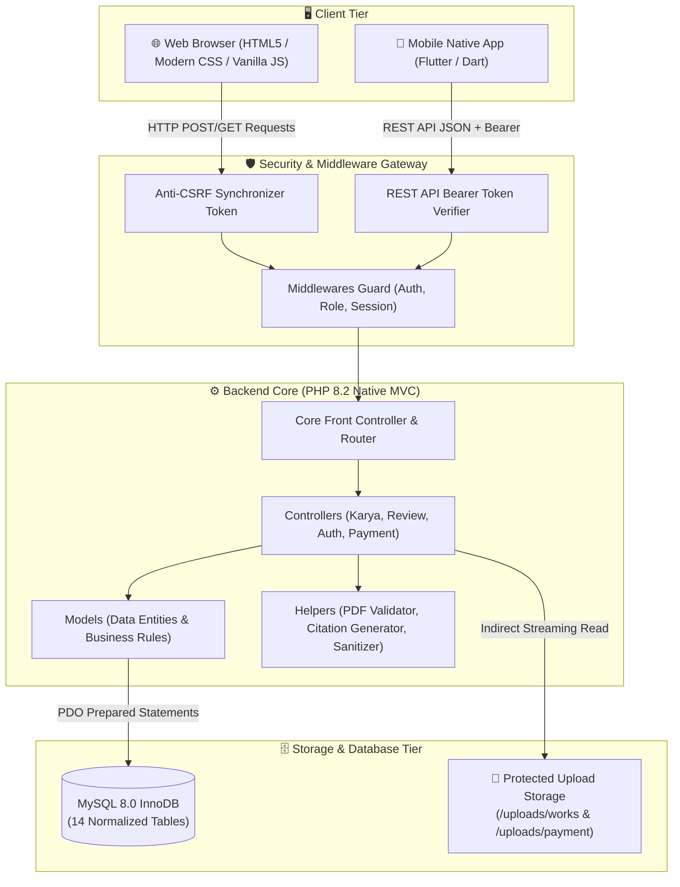

<div align="center">

# 🏛️ LENTERA
### **Laman Etalase Karya Tulis Ilmiah Terpadu Akademik**
**Platform Repositori Digital & Etalase Karya Ilmiah Civitas Akademika Universitas Madura**

[](https://www.php.net/)
[](https://www.mysql.com/)
[](https://flutter.dev/)
[](https://owasp.org/)
[](https://github.com/ImamCode-byte/LENTERA)
[](https://unira.ac.id)
[](LICENSE)

<br/>

> *"Menerangi karya, menginspirasi generasi civitas akademika menuju keterbukaan ilmu pengetahuan yang berintegritas."*

<br/>

[✨ Fitur Unggulan](#-fitur-unggulan-sistem) •
[👥 Tim Pengembang](#-tim-pengembang--tanggung-jawab) •
[🏗️ Arsitektur](#-arsitektur-sistem) •
[📊 Matriks Hak Akses](#-matriks-peran--hak-akses-rbac) •
[🚀 Panduan Instalasi](#-panduan-instalasi--menjalankan-sistem) •
[🛡️ Standar Keamanan](#-standar-keamanan--kepatuhan-owasp) •
[📱 Mobile Native](#-aplikasi-mobile-flutter)

---

</div>

<br/>

## 📖 Tentang Lentera

Setiap tahun, civitas akademika **Universitas Madura (UNIRA)** menghasilkan ratusan karya intelektual bernilai tinggi: skripsi, tesis, jurnal ilmiah, dan laporan penelitian terapan. Tanpa sistem repositori digital terpadu, karya-karya ini berisiko tersimpan hanya di lemari arsip fisik yang rentan rusak dan sulit diakses.

**LENTERA** hadir sebagai platform repositori digital modern berbasis web dan aplikasi mobile native. Mengadopsi standar alur kerja penelaahan sejawat (*peer-review*) mirip *Open Journal Systems (OJS)*, Lentera menjembatani mahasiswa, dewan kurator/dosen, serta masyarakat luas dalam ekosistem akademik yang aman, transparan, dan terstruktur.

<br/>

---

## ✨ Fitur Unggulan Sistem

<table>
  <tr>
    <td width="50%" valign="top">
      <h3>👨‍🎓 Pengajuan Mandiri (Author)</h3>
      <ul>
        <li>Unggah naskah skripsi, jurnal, dan laporan ilmiah lengkap beserta metadata dosen pembimbing.</li>
        <li>Validasi berkas PDF otomatis (MIME-Type, ukuran berkas maks 15 MB).</li>
        <li>Pelacakan status verifikasi dan kurasi secara <i>real-time</i> dari dasbor pribadi.</li>
      </ul>
    </td>
    <td width="50%" valign="top">
      <h3>⚖️ Alur Kurasi OJS (Curator)</h3>
      <ul>
        <li>Panel penelaahan naskah masuk oleh dewan kurator/dosen penilai.</li>
        <li>Pengambilan keputusan telaah: <b>Terima (Publish)</b> atau <b>Tolak (Reject)</b> disertai catatan evaluasi akademik.</li>
        <li>Hanya karya yang disetujui kurator yang tayang pada etalase repositori publik.</li>
      </ul>
    </td>
  </tr>
  <tr>
    <td width="50%" valign="top">
      <h3>🔍 Etalase Publik & Sitasi Cepat</h3>
      <ul>
        <li>Pencarian cerdas naskah berdasarkan judul, penulis, abstrak, dan tahun terbit.</li>
        <li>Penyaringan multi-kategori: Fakultas, Program Studi, dan Jenis Dokumen.</li>
        <li><b>1-Klik Generator Sitasi</b> berstandar internasional: <code>APA 7th</code>, <code>IEEE</code>, <code>Harvard</code>, dan <code>BibTeX</code>.</li>
      </ul>
    </td>
    <td width="50%" valign="top">
      <h3>📊 Visualisasi Tren & Pembayaran APC</h3>
      <ul>
        <li>Grafik analitik interaktif berbasis <b>Chart.js</b> untuk sebaran karya per fakultas dan tren tahunan.</li>
        <li>Manajemen biaya publikasi (Article Processing Charge / APC) dengan verifikasi QRIS & transfer bank.</li>
        <li>Panel Super Admin untuk audit log unduhan naskah dan manajemen pengguna.</li>
      </ul>
    </td>
  </tr>
</table>

<br/>

---

## 👥 Tim Pengembang & Tanggung Jawab

Proyek ini dikembangkan oleh **Kelompok 01** untuk mata kuliah **Pemrograman Berbasis Platform**, Program Studi Informatika, **Universitas Madura (UNIRA)**:

| No | Profil & Nama | NIM | Email & Kontak | Peran & Ruang Lingkup Kerja | Branch Kerja |
|:--:|---|:--:|---|---|:--:|
| 1 | **Imam**<br/><sub>👑 Ketua Kelompok</sub> | `2024520030` | [imamdhespachito001@gmail.com](mailto:imamdhespachito001@gmail.com) | **Backend Lead & Security Architect**<br/>• Arsitektur routing MVC & PDO Singleton<br/>• Keamanan OWASP, Proteksi CSRF, Session & Auth<br/>• REST API JSON Engine (Bearer Token) | `feat/backend-api-imam` |
| 2 | **Alvin Hidayat Putra Pratam**<br/><sub>🎨 Frontend Specialist</sub> | `2024520050` | [alvnhdytptr@gmail.com](mailto:alvnhdytptr@gmail.com) | **Frontend Web Engineer**<br/>• Desain UI/UX Design System Tokens & Responsif Mobile<br/>• Interaksi Dashboard Penulis, Kurator & Admin<br/>• Chart.js Analytics & Citation Generator | `feat/frontend-web-alvin` |
| 3 | **Moh. Gilank Alamsyah**<br/><sub>📱 Mobile Engineer</sub> | `2024520052` | [alamsyahgilank@gmail.com](mailto:alamsyahgilank@gmail.com) | **Mobile Native Engineer**<br/>• Aplikasi Native Android & iOS berbasis Flutter (Dart)<br/>• Konsumsi REST API Backend & Offline Cache Handling<br/>• Katalog repositori mobile & pembaca abstrak | `feat/mobile-flutter-gilank` |
| 4 | **Abdul Halim**<br/><sub>🗄️ Database & QA</sub> | `2024520059` | [kikybagaskara@gmail.com](mailto:kikybagaskara@gmail.com) | **Database & QA Lead**<br/>• Perancangan skema relasional 14 tabel & Migrasi DDL<br/>• Quality Assurance, Pengujian Fungsional & Kuesioner<br/>• Manajemen Git Repositori & Dokumentasi Laporan | `feat/database-workflow-halim` |

<br/>

---

## 🏗️ Arsitektur Sistem

Platform **Lentera** dibangun dengan pendekatan *Multi-Tier Architecture* yang memisahkan antarmuka, pengendali keamanan, logika bisnis, dan media penyimpanan:



<br/>

---

## 📊 Matriks Peran & Hak Akses (RBAC)

Sistem menerapkan prinsip *Least Privilege* dengan pemisahan peran yang tegas:

| Kemampuan Fitur | 🌐 Publik / Tamu | 👨‍🎓 Penulis (Mahasiswa/Dosen) | ⚖️ Kurator (Reviewer) | 🛡️ Super Admin |
|---|:--:|:--:|:--:|:--:|
| Jelajah & Cari Etalase Naskah | ✅ | ✅ | ✅ | ✅ |
| Baca Abstrak & Salin Sitasi | ✅ | ✅ | ✅ | ✅ |
| Unduh Berkas PDF Resmi | ✅ *(Ter-audit)* | ✅ | ✅ | ✅ |
| Registrasi Akun Mandiri | ✅ | — | — | — |
| Unggah & Kelola Naskah Pribadi | ❌ | ✅ | ❌ | ✅ |
| Upload Bukti Pembayaran APC | ❌ | ✅ | ❌ | ❌ |
| Akses Panel Kurasi Naskah Masuk | ❌ | ❌ | ✅ | ✅ |
| Setujui / Tolak Naskah Ilmiah | ❌ | ❌ | ✅ | ✅ |
| Verifikasi Pembayaran APC | ❌ | ❌ | ❌ | ✅ |
| Kelola Akun, Pengguna & Master Data | ❌ | ❌ | ❌ | ✅ |
| Pantau Log Audit Unduhan & Akses | ❌ | ❌ | ❌ | ✅ |

<br/>

---

## 🛠️ Stack Teknologi

<div align="center">

| Kategori | Teknologi | Deskripsi Penggunaan |
|---|---|---|
| **Backend Language** | `PHP 8.1 / 8.2` | Native Object-Oriented MVC tanpa framework bloated |
| **Database Engine** | `MySQL 8.0+` | Engine InnoDB dengan Relasi Kunci Asing & Transaksi Atomik |
| **Frontend Web** | `HTML5, CSS3, JS` | Design tokens native, Mobile Drawer responsif, Font Plus Jakarta Sans |
| **Mobile Application** | `Flutter (Dart SDK)` | Aplikasi native Android & iOS berkinerja tinggi |
| **Visualisasi Data** | `Chart.js` | Diagram lingkaran (sebaran fakultas) & batang (tren tahunan) |
| **Web Server** | `Apache (XAMPP)` | Modul `mod_rewrite` aktif via konfig `.htaccess` |
| **Standar Keamanan** | `OWASP Top 10` | PDO Prepared Statements, Hash Password Argon2id, Anti-CSRF Token |

</div>

<br/>

---

## 🚀 Panduan Instalasi & Menjalankan Sistem

### 1. Prasyarat Sistem
* **XAMPP** (PHP versi minimal 8.1 dan MySQL 8.0+).
* **Git** terpasang di komputer.
* Peramban web modern (Google Chrome, Edge, Firefox, atau Safari).
* *(Opsional)* **Flutter SDK** versi 3.10+ untuk menjalankan aplikasi mobile.

<br/>

### 2. Langkah Pemasangan Web (XAMPP)

```bash
# 1. Masuk ke direktori web root XAMPP
cd C:\xampp\htdocs

# 2. Kloning repositori Lentera
git clone https://github.com/ImamCode-byte/LENTERA.git lentera
cd lentera

# 3. Konfigurasi Environment
cp backend/.env.example backend/.env
```

Buka berkas `backend/.env` dan pastikan kredensial basis data sesuai dengan konfigurasi lokal Anda:

```env
APP_NAME=Lentera
APP_ENV=development
APP_URL=http://localhost/lentera/

DB_HOST=127.0.0.1
DB_PORT=3306
DB_NAME=db_lentera
DB_USER=root
DB_PASS=
```

<br/>

### 3. Inisialisasi Basis Data (Auto-Healing)

1. Jalankan modul **Apache** dan **MySQL** melalui XAMPP Control Panel.
2. Buka peramban dan akses alamat:
   ```
   http://localhost/lentera/
   ```
3. ✨ **Fitur Auto-Healing**: Sistem secara cerdas akan mendeteksi apakah basis data `db_lentera` sudah ada. Jika belum, skema dan seeder data awal akademik (fakultas, program studi, naskah contoh, dan akun pengujian) akan otomatis diinisialisasi tanpa perlu impor manual.

<br/>

---

## 📱 Aplikasi Mobile (Flutter)

Aplikasi mobile Lentera dirancang khusus untuk kenyamanan pembaca di perangkat ponsel cerdas:

```bash
# Masuk ke direktori mobile
cd frontend/mobile

# Ambil seluruh dependencies Flutter
flutter pub get

# Jalankan pada emulator atau perangkat fisik Android
flutter run
```

> [!NOTE]
> Modul mobile telah diimplementasikan dengan arsitektur bersih (*Clean Architecture*), penanganan *offline banner*, serta integrasi penuh ke REST API backend Lentera.

<br/>

---

## 🛡️ Standar Keamanan & Kepatuhan OWASP

Platform Lentera dirancang dengan prinsip **Defense in Depth**:

* 🔒 **Anti-SQL Injection**: Seluruh transaksi basis data menggunakan PDO *Prepared Statements* dengan *parameterized query*. Tidak ada penggabungan string langsung ke sintaks SQL.
* 🛡️ **Anti-Cross-Site Scripting (XSS)**: Semua data dinamis yang dirender ke antarmuka di-escape menggunakan fungsi pembantu `htmlspecialchars(..., ENT_QUOTES, 'UTF-8')`.
* 🔑 **Proteksi CSRF**: Setiap formulir HTML dilengkapi *Synchronizer Token Pattern* yang divalidasi ketat di sisi server sebelum aksi dieksekusi.
* 🔐 **Hashing Sandi Kuat**: Sandi akun pengguna di-hash menggunakan algoritma modern `PASSWORD_ARGON2ID` / `BCRYPT`.
* 📁 **Akses Berkas PDF Terproteksi**: Berkas PDF tidak dapat diunduh langsung lewat tautan URL statis. Pengunduhan wajib melewati *streaming script* (`downloads.php`) yang memeriksa status publikasi naskah dan mencatat identitas pengunduh dalam tabel audit log.

<br/>

---

## 📁 Struktur Direktori Proyek

<details>
<summary><b>📂 Klik di sini untuk melihat peta struktur berkas repositori</b></summary>

<br/>

```
lentera/
├── .github/
│   ├── ISSUE_TEMPLATE/
│   │   └── kendala.md                 → Template pelaporan kendala/bug tim
│   └── pull_request_template.md       → Standar verifikasi merge code
├── .gitignore                         → Pengabaian file sensitif (.env, vendor, uploads)
├── CONTRIBUTING.md                    → Panduan kontribusi, alur git & branch
├── README.md                          → Dokumentasi utama sistem repositori
├── docs/
│   ├── Laporan-Kelompok-01-Lentera.docx → Laporan akhir praktikum kelompok
│   ├── proposal.md                    → Proposal teknis latar belakang & solusi
│   ├── backlog.md                     → Pembagian modul & status pengerjaan
│   └── prds.md                        → Dokumen spesifikasi fungsional (PRD)
├── backend/
│   ├── configs/                       → Inisialisasi basis data & environment
│   ├── apps/
│   │   ├── controllerss/              → Logika bisnis (Karya, Review, Auth, Payment)
│   │   ├── modelss/                   → Pemodelan data PDO (Users, Works, APC, dsb.)
│   │   ├── helperss/                  → Utilitas CSRF, Sanitizer, Sitasi & PDF Validator
│   │   └── middlewaress/              → Middleware otorisasi peran & sesi login
│   └── databases/
│       ├── migrationss/               → 17 file migrasi SQL DDL berurutan
│       └── seederss/                  → Data awal fakultas, prodi & karya contoh
├── frontend/
│   ├── web/
│   │   ├── indexs.php                 → Halaman etalase publik utama
│   │   ├── csss/styles.css            → Desain token responsif modern
│   │   ├── jss/apps.js                → Sitasi generator & interaksi DOM
│   │   └── viewss/                    → Antarmuka Penulis, Kurator, Admin & Statistik
│   └── mobile/
│       ├── pubspec.yaml               → Konfigurasi paket aplikasi Flutter
│       └── lib/                       → Kode sumber antarmuka & REST API client
└── uploads/
    ├── payment/                       → Direktori penyimpanan bukti transfer APC
    └── works/                         → Direktori naskah PDF akademik
```

</details>

<br/>

---

## 📜 Lisensi & Atribusi

Proyek ini dikembangkan untuk tujuan edukasi dan pemenuhan tugas besar mata kuliah **Pemrograman Berbasis Platform (2026)**.

**Universitas Madura (UNIRA)**  
Fakultas Teknik • Program Studi Informatika  
*Menerangi Karya, Menginspirasi Generasi.*

<br/>

<div align="center">
  <sub>Dibuat dengan dedikasi oleh Kelompok 01 • Lentera © 2026</sub>
</div>
