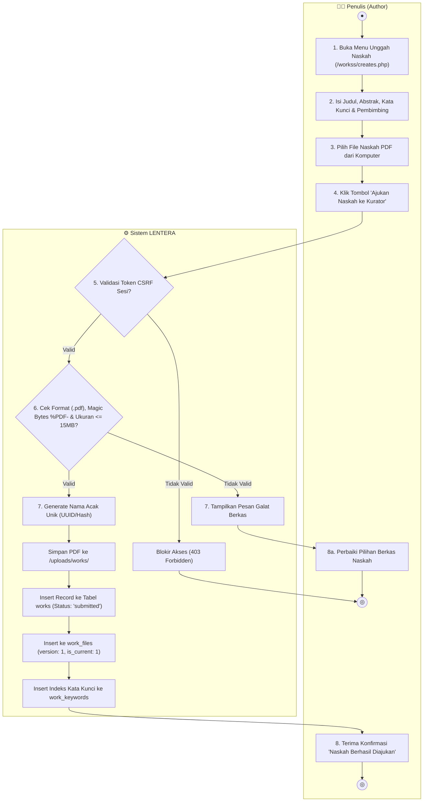
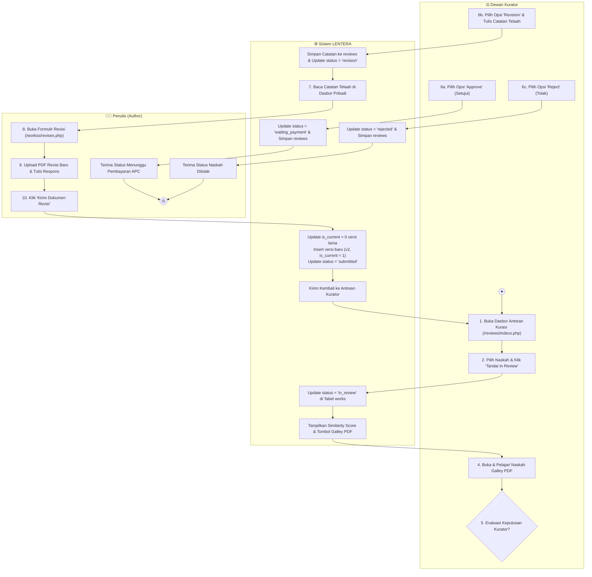
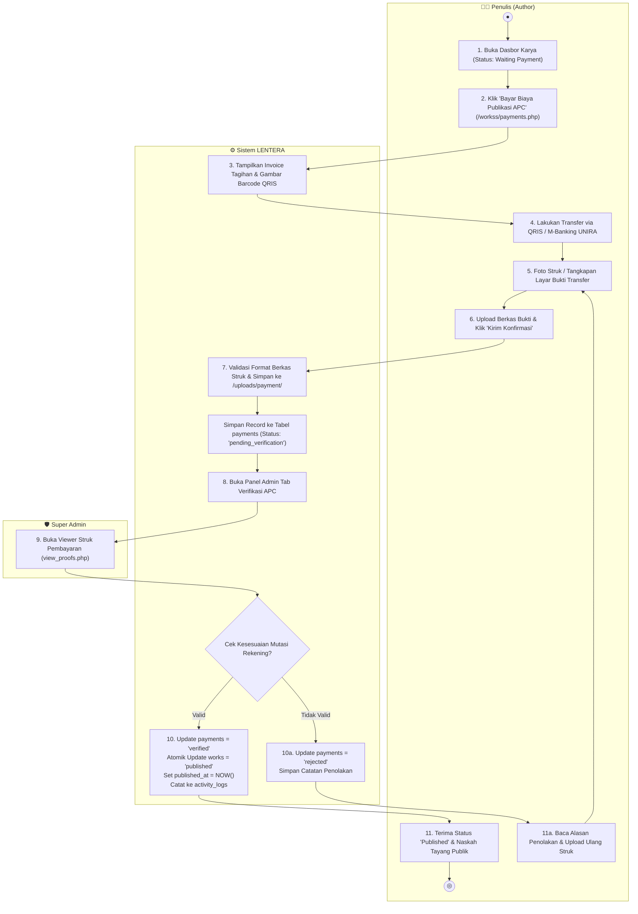
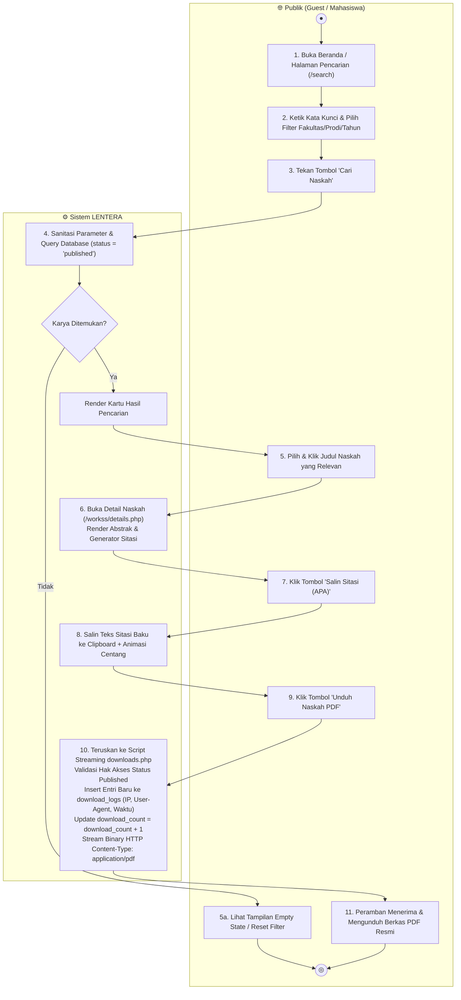
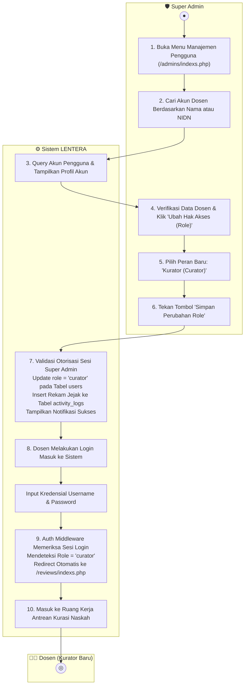

# 2.3 Activity Diagram — Sistem Repositori LENTERA
### Laman Etalase Karya Tulis Ilmiah Terpadu Akademik Universitas Madura (UNIRA)

Dokumen ini menyajikan pemodelan **Activity Diagram** berstandar StarUML dan PlantUML untuk 5 (lima) alur proses bisnis inti dan tersulit dalam platform LENTERA. Setiap diagram menggunakan notasi UML baku: *initial node* (oval hitam), *activity state* (rounded-rect), *decision node* (diamond percabangan), *merge/join bar*, serta partisi jalur tanggung jawab (*swimlanes*) antar-aktor dan sistem.

---

### Daftar 5 Diagram Alur Aktivitas:
1. **Gambar 6.1**: Alur Pengajuan Mandiri Naskah Baru & Validasi Berkas (*Penulis & Sistem*)
2. **Gambar 6.2**: Alur Penelaahan Sejawat OJS & Evaluasi Editorial Berulang (*Kurator, Sistem, & Penulis*)
3. **Gambar 6.3**: Alur Transaksi APC, Verifikasi Bukti Bayar & Penerbitan Karya (*Penulis, Sistem, & Super Admin*)
4. **Gambar 6.4**: Alur Pencarian Naskah, Sitasi 1-Klik & Unduhan PDF Terproteksi (*Publik & Sistem*)
5. **Gambar 6.5**: Alur Manajemen Pengguna & Pengangkatan Peran Kurator (*Super Admin, Sistem, & Dosen Kurator*)

---

### 1. Gambar 6.1 — Alur Pengajuan Mandiri Naskah Baru & Validasi Berkas

Diagram ini memodelkan proses awal saat penulis mengajukan naskah akademik baru, mencakup pemeriksaan keamanan token CSRF, validasi integritas biner PDF, penyimpanan direktori terisolasi, hingga pencatatan status `'submitted'`.

> **Tools:** StarUML v5.x / PlantUML | **File:** `docs/diagram/activity_pengajuan_naskah.puml`

#### Narasi Alur 6.1 (10 Langkah):
1. **Penulis** mengakses formulir pengajuan naskah ilmiah baru melalui menu navigasi pribadi (`/workss/creates.php`).
2. **Penulis** melengkapi seluruh isian metadata akademik: judul naskah (minimal 10 karakter), abstrak lengkap (minimal 30 karakter), kata kunci penelitian, program studi, tahun kelulusan, serta dosen pembimbing I & II.
3. **Penulis** memilih berkas dokumen naskah format PDF dari media penyimpanan lokal komputernya.
4. **Penulis** menekan tombol *"Ajukan Naskah ke Kurator"*.
5. **Sistem** memverifikasi keabsahan token keamanan anti-CSRF pada sesi formulir yang dikirimkan.
6. **Sistem** melakukan validasi lapis ganda terhadap berkas: memastikan ekstensi biner `.pdf`, memeriksa *magic bytes* pembuka `%PDF-`, serta memastikan ukuran berkas tidak melampaui ambang batas $15\text{ MB}$.
7. Jika berkas tidak valid, **Sistem** membatalkan proses dan menampilkan pesan kesalahan edukatif kepada penulis.
8. Jika berkas valid, **Sistem** menamai ulang berkas secara acak (*obfuscated hash*) guna mencegah konflik nama serta menyimpan file fisik ke direktori terisolasi `uploads/works/`.
9. **Sistem** secara atomik menyimpan data naskah ke tabel `works` dengan status awal mutlak `'submitted'`, mencatat versi pertama pada `work_files`, dan mengindeks kata kunci pada `work_keywords`.
10. **Penulis** menerima notifikasi sukses dan melihat karya ilmiahnya telah terdaftar pada dasbor pribadi dalam status antre kurasi.

---

### 2. Gambar 6.2 — Alur Penelaahan Sejawat OJS & Evaluasi Editorial Berulang

Diagram ini memodelkan siklus penelaahan kualitas karya ilmiah (*peer-review workflow*) ala Open Journal Systems (OJS), termasuk evaluasi plagiasi (*similarity*), pembacaan galley PDF, penerbitan, penolakan, serta siklus revisi berulang (*iterative revision cycle*).

> **Tools:** StarUML v5.x / PlantUML | **File:** `docs/diagram/activity_kurasi_ojs.puml`

#### Narasi Alur 6.2 (12 Langkah):
1. **Dewan Kurator** masuk ke ruang kerja antrean kurasi (`/reviews/indexs.php`) untuk melihat daftar naskah civitas yang masuk.
2. **Kurator** memilih salah satu naskah dan mengklik aksi *"Tandai In Review"* agar penelaah lain mengetahui naskah sedang aktif dipelajari.
3. **Sistem** memperbarui status naskah menjadi `in_review` dan menyajikan data skor kemiripan (*similarity score*).
4. **Kurator** membuka tautan aman berkas *Galley PDF* untuk membaca konten, metodologi, dan memeriksa orisinalitas naskah.
5. **Kurator** membuka formulir modal keputusan editorial dan mempertimbangkan 3 opsi keputusan: *Approve*, *Revision*, atau *Reject*.
6. Jika naskah melanggar etika ilmiah/plagiasi berat, **Kurator** memilih *Reject*, dan **Sistem** mengunci naskah pada status `rejected`.
7. Jika naskah telah memenuhi standar akademik, **Kurator** memilih *Approve*, dan **Sistem** mengalihkan status naskah ke `waiting_payment` (atau langsung `published`).
8. Jika naskah membutuhkan perbaikan, **Kurator** memilih *Revision* dan wajib mengetikkan poin-poin catatan telaah pada kolom evaluasi.
9. **Sistem** menyimpan keputusan telaah ke tabel `reviews` dan memperbarui status naskah menjadi `revision`.
10. **Penulis** melihat peringatan revisi pada dasbornya, membaca catatan kurator, dan membuka formulir pengunggahan naskah revisi (`/workss/revises.php`).
11. **Penulis** mengunggah berkas PDF naskah yang telah disempurnakan lalu menekan tombol *"Kirim Dokumen Revisi"*.
12. **Sistem** secara otomatis menonaktifkan versi dokumen sebelumnya (`is_current = 0`), menerbitkan nomor versi baru (`version = 2`, `is_current = 1`), dan mengembalikan status naskah menjadi `'submitted'` untuk ditelaah kembali oleh kurator.

---

### 3. Gambar 6.3 — Alur Transaksi APC, Verifikasi Bukti Bayar & Penerbitan Karya

Diagram ini memodelkan proses penyelesaian administrasi biaya publikasi (*Article Processing Charge / APC*), unggah bukti bayar oleh penulis, pencocokan mutasi oleh Super Admin, hingga penerbitan naskah secara atomik ke katalog publik.

> **Tools:** StarUML v5.x / PlantUML | **File:** `docs/diagram/activity_pembayaran_apc.puml`

#### Narasi Alur 6.3 (11 Langkah):
1. **Penulis** melihat naskahnya telah disetujui kurator dengan status *"Menunggu Pembayaran"* pada dasbor karya.
2. **Penulis** mengklik tombol aksi *"Bayar Biaya Publikasi APC"* untuk membuka portal transaksi (`/workss/payments.php`).
3. **Sistem** menampilkan rincian nomor invoice, besaran nominal tagihan resmi, serta barcode QRIS resmi Universitas Madura.
4. **Penulis** menyelesaikan transaksi melalui transfer perbankan atau pemindaian QRIS lewat aplikasi mobile banking.
5. **Penulis** menyimpan bukti transfer dan mengunggahnya pada kolom konfirmasi pembayaran.
6. **Penulis** menekan tombol *"Kirim Konfirmasi Pembayaran"*.
7. **Sistem** memvalidasi tipe file bukti transfer, menyimpan berkas ke `uploads/payment/`, dan membuat entri baru pada tabel `payments` dengan status `pending_verification`.
8. **Super Admin** membuka panel kendali (`/admins/indexs.php`) pada tab *"Verifikasi Pembayaran APC"*.
9. **Super Admin** membuka penampil berkas aman (`view_proofs.php`) untuk mencocokkan mutasi rekening koran kampus.
10. Jika bukti transfer terbukti palsu atau tidak sesuai nominal, **Admin** menolak bukti bayar disertai alasan, dan **Sistem** mengembalikan status pembayaran ke `rejected` agar penulis mengunggah ulang.
11. Jika bukti transfer valid, **Admin** menekan tombol *"Verifikasi & Terbitkan"*, sehingga **Sistem** secara atomik mengubah status pembayaran menjadi `verified`, mengubah status naskah menjadi `published`, mengisi `published_at = NOW()`, dan naskah langsung resmi tayang di etalase publik.

---

### 4. Gambar 6.4 — Alur Pencarian Naskah, Sitasi 1-Klik & Unduhan PDF Terproteksi

Diagram ini memodelkan interaksi publik tanpa login saat menelusuri literatur ilmiah, menyalin sitasi multi-format, hingga mengunduh naskah PDF resmi yang disertai pencatatan jejak audit (*audit logging*).

> **Tools:** StarUML v5.x / PlantUML | **File:** `docs/diagram/activity_pencarian_sitasi_unduh.puml`

#### Narasi Alur 6.4 (11 Langkah):
1. **Publik** membuka portal repositori Lentera melalui peramban web pada komputer atau ponsel pintar.
2. **Publik** memasukkan kata kunci penelitian pada input pencarian dan menerapkan filter spesifik (Fakultas, Program Studi, Jenis Dokumen, atau Rentang Tahun).
3. **Publik** menekan tombol *"Cari Naskah"*.
4. **Sistem** mengeksekusi *parameterized SQL query* dengan menyaring data naskah yang mutlak berstatus `'published'`.
5. Jika tidak ada data yang cocok, **Sistem** menyajikan tampilan *empty state* ramah pengguna beserta tombol atur ulang pencarian.
6. Jika naskah ditemukan, **Publik** mengklik judul naskah yang diinginkan, dan **Sistem** membuka halaman detail naskah (`details.php`).
7. **Sistem** menyajikan teks abstrak lengkap, metadata nama pembimbing, kata kunci, dan kotak generator sitasi otomatis.
8. **Publik** memilih format sitasi yang diinginkan (APA, IEEE, Harvard, atau BibTeX) lalu menekan tombol *"Salin Sitasi"*.
9. **Sistem** menyalin teks sitasi terstandar ke dalam *clipboard* sistem pengguna dengan konfirmasi visual animasi centang hijau.
10. **Publik** mengklik tombol *"Unduh Naskah PDF"* untuk mengunduh naskah lengkap.
11. **Sistem** memverifikasi status dokumen melalui skrip *indirect streaming* (`downloads.php`), mencatat rekam jejak audit (alamat IP, *browser user-agent*, timestamp) ke tabel `download_logs`, menambahkan hitungan `download_count + 1`, dan mengalirkan berkas biner PDF ke peramban pengguna.

---

### 5. Gambar 6.5 — Alur Manajemen Pengguna & Pengangkatan Peran Kurator

Diagram ini memodelkan proses tata kelola pengguna oleh Super Admin, khususnya verifikasi integritas dosen pembimbing dan pengangkatan hak akses (*Role Elevation*) dari peran Author menjadi Dewan Kurator.

> **Tools:** StarUML v5.x / PlantUML | **File:** `docs/diagram/activity_manajemen_user_role.puml`

#### Narasi Alur 6.5 (9 Langkah):
1. **Super Admin** mengakses dasbor administrasi sistem pada tab *"Manajemen Pengguna"* (`/admins/indexs.php`).
2. **Super Admin** memasukkan nama lengkap atau nomor induk dosen (NIDN) pada kotak pencarian akun civitas.
3. **Sistem** menampilkan rincian akun yang cocok beserta status peran aktif saat ini (`author`).
4. **Super Admin** memverifikasi surat tugas akademik penelaah dan mengklik opsi *"Ubah Hak Akses / Role Elevation"*.
5. **Super Admin** memilih peran baru: *"Kurator (Curator)"* pada pilihan tingkat wewenang.
6. **Super Admin** menekan tombol *"Simpan Perubahan Role"*.
7. **Sistem** memverifikasi wewenang admin, memperbarui kolom `role = 'curator'` pada tabel `users`, dan mencatat mutasi hak akses ini ke dalam tabel `activity_logs`.
8. **Dosen** yang bersangkutan melakukan login ke portal Lentera menggunakan kredensial resminya.
9. **Sistem** melalui *role-based middleware* mendeteksi bahwa pengguna kini memegang peran `curator`, sehingga sistem secara otomatis mengalihkan navigasi langsung ke dasbor antrean kurasi naskah (`/reviews/indexs.php`) agar siap menelaah karya ilmiah civitas akademika.

---

  <b>Sistem Repositori LENTERA — Universitas Madura (UNIRA)</b> 
  Disusun oleh Kelompok 01 (Imam, Alvin, Gilank, Halim) • PBP 2026

