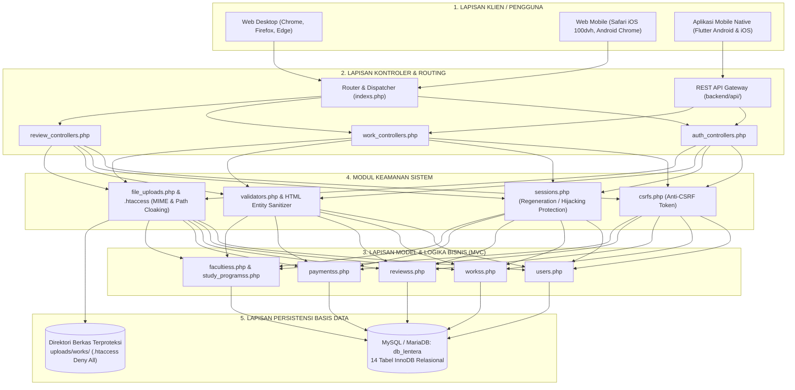
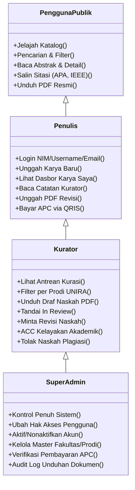
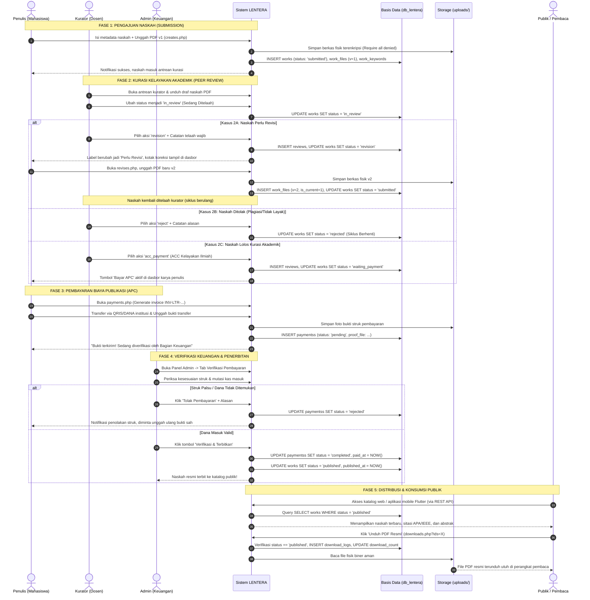
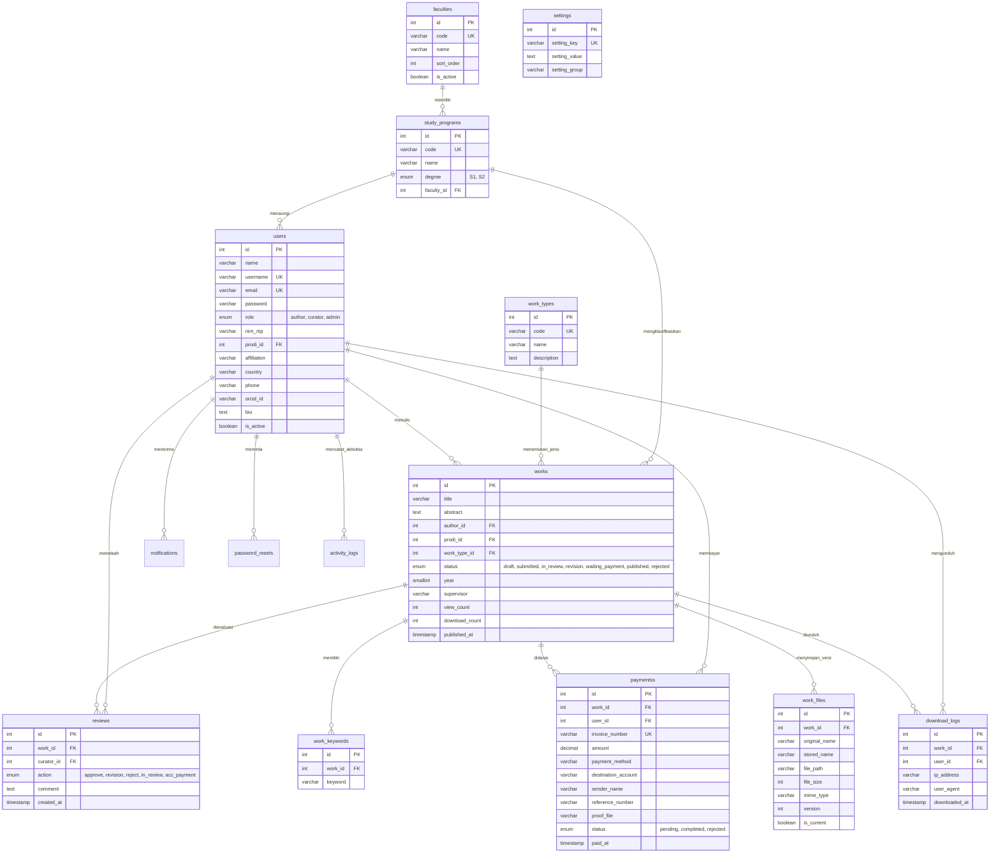

# 📖 BUKU PANDUAN KOMPREHENSIF ARSITEKTUR, FITUR, DAN ALUR KERJA
## Repositori Karya Ilmiah Terpadu "LENTERA" — Universitas Madura (UNIRA)

---

## 1. Identitas & Latar Belakang Sistem

* **Nama Sistem**: **LENTERA** (*Laman Etalase Karya Tulis Ilmiah Terpadu Akademik*)
* **Institusi Penaung**: Universitas Madura (UNIRA), Pamekasan, Madura, Jawa Timur
* **Slogan Resmi**: *"Menerangi Karya, Menginspirasi Generasi"*
* **URL Lokal**: `http://localhost/lentera/`
* **Basis Data Aktif**: `db_lentera` (MySQL / MariaDB XAMPP `127.0.0.1:3306`)
* **Arsitektur Utama**: Native Model-View-Controller (MVC) PHP 8.1+ & Cross-Platform Mobile Flutter (Dart 3)

### Dasar Hukum & Standar Referensi
Pembangunan dan perancangan sistem Lentera merujuk pada standar-standar akademik dan rekayasa perangkat lunak internasional:
1. **Permendikbud No. 3 Tahun 2020 (SN-Dikti)**: Kewajiban perguruan tinggi mengelola dan mempublikasikan karya ilmiah tugas akhir mahasiswa (skripsi, tesis) dalam repositori institusi yang dapat diakses publik.
2. **Pedoman Repositori Institusi Pendidikan Tinggi (Ditjen Dikti Kemendikbudristek RI)**: Standar metadata (Dublin Core), pelestarian digital (*digital preservation*), dan akses terbuka (*Open Access*).
3. **COPE (*Committee on Publication Ethics*) Guidelines 2021**: Pemisahan tegas antara telaah kelayakan akademik (*peer-review*) dan administrasi keuangan (*Article Processing Charge - APC*) untuk mencegah konflik kepentingan (*conflict of interest*).
4. **Alur Kerja Editorial Open Journal Systems (PKP OJS 3)**: Standar tahapan editorial ilmiah (*Submission $\rightarrow$ Review $\rightarrow$ Copyediting/Payment $\rightarrow$ Production/Publish*).
5. **Standar Kualitas Perangkat Lunak ISO/IEC 25010**: Memenuhi karakteristik fungsionalitas, efisiensi kinerja, kompatibilitas, kegunaan (*usability*), dan keandalan (*reliability*).
6. **OWASP Top 10 Application Security Standard**: Mitigasi risiko injeksi SQL, Cross-Site Scripting (XSS), Cross-Site Request Forgery (CSRF), kebocoran berkas, dan kegagalan autentikasi.
7. **W3C Web Content Accessibility Guidelines (WCAG) 2.2 AA**: Target sentuh minimal $44 \times 44\text{ px}$, rasio kontras warna memadai, dan kenyamanan tampilan di perangkat seluler (*Mobile-First*).

---

## 2. Arsitektur Teknis Sistem (*Full-Stack Architecture*)

### Rincian Tumpukan Teknologi (*Tech Stack*):
* **Backend**: PHP 8.1+ Native MVC (Pendekatan *clean architecture* tanpa dependensi *framework* pihak ketiga yang memberatkan).
* **Koneksi Database**: PDO (*PHP Data Objects*) Singleton Pattern dengan *prepared statements* anti-SQL injection, mode pelaporan galat `PDO::ERRMODE_EXCEPTION`, dan fitur *auto-healing*.
* **Frontend Web**: HTML5 Semantik, CSS Tokens Modern (dukungan tema warna institusi, transisi halus, tipografi inter), JavaScript Native (ES6+), FontAwesome 6, Chart.js CDN untuk grafik visualisasi.
* **Frontend Mobile**: Google Flutter Framework (Dart 3) dengan pola *Clean State Separation*, model entitas kuat (*strongly-typed models*), penanganan *offline mode* dan *graceful network timeout*.
* **REST API**: JSON API standar RFC 8259 dengan otentikasi *HMAC-SHA256 Signed Bearer Token*, proteksi *CORS*, dan respons terstruktur (*success, message, data*).

---

## 3. Matriks Peran Pengguna & Hak Akses (*RBAC*)

Sistem Lentera memiliki 4 tingkat peran pengguna dengan batasan akses (*least privilege principle*) yang ditegakkan di sisi peladen (*server-side authorization*):

| Fitur / Hak Akses | Tamu Publik | Penulis (Mahasiswa) | Kurator (Dosen) | Super Admin | Lokasi Kode Pengontrol |
|---|:---:|:---:|:---:|:---:|---|
| **Jelajah Katalog & Statistik** | ✅ Ya | ✅ Ya | ✅ Ya | ✅ Ya | `frontend/web/indexs.php` |
| **Pencarian Naskah Multi-Filter** | ✅ Ya | ✅ Ya | ✅ Ya | ✅ Ya | `viewss/searchs/indexs.php` |
| **Unduh Berkas PDF Resmi Terbit** | ✅ Ya | ✅ Ya | ✅ Ya | ✅ Ya | `viewss/workss/downloads.php` |
| **Registrasi Mandiri Penulis** | ✅ Ya | ❌ Tidak | ❌ Tidak | ❌ Tidak | `viewss/auths/registers.php` |
| **Dasbor Karya Saya (*Author Dashboard*)** | ❌ Ditolak | ✅ Ya | ❌ Dialihkan | ❌ Dialihkan | `viewss/workss/indexs.php` |
| **Unggah Naskah Ilmiah Baru** | ❌ Ditolak | ✅ Ya | ✅ Ya | ✅ Ya | `viewss/workss/creates.php` |
| **Unggah Berkas Naskah Revisi ($v_2$)** | ❌ Ditolak | ✅ Ya (Pemilik) | ❌ Ditolak | ❌ Ditolak | `viewss/workss/revises.php` |
| **Akses Tagihan & Form Bayar APC** | ❌ Ditolak | ✅ Ya (Pemilik) | ❌ Ditolak | ❌ Ditolak | `viewss/workss/payments.php` |
| **Dasbor Kurasi Editorial** | ❌ Ditolak | ❌ Ditolak | ✅ Ya | ✅ Ya | `viewss/reviews/indexs.php` |
| **Unduh Berkas Draf Naskah Mentah** | ❌ Ditolak | ❌ Ditolak | ✅ Ya | ✅ Ya | `viewss/workss/downloads.php` |
| **Beri Catatan Telaah & Putusan ACC** | ❌ Ditolak | ❌ Ditolak | ✅ Ya | ✅ Ya | `controllerss/review_controllers.php` |
| **Master Control Panel Repositori** | ❌ Ditolak | ❌ Ditolak | ❌ Ditolak | ✅ Ya | `viewss/admins/indexs.php` |
| **Manajemen Peran & Akun Pengguna** | ❌ Ditolak | ❌ Ditolak | ❌ Ditolak | ✅ Ya | `modelss/users.php` |
| **Kelola Master Fakultas & Prodi** | ❌ Ditolak | ❌ Ditolak | ❌ Ditolak | ✅ Ya | `modelss/facultiess.php` |
| **Audit Log Jejak Digital Pengunduhan** | ❌ Ditolak | ❌ Ditolak | ❌ Ditolak | ✅ Ya | `modelss/workss.php` |

---

## 4. Alur Kerja Terpadu: Dari Unggah (*Upload*) hingga Terbit (*Publish*)

Alur kerja berikut menerapkan standar **Pemisahan Peran Akademik dan Keuangan (*Separation of Concerns*)**:

---

## 5. Struktur Skema 14 Tabel Basis Data (`db_lentera`)

Seluruh tabel menggunakan mesin penyimpanan **InnoDB** dengan relasi integritas referensial ketat:

---

## 6. Inventaris Fitur Web & Mobile Flutter

### A. Fitur Aplikasi Web (14 Fitur Utama)
1. **Portal Beranda & Katalog Ilmiah Publik**: Etalase naskah terbit terbaru dan sorotan karya unggulan.
2. **Mesin Pencari Multi-Filter & Fulltext Search**: Pencarian komprehensif berdasarkan judul, abstrak, nama penulis, fakultas, prodi, dan tahun terbit.
3. **Halaman Detail Naskah & Generator Sitasi Otomatis**: Pratinjau karya lengkap dengan kutipan otomatis format **APA**, **IEEE**, dan **Harvard Style**.
4. **Pengontrol Unduhan Dokumen Aman (*Gatekeeper Download*)**: Mengalirkan berkas biner PDF dengan otorisasi hak akses dan pencatatan audit IP.
5. **Autentikasi Pengguna Fleksibel (*Multi-Identifier Login*)**: Dukungan login menggunakan **NIM / NIP**, **Username**, maupun **Email**.
6. **Registrasi Mandiri Mahasiswa (*Self-Registration*)**: Pendaftaran mandiri dengan validasi NIM, username unik, dan pilihan program studi.
7. **Dasbor Penulis (*Author Workspace*)**: Manajemen naskah pribadi, badge status kurasi berwarna, dan pemantau statistik dibaca/diunduh.
8. **Formulir Pengajuan Naskah Multi-Bagian**: Pengunggahan berkas PDF (maksimal 20 MB) berpelindung token anti-CSRF.
9. **Sistem Pengarsipan Revisi Bersiklus**: Penyimpanan riwayat versi naskah ($v_1 \rightarrow v_2 \rightarrow v_3$) tanpa menimpa naskah terdahulu.
10. **Kasir Pembayaran Publikasi Digital (APC Checkout)**: Penerbitan invoice resmi institusi dilengkapi instruksi pembayaran QRIS Dhes Mart / DANA.
11. **Dasbor Kurasi Editorial (*Curator Desk*)**: Kartu metrik antrean kurasi, filter status terpadu, dan penyaring per program studi.
12. **Modal Lembar Telaah Interaktif**: Formulir evaluasi naskah di tempat (*in-place review*) dengan aksi telaah, revisi, tolak, atau ACC.
13. **Master Control Panel Super Admin**: Pengawasan statistik global, penggantian peran akun instan (*role switcher*), dan penonaktifan akun.
14. **Visualisasi Data Statistik Kampus (Chart.js)**: Grafik interaktif perbandingan tren publikasi per fakultas dan prodi di Universitas Madura.

### B. Fitur Aplikasi Mobile Native Flutter (14 Fitur Utama)
1. **Layar Pembuka Dinamis (*Branded Splash Screen*)**: Inisialisasi token autentikasi dan pengecekan koneksi jaringan secara anggun.
2. **Layar Beranda Repositori Seluler**: Kartu karya ilmiah modern dengan *pull-to-refresh* dan kartu metrik pencapaian kampus.
3. **Layar Pencarian Cepat (*Instant Search*)**: Pencarian responsif dengan *debouncing* untuk menghemat kuota data seluler.
4. **Modal Filter Taksonomi Akademik**: *Bottom sheet* interaktif untuk menyaring naskah berdasarkan 7 Fakultas UNIRA.
5. **Layar Detail Naskah Imersif**: Tampilan abstrak tipografis dengan penataan ruang baca yang nyaman di layar ponsel.
6. **Alat Salin Sitasi Sekali Sentuh**: Fitur menyalin format sitasi akademik ke *clipboard* perangkat smartphone.
7. **Layar Masuk Pengguna Seluler (*Mobile Auth*)**: Form login hemat sentuhan dengan validasi lokal sebelum permintaan dikirim ke API.
8. **Dasbor Seluler "Karya Saya"**: Pemantauan status naskah mahasiswa secara waktu nyata dengan indikator badge warna kontras.
9. **Penanganan Mode Luring & Galat Bersahabat (*Offline Graceful Handling*)**: Layar *state* informatif saat internet terputus dengan tombol coba lagi (*Retry*).
10. **Kepatuhan Area Aman Ponsel (*Notch & Dynamic Island Compliance*)**: Penyesuaian tata letak otomatis mengikuti *Safe Area* pada iPhone dan punch-hole Android.
11. **Manajemen Sesi Token Bearer**: Penyimpanan token sesi aman (*Secure Local Storage*) untuk persistensi login aplikasi.
12. **Dukungan Pengguliran Mulus (*Smooth Infinite Scroll*)**: Pengalaman navigasi data besar tanpa tersendat (*zero lag*).
13. **Layar Profil & Identitas Civitas**: Informasi detail penulis, program studi, afiliasi kampus, dan tombol keluar sesi.
14. **Pembaruan Data Cepat (*Swipe to Refresh*)**: Memperbarui status kurasi naskah secara instan tanpa perlu menutup aplikasi.

### C. Antarmuka Pemrograman Aplikasi (6 Endpoint REST API JSON)
1. `POST /lentera/backend/api/auths/logins.php`: Otentikasi identitas dan penerbitan token sesi bertanda tangan digital.
2. `GET  /lentera/backend/api/workss/recents.php`: Mengambil daftar naskah berstatus terbit terbaru untuk beranda publik.
3. `GET  /lentera/backend/api/workss/searchs.php?q={query}&prodi={id}`: Pencarian naskah publik dengan filter parameter.
4. `GET  /lentera/backend/api/workss/details.php?id={id}`: Mengambil seluruh metadata detail satu naskah ilmiah.
5. `GET  /lentera/backend/api/facultiess/indexs.php`: Mengambil daftar fakultas, kode, dan program studi UNIRA.
6. `GET  /lentera/backend/api/authors/workss.php`: Mengambil riwayat seluruh naskah milik penulis yang sedang login (membutuhkan Bearer Token).

---

## 7. Arsitektur Keamanan Perangkat Lunak (*Security Standards*)

Sistem Lentera dirancang dengan postur pertahanan berlapis (*Defense-in-Depth*):

| Jenis Ancaman Siber | Mitigasi yang Diterapkan di Lentera | Berkas Implementasi |
|---|---|---|
| **SQL Injection (SQLi)** | 100% query basis data menggunakan *PDO Parameterized Prepared Statements*. Dilarang keras menggabungkan string (*string concatenation*) ke dalam query SQL. | [`backend/configs/databases.php`](file:///d:/xampp/htdocs/lentera/backend/configs/databases.php), [`backend/apps/modelss/`](file:///d:/xampp/htdocs/lentera/backend/apps/modelss/) |
| **Cross-Site Scripting (XSS)** | Seluruh data luaran yang dicetak ke HTML melalui fungsi enkapsulasi `htmlspecialchars($val, ENT_QUOTES, 'UTF-8')`. | Seluruh berkas tampilan di [`frontend/web/viewss/`](file:///d:/xampp/htdocs/lentera/frontend/web/viewss/) |
| **Cross-Site Request Forgery (CSRF)** | Setiap formulir POST wajib menyertakan token kriptografi acak `csrf_tokens` yang divalidasi dengan perbandingan string aman di sesi server. | [`backend/apps/helperss/csrfs.php`](file:///d:/xampp/htdocs/lentera/backend/apps/helperss/csrfs.php) |
| **Kebocoran File Dokumen (*Directory Traversal / Hotlinking*)** | Direktori `uploads/works/` dan `uploads/payment/` dikunci dengan Apache `.htaccess` (`Require all denied`). Berkas fisik diacak namanya dan hanya dapat dialirkan via controller perantara `downloads.php`. | [`uploads/works/.htaccess`](file:///d:/xampp/htdocs/lentera/uploads/works/.htaccess), [`frontend/web/viewss/workss/downloads.php`](file:///d:/xampp/htdocs/lentera/frontend/web/viewss/workss/downloads.php) |
| **Pencurian Sesi (*Session Hijacking & Fixation*)** | Sesi PHP menggunakan nama unik institusi, flag `HttpOnly`, `SameSite=Lax`, dan otomatis mengeksekusi `session_regenerate_id(true)` saat pengguna berhasil login. | [`backend/apps/helperss/sessions.php`](file:///d:/xampp/htdocs/lentera/backend/apps/helperss/sessions.php) |
| **Kebocoran Kata Sandi (*Credential Exposure*)** | Kata sandi disimpan murni dalam bentuk hash satu arah **Bcrypt ($Cost=10$)**. Tidak ada penyimpanan teks asli (*plaintext*) di database maupun di berkas log. | [`backend/apps/modelss/users.php`](file:///d:/xampp/htdocs/lentera/backend/apps/modelss/users.php) |
| **Pelanggaran Hak Akses (*Broken Access Control*)** | Pengecekan peran dilakukan di tingkat server (*server-side role check*) pada baris awal setiap halaman dan API, bukan sekadar menyembunyikan tombol di tampilan. | [`backend/apps/controllerss/`](file:///d:/xampp/htdocs/lentera/backend/apps/controllerss/), [`backend/api/helperss/api_helpers.php`](file:///d:/xampp/htdocs/lentera/backend/api/helperss/api_helpers.php) |

---

## 8. Kredensial Resmi Akun Pengujian Sistem

Seluruh akun pengujian di bawah ini telah aktif di basis data `db_lentera` dengan kata sandi seragam: **`password123`**:

| Peran | Nama Akun | Identitas Masuk (Username / Email / NIM) | Kata Sandi | Deskripsi Hak Akses |
|---|---|---|:---:|---|
| **Super Admin** | Super Admin LENTERA | `admin` `admin@lentera.unira.ac.id` `197508102001121001` | `password123` | Akses penuh ke seluruh kontrol panel sistem repositori |
| **Kurator Dosen** | Dr. Ahmad Fauzi, M.Kom. | `kurator` `kurator@lentera.unira.ac.id` `198203152008121003` | `password123` | Dosen Informatika & Tim Kurator Naskah Akademik UNIRA |
| **Penulis Mahasiswa 1** | Moh. Imam Arifin | `mahasiswa` `mahasiswa@lentera.unira.ac.id` `2021510001` | `password123` | Mahasiswa Teknik Informatika (Karya: Terbit, Bayar, Revisi) |
| **Penulis Mahasiswa 2** | Siti Nurhaliza | `siti` `siti@lentera.unira.ac.id` `2021520015` | `password123` | Mahasiswi Manajemen FEB (Karya: Terbit Skripsi Batik) |
| **Penulis Mahasiswa 3** | Budi Santoso | `budi` `budi@lentera.unira.ac.id` `2020530022` | `password123` | Mahasiswa Ilmu Hukum FH (Karya: Sedang Ditelaah / In Review) |

---

## 9. Glosarium Istilah Akademik

* **APC (*Article Processing Charge*)**: Biaya pengelolaan penerbitan artikel ilmiah yang dibebankan kepada penulis naskah setelah dinyatakan lolos kurasi oleh dewan penelaah.
* **Auto-Healing**: Fitur keandalan sistem di mana basis data dan skema tabel akan diinisialisasi secara mandiri oleh kode peladen jika sewaktu-waktu basis data belum terkonfigurasi.
* **Curator (Kurator)**: Dosen atau pakar bidang keilmuan yang bertugas memvalidasi, menelaah orisinalitas, dan menilai kepantasan ilmiah suatu karya sebelum diterbitkan ke etalase publik.
* **Gatekeeper Controller**: Pola arsitektur keamanan di mana pengunduhan file fisik tidak diberikan via tautan berkas langsung, melainkan dicegat oleh skrip peladen untuk memverifikasi hak akses pengguna dan mencatat log audit.
* **Multi-Identifier Login**: Mekanisme masuk sistem yang fleksibel di mana pengguna dapat menggunakan NIM/NIP mahasiswa/dosen, nama pengguna (*username*), maupun alamat surat elektronik (*email*).
* **Multi-Version Document**: Sistem manajemen berkas yang menyimpan riwayat perbaikan naskah ($v_1, v_2, \dots$) secara berkesinambungan tanpa menghapus naskah terdahulu sebagai bukti jejak rekam perbaikan akademik.

