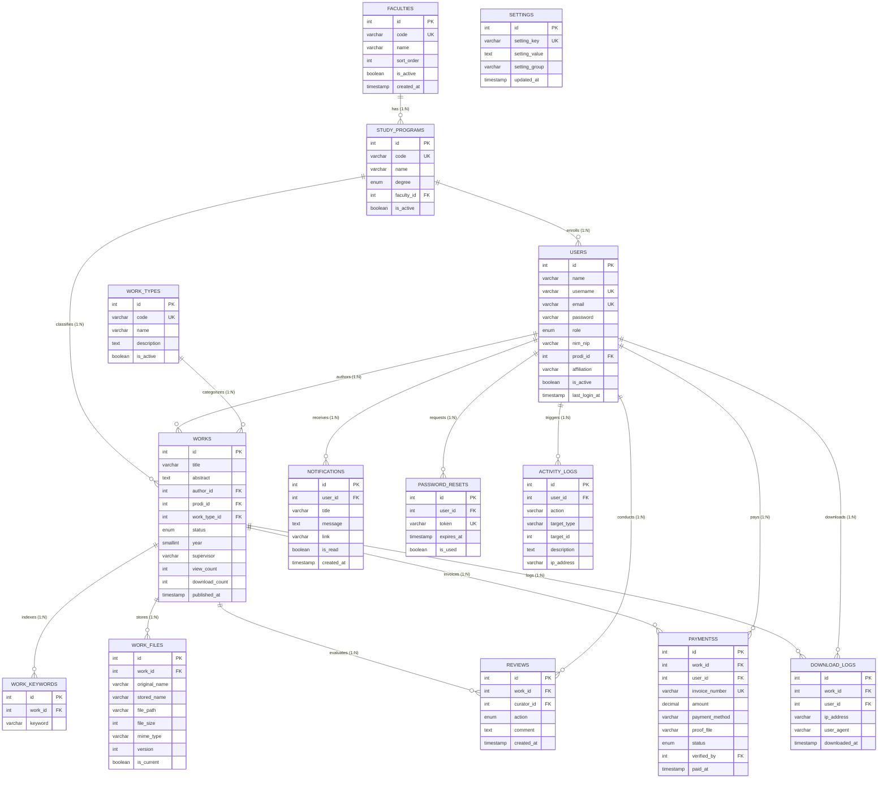

# 2.4 Entity-Relationship Diagram (ERD) — Sistem Repositori LENTERA
### Laman Etalase Karya Tulis Ilmiah Terpadu Akademik Universitas Madura (UNIRA)

Dokumen ini memetakan rancangan basis data konseptual dan fisikal (*Physical Relational Schema*) untuk platform **LENTERA** menggunakan pemodelan **Entity-Relationship Diagram (ERD)** berstandar **StarUML** dan **PlantUML**. Basis data dirancang menggunakan mesin relasional **MySQL 8.0 InnoDB** yang mengadopsi normalisasi tingkat ketiga (3NF) guna menjamin integritas referensial, ketiadaan anomali data, serta performa kueri yang optimal.

---

### A. Gambar 7.1 — Entity-Relationship Diagram (ERD) Sistem LENTERA

Berikut adalah representasi visual diagram relasi 14 tabel entitas menggunakan notasi *Crow's Foot*:

> **Tools:** StarUML v5.x / PlantUML | **File sumber:** `docs/diagram/erd.puml`

---

### B. Matriks Kardinalitas Relasi Antar-Entitas

| Entitas Asal (Parent) | Kardinalitas | Entitas Tujuan (Child) | Kunci Asing (Foreign Key) | Aksi Penghapusan (ON DELETE) |
|---|:---:|---|---|---|
| `faculties` | **1 : N** | `study_programs` | `study_programs.faculty_id` | `RESTRICT` (Mencegah fakultas terhapus jika masih memiliki prodi) |
| `study_programs` | **1 : N** | `users` | `users.prodi_id` | `SET NULL` (Akun pengguna tetap ada jika prodi dihapus) |
| `study_programs` | **1 : N** | `works` | `works.prodi_id` | `RESTRICT` (Menjaga keutuhan riwayat karya ilmiah prodi) |
| `work_types` | **1 : N** | `works` | `works.work_type_id` | `RESTRICT` (Mencegah penghapusan kategori karya aktif) |
| `users` (Author) | **1 : N** | `works` | `works.author_id` | `RESTRICT` (Menjamin hak cipta dan atribusi penulis) |
| `works` | **1 : N** | `work_keywords` | `work_keywords.work_id` | `CASCADE` (Kata kunci otomatis terhapus jika naskah dihapus) |
| `works` | **1 : N** | `work_files` | `work_files.work_id` | `CASCADE` (Riwayat versi berkas ikut terhapus bersama naskah) |
| `works` | **1 : N** | `reviews` | `reviews.work_id` | `CASCADE` (Riwayat telaah ikut terhapus jika naskah dihapus) |
| `users` (Curator) | **1 : N** | `reviews` | `reviews.curator_id` | `RESTRICT` (Menjaga rekam jejak tanggung jawab kurator) |
| `works` | **1 : N** | `paymentss` | `paymentss.work_id` | `CASCADE` (Tagihan APC terkait naskah) |
| `users` (Author) | **1 : N** | `paymentss` | `paymentss.user_id` | `CASCADE` (Riwayat transaksi penulis) |
| `works` | **1 : N** | `download_logs` | `download_logs.work_id` | `SET NULL` (Log unduhan tetap tersimpan untuk statistik audit) |
| `users` | **1 : N** | `download_logs` | `download_logs.user_id` | `SET NULL` (Log unduhan tamu/user tetap tercatat) |
| `users` | **1 : N** | `notifications` | `notifications.user_id` | `CASCADE` (Notifikasi terhapus jika akun dihapus) |
| `users` | **1 : N** | `password_resets` | `password_resets.user_id` | `CASCADE` (Token reset terhapus jika akun dihapus) |
| `users` | **1 : N** | `activity_logs` | `activity_logs.user_id` | `SET NULL` (Audit trail sistem tetap dipertahankan) |

---

### C. Kamus Data (Data Dictionary) 14 Tabel Sistem LENTERA

#### 1. Tabel `faculties` (Master Data Fakultas)
Menyimpan daftar fakultas di lingkungan Universitas Madura (UNIRA).
| Kolom | Tipe Data | Kunci | Nullable | Keterangan |
|---|---|:---:|:---:|---|
| `id` | `INT AUTO_INCREMENT` | **PK** | No | Identifikator unik fakultas |
| `code` | `VARCHAR(10)` | **UK** | No | Kode unik fakultas (misal: `FT`, `FE`, `FH`) |
| `name` | `VARCHAR(100)` | — | No | Nama lengkap fakultas (misal: "Fakultas Teknik") |
| `sort_order` | `INT` | — | Yes | Urutan penataan tampilan di menu (default: 0) |
| `is_active` | `BOOLEAN` | — | Yes | Status keaktifan fakultas (default: TRUE) |
| `created_at` | `TIMESTAMP` | — | Yes | Waktu data pertama kali dibuat |
| `updated_at` | `TIMESTAMP` | — | Yes | Waktu data terakhir diperbarui |

---

#### 2. Tabel `study_programs` (Master Data Program Studi)
Menyimpan program studi akademik yang bernaung di bawah fakultas.
| Kolom | Tipe Data | Kunci | Nullable | Keterangan |
|---|---|:---:|:---:|---|
| `id` | `INT AUTO_INCREMENT` | **PK** | No | Identifikator unik program studi |
| `code` | `VARCHAR(20)` | **UK** | No | Kode unik program studi (misal: `TI`, `SI`) |
| `name` | `VARCHAR(100)` | — | No | Nama program studi (misal: "Teknik Informatika") |
| `degree` | `ENUM('S1','S2')` | — | No | Jenjang strata akademik |
| `faculty_id` | `INT` | **FK** | No | Relasi ke `faculties.id` |
| `is_active` | `BOOLEAN` | — | Yes | Status keaktifan prodi |
| `created_at` | `TIMESTAMP` | — | Yes | Waktu pembuatan data |
| `updated_at` | `TIMESTAMP` | — | Yes | Waktu pembaruan data |

---

#### 3. Tabel `users` (Entitas Pengguna & Hak Akses)
Menyimpan seluruh data akun civitas akademika (Mahasiswa, Dosen, Kurator, Admin).
| Kolom | Tipe Data | Kunci | Nullable | Keterangan |
|---|---|:---:|:---:|---|
| `id` | `INT AUTO_INCREMENT` | **PK** | No | Identifikator unik pengguna |
| `name` | `VARCHAR(100)` | — | No | Nama lengkap beserta gelar akademik |
| `username` | `VARCHAR(60)` | **UK** | Yes | Nama pengguna untuk login unik |
| `email` | `VARCHAR(150)` | **UK** | No | Alamat email resmi civitas |
| `password` | `VARCHAR(255)` | — | No | Hash kata sandi (`PASSWORD_ARGON2ID` / `BCRYPT`) |
| `role` | `ENUM('author','curator','admin')` | — | No | Peran otorisasi sistem (default: `'author'`) |
| `nim_nip` | `VARCHAR(30)` | — | Yes | Nomor Induk Mahasiswa atau NIDN Dosen |
| `prodi_id` | `INT` | **FK** | Yes | Relasi ke `study_programs.id` |
| `affiliation`| `VARCHAR(150)` | — | Yes | Nama institusi (default: "Universitas Madura") |
| `country` | `VARCHAR(60)` | — | Yes | Negara asal peneliti (default: "Indonesia") |
| `phone` | `VARCHAR(30)` | — | Yes | Nomor telepon / WhatsApp aktif |
| `orcid_id` | `VARCHAR(50)` | — | Yes | Tautan ID ORCID periset internasional |
| `avatar` | `VARCHAR(255)` | — | Yes | Path berkas foto profil pengguna |
| `bio` | `TEXT` | — | Yes | Deskripsi singkat profil akademik |
| `is_active` | `BOOLEAN` | — | Yes | Status aktif akun (TRUE = aktif) |
| `last_login_at`| `TIMESTAMP` | — | Yes | Riwayat waktu login terakhir |
| `created_at` | `TIMESTAMP` | — | Yes | Waktu registrasi akun |
| `updated_at` | `TIMESTAMP` | — | Yes | Waktu perubahan profil akun |

---

#### 4. Tabel `work_types` (Master Tipe Karya Ilmiah)
Mengklasifikasikan jenis dokumen ilmiah yang diarsipkan.
| Kolom | Tipe Data | Kunci | Nullable | Keterangan |
|---|---|:---:|:---:|---|
| `id` | `INT AUTO_INCREMENT` | **PK** | No | Identifikator jenis karya |
| `code` | `VARCHAR(10)` | **UK** | No | Kode klasifikasi (`SKRIPSI`, `TESIS`, `JURNAL`, `KP`) |
| `name` | `VARCHAR(50)` | — | No | Nama kategori karya ilmiah |
| `description`| `TEXT` | — | Yes | Penjelasan ruang lingkup dokumen |
| `is_active` | `BOOLEAN` | — | Yes | Status keaktifan kategori |

---

#### 5. Tabel `works` (Master Naskah Karya Tulis Ilmiah)
Entitas sentral repositori yang menyimpan naskah akademik dan siklus statusnya.
| Kolom | Tipe Data | Kunci | Nullable | Keterangan |
|---|---|:---:|:---:|---|
| `id` | `INT AUTO_INCREMENT` | **PK** | No | Identifikator unik naskah ilmiah |
| `title` | `VARCHAR(500)` | — | No | Judul lengkap karya ilmiah |
| `abstract` | `TEXT` | — | No | Teks abstrak lengkap naskah |
| `author_id` | `INT` | **FK** | No | Relasi ke `users.id` (Penulis naskah) |
| `prodi_id` | `INT` | **FK** | No | Relasi ke `study_programs.id` |
| `work_type_id`| `INT` | **FK** | No | Relasi ke `work_types.id` |
| `status` | `ENUM(...)` | — | No | State: `draft`, `submitted`, `in_review`, `revision`, `waiting_payment`, `published`, `rejected` |
| `year` | `SMALLINT` | — | No | Tahun penyelesaian karya ilmiah |
| `supervisor`| `VARCHAR(200)` | — | Yes | Nama dosen pembimbing naskah |
| `view_count` | `INT UNSIGNED` | — | Yes | Akumulasi jumlah penayangan abstrak (default: 0) |
| `download_count`| `INT UNSIGNED`| — | Yes | Akumulasi jumlah unduhan naskah PDF (default: 0) |
| `submitted_at`| `TIMESTAMP` | — | Yes | Waktu pengajuan awal naskah oleh penulis |
| `published_at`| `TIMESTAMP` | — | Yes | Waktu resmi naskah diterbitkan ke publik |
| `created_at` | `TIMESTAMP` | — | Yes | Waktu pembuatan record |
| `updated_at` | `TIMESTAMP` | — | Yes | Waktu pembaruan naskah |

---

#### 6. Tabel `work_keywords` (Indeks Kata Kunci Karya)
Menyimpan kata kunci terpisah untuk optimasi mesin pencari.
| Kolom | Tipe Data | Kunci | Nullable | Keterangan |
|---|---|:---:|:---:|---|
| `id` | `INT AUTO_INCREMENT` | **PK** | No | Identifikator kata kunci |
| `work_id` | `INT` | **FK** | No | Relasi ke `works.id` |
| `keyword` | `VARCHAR(50)` | — | No | Kata kunci naskah (misal: "Kriptografi", "AI") |

---

#### 7. Tabel `work_files` (Manajemen Versi Berkas PDF)
Mencatat riwayat versi fisik berkas PDF (`v1`, `v2`, dst.) dan status keaktifan versi.
| Kolom | Tipe Data | Kunci | Nullable | Keterangan |
|---|---|:---:|:---:|---|
| `id` | `INT AUTO_INCREMENT` | **PK** | No | Identifikator berkas |
| `work_id` | `INT` | **FK** | No | Relasi ke `works.id` |
| `original_name`| `VARCHAR(255)`| — | No | Nama asli berkas saat diunggah penulis |
| `stored_name` | `VARCHAR(255)`| — | No | Nama berkas teracak aman di media penyimpanan |
| `file_path` | `VARCHAR(500)`| — | No | Jalur direktori penyimpanan server |
| `file_size` | `INT UNSIGNED`| — | No | Ukuran berkas dalam satuan byte |
| `mime_type` | `VARCHAR(100)`| — | Yes | Tipe MIME dokumen (default: `application/pdf`) |
| `version` | `INT` | — | Yes | Nomor urut versi naskah (`1`, `2`, `3`) |
| `is_current` | `BOOLEAN` | — | Yes | Penanda berkas versi aktif (TRUE = naskah terkini) |
| `uploaded_at` | `TIMESTAMP` | — | Yes | Waktu berkas diunggah |

---

#### 8. Tabel `reviews` (Rekam Jejak Telaah Kurator OJS)
Menyimpan catatan hasil telaah sejawat dan keputusan dewan kurasi.
| Kolom | Tipe Data | Kunci | Nullable | Keterangan |
|---|---|:---:|:---:|---|
| `id` | `INT AUTO_INCREMENT` | **PK** | No | Identifikator catatan telaah |
| `work_id` | `INT` | **FK** | No | Relasi ke `works.id` |
| `curator_id` | `INT` | **FK** | No | Relasi ke `users.id` (Kurator penelaah) |
| `action` | `ENUM(...)` | — | No | Keputusan: `approve`, `revision`, `reject`, `in_review` |
| `comment` | `TEXT` | — | No | Catatan evaluasi akademik bagi penulis |
| `created_at` | `TIMESTAMP` | — | Yes | Waktu keputusan telaah ditetapkan |

---

#### 9. Tabel `paymentss` (Biaya Publikasi / APC)
Menangani transaksi administrasi *Article Processing Charge* (APC) dan verifikasi bukti bayar.
| Kolom | Tipe Data | Kunci | Nullable | Keterangan |
|---|---|:---:|:---:|---|
| `id` | `INT AUTO_INCREMENT` | **PK** | No | Identifikator tagihan pembayaran |
| `work_id` | `INT` | **FK** | No | Relasi ke `works.id` |
| `user_id` | `INT` | **FK** | No | Relasi ke `users.id` (Penulis pembayar) |
| `invoice_number`| `VARCHAR(50)`| **UK** | No | Nomor unik invoice pembayaran |
| `amount` | `DECIMAL(12,2)`| — | No | Nominal biaya publikasi (default: Rp 150.000) |
| `payment_method`| `VARCHAR(50)`| — | Yes | Metode pembayaran (QRIS / Transfer Bank) |
| `destination_account`|`VARCHAR(100)`| — | Yes | Rekening / Akun tujuan transfer UNIRA |
| `sender_name` | `VARCHAR(100)`| — | Yes | Nama pengirim pada rekening transfer |
| `proof_file` | `VARCHAR(255)`| — | Yes | Path berkas struk bukti pembayaran |
| `admin_notes` | `TEXT` | — | Yes | Catatan verifikator admin jika bukti ditolak |
| `verified_by` | `INT` | **FK** | Yes | Relasi ke `users.id` (Admin yang menyetujui) |
| `status` | `ENUM(...)` | — | No | Status: `pending`, `completed`, `rejected` |
| `paid_at` | `TIMESTAMP` | — | Yes | Waktu pembayaran dikonfirmasi penulis |
| `created_at` | `TIMESTAMP` | — | Yes | Waktu invoice diterbitkan |
| `updated_at` | `TIMESTAMP` | — | Yes | Waktu status pembayaran diperbarui |

---

#### 10. Tabel `download_logs` (Audit Log Pengunduhan PDF)
Mencatat jejak digital setiap pengunduhan naskah secara atomik untuk keperluan borang akreditasi.
| Kolom | Tipe Data | Kunci | Nullable | Keterangan |
|---|---|:---:|:---:|---|
| `id` | `INT AUTO_INCREMENT` | **PK** | No | Identifikator entri log |
| `work_id` | `INT` | **FK** | Yes | Relasi ke `works.id` |
| `user_id` | `INT` | **FK** | Yes | Relasi ke `users.id` (NULL jika tamu publik) |
| `ip_address` | `VARCHAR(45)` | — | No | Alamat IP pengunjung (IPv4 / IPv6) |
| `user_agent` | `VARCHAR(500)`| — | Yes | Informasi jenis dan versi peramban web pengunduh |
| `downloaded_at`| `TIMESTAMP` | — | Yes | Waktu pengunduhan naskah dieksekusi |

---

#### 11. Tabel `notifications` (Notifikasi Sistem)
Menyampaikan pemberitahuan perubahan status naskah atau keputusan telaah kepada pengguna.
| Kolom | Tipe Data | Kunci | Nullable | Keterangan |
|---|---|:---:|:---:|---|
| `id` | `INT AUTO_INCREMENT` | **PK** | No | Identifikator pesan notifikasi |
| `user_id` | `INT` | **FK** | No | Relasi ke `users.id` (Penerima notifikasi) |
| `title` | `VARCHAR(100)` | — | No | Judul ringkas notifikasi |
| `message` | `TEXT` | — | No | Pesan notifikasi terperinci |
| `link` | `VARCHAR(255)` | — | Yes | Tautan URL aksi naskah terkait |
| `is_read` | `BOOLEAN` | — | Yes | Penanda pesan telah dibaca (default: FALSE) |
| `created_at` | `TIMESTAMP` | — | Yes | Waktu notifikasi dibuat |

---

#### 12. Tabel `password_resets` (Pemulihan Kata Sandi)
Menyimpan token aman sementara untuk prosedur reset kata sandi pengguna.
| Kolom | Tipe Data | Kunci | Nullable | Keterangan |
|---|---|:---:|:---:|---|
| `id` | `INT AUTO_INCREMENT` | **PK** | No | Identifikator token reset |
| `user_id` | `INT` | **FK** | No | Relasi ke `users.id` |
| `token` | `VARCHAR(255)` | **UK** | No | Token acak kriptografis aman |
| `expires_at` | `TIMESTAMP` | — | No | Batas waktu kedaluwarsa token (misal: 1 jam) |
| `is_used` | `BOOLEAN` | — | Yes | Status penggunaan token (TRUE = sudah terpakai) |
| `created_at` | `TIMESTAMP` | — | Yes | Waktu token digenerasi |

---

#### 13. Tabel `activity_logs` (Audit Log Aktivitas Super Admin)
Mencatat rekam jejak operasional administratif (pengangkatan role, perubahan status, audit sistem).
| Kolom | Tipe Data | Kunci | Nullable | Keterangan |
|---|---|:---:|:---:|---|
| `id` | `INT AUTO_INCREMENT` | **PK** | No | Identifikator log aktivitas |
| `user_id` | `INT` | **FK** | Yes | Relasi ke `users.id` (Pelaku aksi admin) |
| `action` | `VARCHAR(50)` | — | No | Tipe aksi (misal: `ROLE_CHANGE`, `VERIFY_APC`) |
| `target_type`| `VARCHAR(100)`| — | Yes | Nama tabel objek yang diubah |
| `target_id` | `INT` | — | Yes | ID record objek yang diubah |
| `description`| `TEXT` | — | Yes | Rincian narasi perubahan yang dilakukan |
| `ip_address` | `VARCHAR(45)` | — | Yes | Alamat IP pelaku aksi |
| `created_at` | `TIMESTAMP` | — | Yes | Waktu eksekusi aksi operasional |

---

#### 14. Tabel `settings` (Konfigurasi Global Repositori)
Menyimpan parameter konfigurasi global sistem repositori.
| Kolom | Tipe Data | Kunci | Nullable | Keterangan |
|---|---|:---:|:---:|---|
| `id` | `INT AUTO_INCREMENT` | **PK** | No | Identifikator pengaturan |
| `setting_key` | `VARCHAR(50)` | **UK** | No | Kunci parameter (misal: `apc_default_fee`, `campus_name`) |
| `setting_value`| `TEXT` | — | Yes | Nilai konfigurasi |
| `setting_group`| `VARCHAR(50)` | — | Yes | Pengelompokan parameter (default: `'general'`) |
| `updated_at` | `TIMESTAMP` | — | Yes | Waktu konfigurasi terakhir diubah |

---

  <b>Sistem Repositori LENTERA — Universitas Madura (UNIRA)</b> 
  Disusun oleh Kelompok 01 (Imam, Alvin, Gilank, Halim) • PBP 2026

