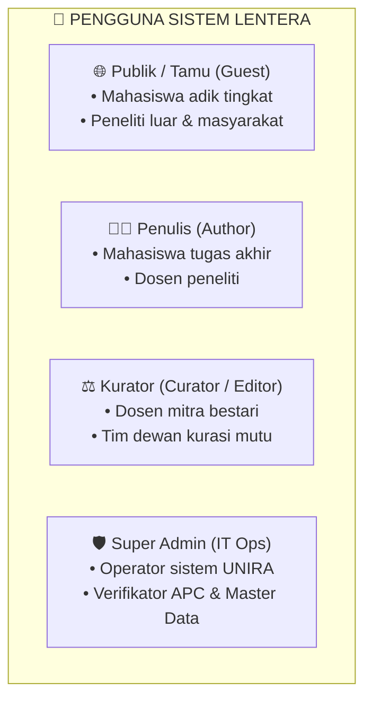
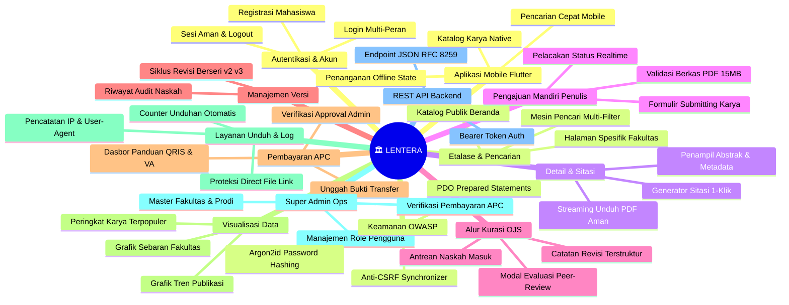
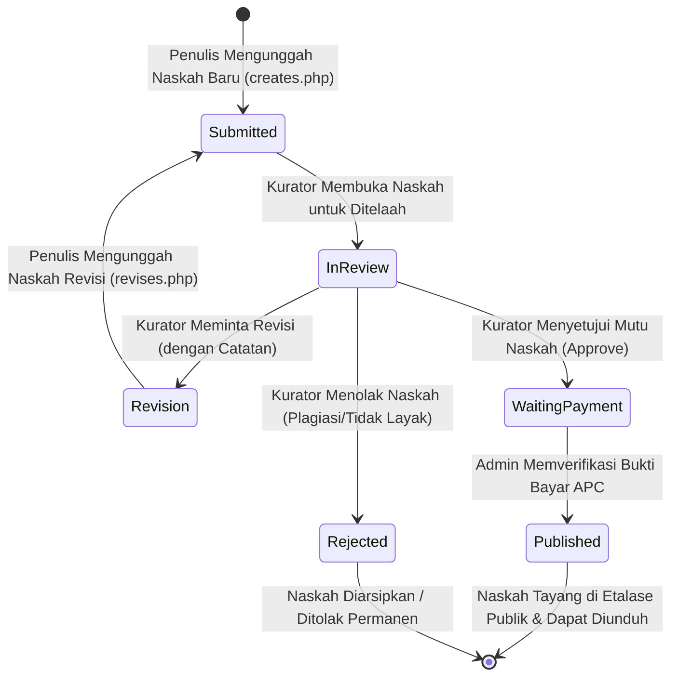
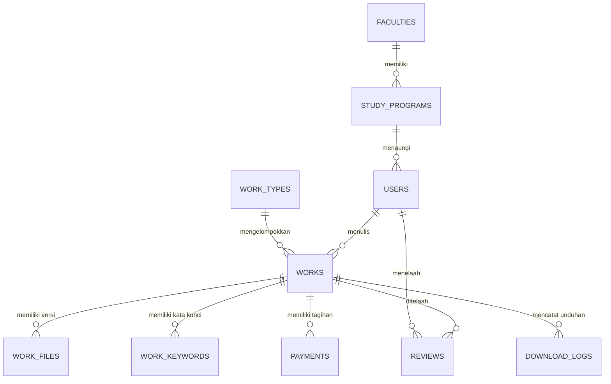

# 📑 PRODUCT REQUIREMENT DOCUMENT (PRD)
## LENTERA — Laman Etalase Karya Tulis Ilmiah Terpadu Akademik
### Platform Repositori Digital & Kurasi Ilmiah Civitas Akademika Universitas Madura (UNIRA)

---

## 📌 Informasi Dokumen & Kontrol Versi

| Properti | Keterangan |
|---|---|
| **Nama Produk** | **LENTERA** (Laman Etalase Karya Tulis Ilmiah Terpadu Akademik) |
| **Topik Studi Kasus** | Topik #4: E-Library & Repositori Digital Akademik |
| **Institusi** | Program Studi Informatika, Fakultas Teknik, **Universitas Madura (UNIRA)** |
| **Mata Kuliah** | Pemrograman Berbasis Platform (Semester Ganjil 2026) |
| **Versi Dokumen** | **v1.0.0 (Final Comprehensive Release)** |
| **Status Dokumen** | **Approved & Production Ready** |
| **Tanggal Disahkan** | November 2026 |
| **Tim Pengembang** | **Kelompok 01**:  1. **Imam** (2024520030) — *Ketua Kelompok, Backend Lead & Security Architect* 2. **Alvin Hidayat Putra Pratam** (2024520050) — *Frontend Web Engineer & UI/UX Specialist* 3. **Moh. Gilank Alamsyah** (2024520052) — *Mobile Native Flutter Engineer* 4. **Abdul Halim** (2024520059) — *Database & QA Lead* |

---

## 1. Ringkasan Eksekutif & Latar Belakang Masalah

### 1.1. Konteks Permasalahan
Setiap tahun, civitas akademika Universitas Madura menghasilkan ratusan karya intelektual bernilai tinggi: skripsi sarjana, tesis magister, artikel jurnal ilmiah, laporan penelitian terapan, dan laporan kerja praktik. Sebelum hadirnya sistem digital terpadu:
1. **Penyimpanan Tercecer & Risiko Kehilangan**: Naskah fisik menumpuk di lemari arsip program studi yang rentan aus/rusak, tersimpan di flashdisk mahasiswa yang telah lulus, atau tercecer di penyimpanan cloud pribadi dosen.
2. **Hambatan Akses Referensi Adik Tingkat**: Mahasiswa baru atau tingkat akhir kesulitan mencari naskah rujukan berkualitas relevan karena tidak ada katalog pencarian terpusat.
3. **Beban Rekapitulasi Borang Akreditasi**: Program studi menghadapi kesulitan besar saat harus mengumpulkan bukti fisik naskah karya ilmiah secara manual dalam waktu singkat menjelang audit akreditasi BAN-PT/LAM INFOKOM.
4. **Ketiadaan Standar Kurasi Terbuka**: Tidak tersedianya alur penelaahan sejawat (*peer-review*) transparan yang menjamin naskah bebas dari plagiasi dan memenuhi etika akademik sebelum dipublikasikan ke publik.

### 1.2. Solusi Produk: LENTERA
**Lentera** hadir sebagai platform repositori dan etalase digital akademik terpadu berbasis Web dan Mobile Native (Flutter). Mengadopsi prinsip kerja *Open Journal Systems (OJS)*, Lentera mengintegrasikan siklus hidup karya ilmiah secara menyeluruh: pengajuan mandiri oleh penulis, telaah berjenjang oleh dewan kurator, keterbukaan akses bagi publik, serta verifikasi pembiayaan publikasi (APC) dan pemantauan analitik terpusat.

---

## 2. Tujuan & Sasaran Produk (Goals & Objectives)

### 2.1. Sasaran Fungsional & Institusional
- **Digitalisasi Total Memori Intelektual**: Menyimpan dan mengindeks seluruh naskah akademik civitas akademika dalam satu basis data terstruktur dan terlindungi.
- **Transparansi Alur Kurasi OJS**: Memastikan setiap naskah yang terbit telah melalui telaah sejawat (*peer-review*) yang ketat dengan rekam jejak catatan revisi transparan.
- **Keterbukaan Akses Pengetahuan (Open Access)**: Memungkinkan mahasiswa, dosen, dan masyarakat umum membaca abstrak, mengunduh berkas resmi, dan menyalin sitasi karya secara gratis dan cepat.
- **Otomasi Rekapitulasi Akreditasi**: Menyediakan dasbor statistik tren publikasi dan sebaran karya per fakultas secara *real-time* berbasis grafik interaktif.

### 2.2. Sasaran Teknis & Rekayasa Perangkat Lunak
- **Kemandirian Sistem (Native MVC)**: Dibangun menggunakan arsitektur MVC PHP murni tanpa ketergantungan framework berat (*zero framework bloat*), menjamin kecepatan eksekusi dan pemeliharaan jangka panjang.
- **Kepatuhan Keamanan OWASP Top 10**: Bebas dari celah SQL Injection (Prepared Statements PDO), Cross-Site Scripting (Output Encoding UTF-8), Cross-Site Request Forgery (Synchronizer Token), serta perlindungan unduhan berkas PDF dari eksploitasi *directory traversal*.
- **Integrasi Multiplatform**: Menyediakan REST API JSON terstandarisasi untuk menghubungkan server backend dengan aplikasi mobile native Android/iOS berbasis Flutter.

---

## 3. Profil Pengguna & Hak Akses (User Personas & RBAC)

Sistem melayani **4 (empat) aktor peran** dengan pemisahan wewenang yang tegas (*Principle of Least Privilege*):

### 3.1. Deskripsi Peran Pengguna
1. **Publik / Tamu (Guest)**:
   - Pengunjung tanpa login yang memanfaatkan repositori untuk mencari literatur, membaca abstrak, mengunduh berkas PDF resmi, dan menyalin sitasi format standar.
2. **Penulis / Mahasiswa (Author)**:
   - Civitas akademika yang telah memiliki akun terverifikasi. Memiliki wewenang mengunggah naskah baru, mengunggah naskah revisi (v2, v3...), mengunggah bukti pembayaran APC, dan memantau status naskah dari dasbor pribadi.
3. **Dewan Kurator / Mitra Bestari (Curator)**:
   - Dosen atau tim penelaah yang ditunjuk kampus untuk menjaga mutu etalase. Berwenang menelaah naskah yang masuk antrean, memeriksa skor kesamaan (*similarity*), dan memutuskan status: **Terima (Publish)**, **Minta Revisi (Revision)**, atau **Tolak (Reject)**.
4. **Super Admin (IT Administrator & Verifikator APC)**:
   - Administrator teknis kampus yang mengelola master data (fakultas, program studi), mengangkat peran kurator, memverifikasi bukti pembayaran APC dari penulis, dan memantau log audit sistem.

---

## 4. Daftar Lengkap Seluruh Fitur (Comprehensive Feature Inventory)

Berikut adalah inventarisasi lengkap **13 Modul Fitur** yang telah dirancang, dibangun, dan diuji pada sistem Lentera:

---

## 5. Rincian Spesifikasi Fitur per Modul

---

### MODUL 1: AUTENTIKASI & MANAJEMEN AKUN

#### Fitur 1.1: Registrasi Mandiri Pengguna (Author Registration)
- **ID Fitur**: `FEAT-AUTH-01`
- **Aktor**: Publik / Tamu (Mahasiswa & Dosen)
- **Halaman**: `frontend/web/viewss/auths/registers.php`
- **Deskripsi**: Memfasilitasi pendaftaran akun baru bagi mahasiswa atau dosen peneliti secara mandiri.
- **Input Data**: Nama Lengkap, Username (unik), Email resmi (format valid), NIM/NIDN, Pilihan Fakultas, Pilihan Program Studi, Kata Sandi, dan Konfirmasi Kata Sandi.
- **Aturan Bisnis & Validasi**:
  - Sandi wajib di-hash menggunakan algoritma modern `PASSWORD_ARGON2ID` atau `BCRYPT` (bebas dari MD5/SHA1).
  - Pilihan prodi otomatis tersinkronisasi dengan relasi ID fakultas.
  - Peran otomatis ditetapkan sebagai `author`.
  - Formulir dilindungi Anti-CSRF Token.

#### Fitur 1.2: Otentikasi Masuk Multi-Peran (Multi-Role Login)
- **ID Fitur**: `FEAT-AUTH-02`
- **Aktor**: Publik / Semua Pengguna Terdaftar
- **Halaman**: `frontend/web/viewss/auths/logins.php`
- **Deskripsi**: Pintu masuk terpadu untuk semua peran (Author, Curator, Super Admin) dengan pengalihan otomatis (*smart redirection*) sesuai peran masing-masing.
- **Aturan Bisnis**:
  - Proteksi *Brute-Force Attack*: Regenerasi ID sesi setelah otentikasi berhasil (`session_regenerate_id(true)`).
  - Jika peran adalah `author` $\rightarrow$ dialihkan ke `workss/indexs.php`.
  - Jika peran adalah `curator` $\rightarrow$ dialihkan ke `reviews/indexs.php`.
  - Jika peran adalah `admin` $\rightarrow$ dialihkan ke `admins/indexs.php`.

#### Fitur 1.3: Terminasi Sesi Aman (Secure Logout)
- **ID Fitur**: `FEAT-AUTH-03`
- **Aktor**: Seluruh Pengguna Login
- **Halaman**: `frontend/web/viewss/auths/logouts.php`
- **Deskripsi**: Menghapus seluruh data sesi di server, membatalkan cookie sesi di peramban, dan mengalihkan pengguna kembali ke halaman utama publik dengan pesan konfirmasi aman.

---

### MODUL 2: ETALASE PUBLIK & MESIN PENCARIAN PINTAR

#### Fitur 2.1: Katalog Beranda Repositori (Public Showcase Landing Page)
- **ID Fitur**: `FEAT-SHOW-01`
- **Aktor**: Publik (Tanpa Login)
- **Halaman**: `frontend/web/indexs.php`
- **Deskripsi**: Halaman muka modern yang menyajikan identitas digital repositori Universitas Madura.
- **Komponen Tampilan**:
  - Hero banner beridentitas akademik dan pencarian cepat.
  - Kartu ringkasan metrik: Total Naskah Terbit, Total Unduhan Resmi, Total Penulis Civitas Akademika.
  - Daftar naskah ilmiah terbaru (*Recently Published Works*) berstatus `published`.
  - Navigasi responsif dengan dukungan *mobile navigation drawer* untuk layar ponsel $<768\text{px}$.

#### Fitur 2.2: Mesin Pencarian Multi-Filter (Multi-Parameter Search Engine)
- **ID Fitur**: `FEAT-SEARCH-01`
- **Aktor**: Publik & Seluruh Pengguna
- **Halaman**: `frontend/web/viewss/searchs/indexs.php`
- **Deskripsi**: Mesin pencari naskah berkemampuan tinggi dengan penyaringan parameter jamak.
- **Kemampuan Filter**:
  1. *Kata Kunci Bebas*: Pencocokan judul naskah, teks abstrak, dan kata kunci naskah (`work_keywords`).
  2. *Filter Fakultas*: Mempersempit pencarian pada fakultas tertentu di UNIRA.
  3. *Filter Program Studi*: Menampilkan karya spesifik prodi.
  4. *Filter Jenis Karya*: Skripsi, Tesis, Jurnal Ilmiah, Laporan Penelitian, Laporan Kerja Praktik.
  5. *Filter Tahun Publikasi*: Rentang tahun karya ilmiah diterbitkan.
- **Aturan Keamanan**: Query SQL menggunakan klausa mutlak `WHERE status = 'published'` dengan parameter terikat (*Prepared Statement*). Naskah yang belum disetujui kurator tidak akan pernah muncul pada hasil pencarian.

#### Fitur 2.3: Etalase Koleksi Khusus Fakultas (Faculty Archive Showcase)
- **ID Fitur**: `FEAT-SEARCH-02`
- **Aktor**: Publik
- **Halaman**: `frontend/web/viewss/facultiess/details.php`
- **Deskripsi**: Halaman khusus yang mengelompokkan karya ilmiah berdasarkan fakultas pilihan, dilengkapi profil fakultas, daftar program studi di bawahnya, dan katalog karya terkait.

---

### MODUL 3: DETAIL NASKAH & GENERATOR SITASI OTOMATIS

#### Fitur 3.1: Halaman Detail Naskah Komprehensif (Work Detail & Abstract Viewer)
- **ID Fitur**: `FEAT-WORK-DETAIL`
- **Aktor**: Publik
- **Halaman**: `frontend/web/viewss/workss/details.php`
- **Deskripsi**: Menampilkan informasi lengkap naskah ilmiah yang telah terbit.
- **Metadata yang Ditampilkan**:
  - Judul Lengkap Naskah.
  - Nama Penulis Utama & NIM/NIDN.
  - Dosen Pembimbing I dan Dosen Pembimbing II.
  - Nama Fakultas dan Program Studi.
  - Tahun Terbit & Jenis Dokumen.
  - Teks Abstrak Lengkap (Bahasa Indonesia & Inggris).
  - Daftar Kata Kunci (*Keywords*) interaktif yang dapat diklik untuk pencarian serupa.
  - Statistik Naskah: Jumlah kali dilihat (*views count*) dan jumlah kali diunduh (*download count*).

#### Fitur 3.2: Generator Sitasi Ilmiah 1-Klik (Multi-Format Citation Generator)
- **ID Fitur**: `FEAT-CITE-01`
- **Aktor**: Publik & Peneliti
- **Halaman**: `frontend/web/viewss/workss/details.php` (Didukung `frontend/web/jss/apps.js`)
- **Deskripsi**: Generator format sitasi otomatis siap pakai dalam 4 (empat) standar sitasi akademik internasional:
  1. **APA 7th Edition**: `Penulis, (Tahun). Judul naskah. Universitas Madura.`
  2. **IEEE Style**: `[1] Penulis, "Judul naskah," Universitas Madura, Tahun.`
  3. **Harvard Style**: `Penulis Tahun, 'Judul naskah', Universitas Madura.`
  4. **BibTeX Format**: Format sintaks untuk pengguna LaTeX / Overleaf.
- **Fitur Tambahan**: Tombol **"Salin Sitasi" (Copy to Clipboard)** dengan umpan balik visual animasi (*tooltip* centang sukses).

---

### MODUL 4: PENGAJUAN MANDIRI KARYA ILMIAH (AUTHOR SUBMISSION)

#### Fitur 4.1: Formulir Pengajuan Naskah Baru (Work Creation & Submitting)
- **ID Fitur**: `FEAT-SUBMIT-01`
- **Aktor**: Penulis (Author)
- **Halaman**: `frontend/web/viewss/workss/creates.php`
- **Deskripsi**: Antarmuka bagi mahasiswa/peneliti untuk mendaftarkan naskah karya ilmiah baru ke dalam repositori.
- **Data Formulir**:
  - Judul Naskah (Validasi: minimal 10 karakter).
  - Teks Abstrak (Validasi: minimal 30 karakter).
  - Kata Kunci (Dipisahkan koma, minimal 3 kata kunci).
  - Tipe Dokumen (Skripsi / Tesis / Jurnal / Laporan).
  - Tahun Penyelesaian.
  - Dosen Pembimbing (Pembimbing 1 & Pembimbing 2).
  - Unggah Berkas Full-Text PDF.
- **Validasi File Unggahan**:
  - Ekstensi berkas wajib `.pdf`.
  - Validasi *MIME Type* dan *Magic Bytes* `%PDF-` pada header file (mencegah penyamaran berkas eksekusi berbahaya `.exe` / `.php`).
  - Batas ukuran berkas maksimal $15\text{ MB}$ s.d. $20\text{ MB}$.
  - Nama file disimpan dengan pola acak unik (*UUID/hash*) di direktori terisolasi `uploads/works/`.
- **Status Awal**: Karya yang baru diunggah langsung berstatus `'submitted'` dan masuk antrean dewan kurasi.

#### Fitur 4.2: Dasbor Pemantauan Status Karya Pribadi (Author Work Dashboard)
- **ID Fitur**: `FEAT-SUBMIT-02`
- **Aktor**: Penulis (Author)
- **Halaman**: `frontend/web/viewss/workss/indexs.php`
- **Deskripsi**: Dasbor kendali utama penulis untuk melihat rekapitulasi karya yang pernah diajukan beserta status verifikasinya.
- **Indikator Status**:
  - 🟡 **Submitted**: Naskah berada dalam antrean kurasi.
  - 🔵 **In Review**: Naskah sedang aktif diperiksa oleh kurator.
  - 🟠 **Revision**: Naskah memerlukan revisi berdasarkan catatan kurator.
  - 🟣 **Waiting Payment**: Naskah disetujui kurator, menunggu penyelesaian administrasi APC.
  - 🟢 **Published**: Naskah resmi terbit dan tayang di etalase repositori publik.
  - 🔴 **Rejected**: Naskah ditolak permanen.

---

### MODUL 5: ALUR PEER-REVIEW & DEWAN KURASI (OJS WORKFLOW)

#### Fitur 5.1: Antrean Kurasi Naskah Masuk (Editorial Review Queue)
- **ID Fitur**: `FEAT-REVIEW-01`
- **Aktor**: Dewan Kurator (Curator) & Super Admin
- **Halaman**: `frontend/web/viewss/reviews/indexs.php`
- **Deskripsi**: Ruang kerja dewan kurator untuk menyeleksi naskah civitas akademika yang belum terbit.
- **Informasi Antrean**:
  - Daftar karya berstatus `submitted` dan `in_review`.
  - Metadata naskah, nama penulis, tanggal masuk, dan tombol pratinjau naskah PDF asli (*Galley PDF*).
  - Skor uji kemiripan (*similarity score*) untuk kepatuhan batas toleransi plagiasi akademik (maks. 25%).

#### Fitur 5.2: Modal Keputusan Telaah Kurator (Curator Evaluation Modal)
- **ID Fitur**: `FEAT-REVIEW-02`
- **Aktor**: Dewan Kurator (Curator)
- **Halaman**: `frontend/web/viewss/reviews/indexs.php` (Interaksi Modal Dialog)
- **Deskripsi**: Formulir penetapan keputusan akademik berjenjang.
- **Pilihan Keputusan**:
  1. **Setujui / Approve**: Naskah dinyatakan memenuhi standar ilmiah. Karya beralih status ke `waiting_payment` (atau langsung `published` bila bebas APC).
  2. **Minta Revisi / Revision**: Kurator meminta penulis memperbaiki naskah. Wajib mengisi kolom **Catatan Telaah Evaluasi**. Naskah berpindah status ke `revision`.
  3. **Tolak / Reject**: Naskah dinyatakan tidak layak atau melanggar integritas akademik berat. Status menjadi `rejected`.
- **Integritas Audit**: Keputusan kurator dicatat ke tabel `reviews` lengkap dengan timestamp keputusan dan identitas ID kurator penelaah.

---

### MODUL 6: SISTEM VERSI & REVISI KARYA (WORK VERSIONING)

#### Fitur 6.1: Formulir Pengunggahan Naskah Revisi (Work Revision Form)
- **ID Fitur**: `FEAT-REVISI-01`
- **Aktor**: Penulis (Author)
- **Halaman**: `frontend/web/viewss/workss/revises.php`
- **Deskripsi**: Fasilitas bagi penulis untuk menanggapi catatan evaluasi dari kurator.
- **Alur Kerja**:
  - Penulis membaca riwayat catatan perbaikan dari kurator.
  - Penulis mengunggah naskah PDF revisi terbaru beserta rangkuman poin perbaikan (*Author Response Letter*).
  - Sistem menaikkan nomor versi dokumen (`v2`, `v3`...), menonaktifkan status versi lama (`is_current = 0`), dan mengaktifkan file baru (`is_current = 1`).
  - Status naskah otomatis kembali menjadi `'submitted'` agar kurator dapat memeriksa ulang hasil revisi.

---

### MODUL 7: TRANSAKSI & VERIFIKASI BIAYA PUBLIKASI (APC)

#### Fitur 7.1: Dasbor Pembayaran APC Penulis (Author Payment Portal)
- **ID Fitur**: `FEAT-PAY-01`
- **Aktor**: Penulis (Author)
- **Halaman**: `frontend/web/viewss/workss/payments.php`
- **Deskripsi**: Portal pemenuhan biaya publikasi (*Article Processing Charge*) bagi naskah yang telah lolos telaah kurator.
- **Komponen Pembayaran**:
  - Rincian invoice: ID Naskah, Judul Karya, Besaran Tarif APC (misal: Rp 150.000).
  - Kanal Pembayaran: Saluran **QRIS Statis/Dinamis Resmi UNIRA** dan **Transfer Virtual Account Bank**.
  - Formulir unggah bukti transfer/screenshot struk pembayaran (format gambar `.jpg`, `.jpeg`, `.png`, atau `.pdf`).
  - Status pembayaran: *Pending Approval*, *Verified*, atau *Rejected*.

#### Fitur 7.2: Panel Verifikasi Pembayaran Admin (Admin Payment Approval)
- **ID Fitur**: `FEAT-PAY-02`
- **Aktor**: Super Admin
- **Halaman**: `frontend/web/viewss/admins/indexs.php` & `frontend/web/viewss/workss/view_proofs.php`
- **Deskripsi**: Panel pemeriksaan bukti bayar oleh administrator keuangan repositori.
- **Aksi Admin**:
  - **Pratinjau Bukti Bayar**: Melihat berkas struk pembayaran asli secara aman di modal/tab terpisah.
  - **Setujui (Verify)**: Mengubah status pembayaran menjadi `verified`, dan secara otomatis **menerbitkan naskah ke etalase publik (`status = 'published'`)** disertai pencatatan `published_at = NOW()`.
  - **Tolak (Reject)**: Menolak bukti bayar yang tidak valid disertai catatan penolakan bagi penulis.

---

### MODUL 8: VISUALISASI ANALITIK & STATISTIK REAL-TIME

#### Fitur 8.1: Dasbor Statistik & Tren Publikasi (Chart.js Analytics Portal)
- **ID Fitur**: `FEAT-STAT-01`
- **Aktor**: Publik & Seluruh Pengguna
- **Halaman**: `frontend/web/viewss/statisticss/indexs.php`
- **Deskripsi**: Visualisasi data komprehensif untuk pelaporan kinerja penelitian dan borang akreditasi program studi.
- **Komponen Visualisasi**:
  1. *Diagram Lingkaran (Doughnut Chart)*: Sebaran naskah ilmiah per fakultas di lingkungan Universitas Madura.
  2. *Diagram Batang (Bar Chart)*: Tren produktivitas publikasi tahunan civitas akademika (5 tahun terakhir).
  3. *Tabel Peringkat Karya Terpopuler (Top Downloaded Works)*: Menampilkan 10 naskah dengan frekuensi unduhan tertinggi.
  4. *Statistik Ringkas*: Total judul terbit, total volume unduhan, rata-rata unduhan per naskah.

---

### MODUL 9: LAYANAN UNDUH AMAN & AUDIT LOG TRAIL

#### Fitur 9.1: Pengunduhan Berkas PDF Terproteksi (Indirect PDF Download Streamer)
- **ID Fitur**: `FEAT-DOWN-01`
- **Aktor**: Publik & Seluruh Pengguna
- **Halaman**: `frontend/web/viewss/workss/downloads.php`
- **Deskripsi**: Mekanisme pengunduhan naskah tanpa membuka tautan URL berkas fisik langsung ke publik (*Defensive Architecture*).
- **Alur Kerja**:
  - Permintaan unduh diterima melalui format parameter ID: `downloads.php?id={work_id}`.
  - Sistem memvalidasi apakah naskah berstatus `published` (atau pemilik sah/kurator yang sedang memeriksa).
  - Skrip membaca berkas dari direktori terisolasi `uploads/works/` dan mengalirkannya ke output buffer HTTP header (`Content-Type: application/pdf`).

#### Fitur 9.2: Pencatatan Jejak Audit Unduhan (Download Audit Logging)
- **ID Fitur**: `FEAT-DOWN-02`
- **Aktor**: Sistem Internal
- **Penyimpanan**: Tabel Basis Data `download_logs`
- **Deskripsi**: Setiap kali sebuah naskah diunduh, sistem secara atomik mengeksekusi dua operasi:
  1. Menaikkan nilai hitung unduhan naskah: `download_count = download_count + 1`.
  2. Menyimpan rekam jejak audit: `work_id`, `user_id` (atau NULL jika tamu), `ip_address` pengunjung, `user_agent` peramban, dan timestamp `downloaded_at`.

---

### MODUL 10: PANEL PENGELOLAAN MASTER DATA & SUPER ADMIN

#### Fitur 10.1: Manajemen Pengguna & Hak Akses (User Management Panel)
- **ID Fitur**: `FEAT-ADMIN-01`
- **Aktor**: Super Admin
- **Halaman**: `frontend/web/viewss/admins/indexs.php`
- **Deskripsi**: Pengelolaan data akun civitas akademika di repositori.
- **Fungsi**:
  - Pencarian akun berdasarkan nama, username, email, atau NIM/NIDN.
  - Pengangkatan peran dosen/peneliti menjadi **Kurator** (*Role Elevation*).
  - Reset status akun atau blokir akun mencurigakan.

#### Fitur 10.2: Pengelolaan Master Data Fakultas & Program Studi
- **ID Fitur**: `FEAT-ADMIN-02`
- **Aktor**: Super Admin
- **Halaman**: `frontend/web/viewss/admins/indexs.php`
- **Deskripsi**: Menambah, memperbarui, atau menata kode dan nama fakultas serta program studi di lingkungan Universitas Madura agar formulir pendaftaran selalu mutakhir.

#### Fitur 10.3: Audit Log Aktivitas Sistem (Activity Log Viewer)
- **ID Fitur**: `FEAT-ADMIN-03`
- **Aktor**: Super Admin
- **Halaman**: `frontend/web/viewss/admins/indexs.php`
- **Deskripsi**: Memantau seluruh rekaman aktivitas sistem penting: riwayat login, perubahan status naskah, persetujuan pembayaran, dan riwayat kurasi.

---

### MODUL 11: REST API JSON ENGINE (MULTIPLATFORM BACKEND)

#### Fitur 11.1: REST API JSON Standar RFC 8259
- **ID Fitur**: `FEAT-API-01`
- **Aktor**: Klien Mobile (Flutter) & Integrasi Eksternal
- **Format Data**: JSON (`application/json; charset=utf-8`)
- **Daftar Endpoint Utama**:

| HTTP Method | Endpoint | Hak Akses | Deskripsi & Respons |
|:---:|---|:---:|---|
| `GET` | `/backend/api/v1/works` | Publik | Mengambil daftar seluruh naskah terbit dengan pagination |
| `GET` | `/backend/api/v1/works/{id}` | Publik | Mengambil metadata detail naskah, abstrak & sitasi |
| `GET` | `/backend/api/v1/search` | Publik | Mesin pencarian JSON dengan filter `q`, `faculty`, `year` |
| `GET` | `/backend/api/v1/statistics` | Publik | Mengambil data agregasi untuk grafik analitik |
| `POST` | `/backend/api/v1/auth/login` | Publik | Autentikasi akun mobile, menghasilkan `Bearer Token` |
| `GET` | `/backend/api/v1/author/works` | Bearer Token | Mengambil daftar karya milik penulis yang sedang login |
| `POST` | `/backend/api/v1/author/submit` | Bearer Token | Mengunggah naskah karya ilmiah baru via multipart JSON |

---

### MODUL 12: APLIKASI MOBILE NATIVE (FLUTTER)

#### Fitur 12.1: Katalog Naskah Ilmiah Mobile (Mobile Repository Catalogue)
- **ID Fitur**: `FEAT-MOB-01`
- **Aktor**: Pengguna Ponsel Android & iOS
- **Teknologi**: Flutter 3.x (Dart SDK)
- **Direktori**: `frontend/mobile/`
- **Deskripsi**: Antarmuka native ringan dan cepat untuk membaca abstrak naskah ilmiah civitas akademika di layar ponsel cerdas.

#### Fitur 12.2: Pencarian Cepat & Pembaca Abstrak Mobile
- **ID Fitur**: `FEAT-MOB-02`
- **Aktor**: Pengguna Mobile
- **Deskripsi**: Pencarian instan naskah dengan teknik *debouncing*, penampil teks abstrak ramah mata, dan penyalin sitasi format standar ke clipboard ponsel.

#### Fitur 12.3: Penanganan Kondisi Jaringan (Offline State Handling)
- **ID Fitur**: `FEAT-MOB-03`
- **Aktor**: Pengguna Mobile
- **Deskripsi**: Aplikasi secara otomatis mendeteksi ketiadaan koneksi internet, menampilkan *offline banner* informatif, dan menyajikan data cache lokal yang pernah dimuat.

---

### MODUL 13: ARSITEKTUR KEAMANAN SIBER (OWASP TOP 10)

#### Fitur 13.1: Pertahanan Terhadap SQL Injection (Anti-SQLi)
- **ID Fitur**: `FEAT-SEC-01`
- **Implementasi**: Seluruh interaksi basis data wajib menggunakan PDO *Prepared Statements* dengan *parameterized query*. Tidak diperkenankan melakukan konkatenasi string input pengguna ke klausa SQL.

#### Fitur 13.2: Pertahanan Cross-Site Scripting (Anti-XSS)
- **ID Fitur**: `FEAT-SEC-02`
- **Implementasi**: Seluruh variabel dinamis yang dicetak ke tampilan HTML wajib dibersihkan menggunakan fungsi `htmlspecialchars($val, ENT_QUOTES, 'UTF-8')`.

#### Fitur 13.3: Pertahanan Cross-Site Request Forgery (Anti-CSRF)
- **ID Fitur**: `FEAT-SEC-03`
- **Implementasi**: Seluruh permintaan HTTP POST (login, submitting, kurasi, verifikasi pembayaran) wajib memverifikasi kecocokan *Synchronizer CSRF Token* yang disimpan dalam sesi server.

#### Fitur 13.4: Proteksi Sandi Modern (Argon2id Hashing)
- **ID Fitur**: `FEAT-SEC-04`
- **Implementasi**: Sandi pengguna disimpan dalam bentuk hash resistan GPU (`PASSWORD_ARGON2ID` / `BCRYPT`).

---

## 6. Matriks Hak Akses Fitur (Role-Based Access Control Matrix)

Tabel berikut memetakan ketersediaan **seluruh fitur** terhadap masing-masing peran pengguna:

| No | Modul & Nama Fitur | Publik (Guest) | Penulis (Author) | Kurator (Curator) | Super Admin |
|:--:|---|:--:|:--:|:--:|:--:|
| 1 | Registrasi Akun Mandiri | ✅ | ❌ | ❌ | ❌ |
| 2 | Login Sistem Multi-Peran | ✅ | ✅ | ✅ | ✅ |
| 3 | Logout Sesi Aman | ❌ | ✅ | ✅ | ✅ |
| 4 | Jelajah Beranda & Katalog Publik | ✅ | ✅ | ✅ | ✅ |
| 5 | Pencarian Cerdas Multi-Filter | ✅ | ✅ | ✅ | ✅ |
| 6 | Membaca Detail Abstrak & Metadata | ✅ | ✅ | ✅ | ✅ |
| 7 | Salin Sitasi 1-Klik (APA/IEEE/dsb) | ✅ | ✅ | ✅ | ✅ |
| 8 | Unduh Berkas PDF Resmi (Tercatat Log) | ✅ | ✅ | ✅ | ✅ |
| 9 | Unggah Naskah Baru (Submitting) | ❌ | ✅ | ❌ | ❌ |
| 10 | Dasbor Status Karya Pribadi | ❌ | ✅ | ❌ | ❌ |
| 11 | Unggah Revisi Naskah (v2, v3...) | ❌ | ✅ | ❌ | ❌ |
| 12 | Akses Antrean Kurasi Naskah Masuk | ❌ | ❌ | ✅ | ✅ |
| 13 | Pratinjau Naskah Galley Kurasi | ❌ | ❌ | ✅ | ✅ |
| 14 | Formulir Keputusan Kurator (Approve/Rev/Rej) | ❌ | ❌ | ✅ | ✅ |
| 15 | Portal Pembayaran APC & Upload Struk | ❌ | ✅ | ❌ | ❌ |
| 16 | Panel Verifikasi Pembayaran APC Admin | ❌ | ❌ | ❌ | ✅ |
| 17 | Dasbor Analitik & Grafik Chart.js | ✅ | ✅ | ✅ | ✅ |
| 18 | Manajemen Pengguna & Hak Akses | ❌ | ❌ | ❌ | ✅ |
| 19 | Pengelolaan Master Fakultas & Prodi | ❌ | ❌ | ❌ | ✅ |
| 20 | Monitoring Audit Log Unduhan & Akses | ❌ | ❌ | ❌ | ✅ |
| 21 | Akses REST API JSON Publik | ✅ | ✅ | ✅ | ✅ |
| 22 | Akses REST API Author (Bearer Auth) | ❌ | ✅ | ❌ | ❌ |
| 23 | Penggunaan Aplikasi Mobile Flutter | ✅ | ✅ | ❌ | ❌ |

---

## 7. Siklus Hidup & Transisi Status Naskah (Work Lifecycle State Machine)

Siklus hidup setiap naskah karya ilmiah di Lentera diatur oleh mesin status (*Finite State Machine*) berikut:

### Tabel Penjelasan Status Naskah:
| Status | Nama Status | Keterangan & Dampak pada Sistem |
|---|---|---|
| `submitted` | **Diajukan** | Naskah telah diunggah penulis dan masuk antrean dewan kurasi. Belum tampil di pencarian publik. |
| `in_review` | **Sedang Ditelaah** | Naskah sedang diperiksa substansi dan skor kesamaannya oleh kurator. |
| `revision` | **Perlu Revisi** | Kurator meminta perbaikan. Tombol unggah revisi aktif di dasbor penulis. Naskah belum tampil di publik. |
| `waiting_payment` | **Menunggu Pembayaran** | Mutu ilmiah telah disetujui kurator. Penulis wajib menyelesaikan bukti bayar APC. |
| `published` | **Resmi Terbit** | Naskah resmi tayang di etalase publik, dapat dicari, dibaca, disitasi, dan diunduh oleh publik. |
| `rejected` | **Ditolak** | Naskah tidak memenuhi standar akademik atau terbukti plagiasi berat. Tidak tampil di publik. |

---

## 8. Kebutuhan Non-Fungsional (Non-Functional Requirements / NFR)

### 8.1. Performa & Efisiensi (Performance)
- Waktu respons halaman web (*Server Response Time*) rata-rata $\le 400\text{ ms}$ pada lingkungan XAMPP lokal.
- Bobot aset halaman utama (HTML, CSS, JS terkompresi) $\le 1.5\text{ MB}$.
- Skrip Chart.js dimuat secara asinkronus tanpa menghambat *First Contentful Paint (FCP)*.
- Kueri pencarian naskah dioptimalkan dengan indeks basis data pada kolom `title`, `author_name`, `status`, dan relasi `work_keywords`.

### 8.2. Keamanan Siber (Security & Privacy)
- Seluruh input formulir disanitasi di sisi server (bukan hanya bergantung pada validasi HTML5 di peramban).
- Berkas naskah PDF disimpan di luar jangkauan eksekusi web server langsung, hanya dapat dialirkan via skrip `downloads.php`.
- Sesi pengguna otomatis kedaluwarsa setelah 30 menit inaktivitas.
- Tidak ada penyimpanan kata sandi teks asli (wajib Argon2id / Bcrypt).

### 8.3. Keandalan & Ketahanan (Reliability & Auto-Healing)
- Mekanisme **Auto-Healing Migration**: Sistem secara otomatis menginisialisasi skema basis data dan seeder data awal akademik saat pertama kali diakses jika tabel belum terbentuk.
- Penanganan kesalahan (*Error Handling*): Dilengkapi halaman kesalahan kustom `404s.php` dan `500s.php` tanpa membocorkan pesan galat SQL atau *stack trace* sensitif ke layar publik.

### 8.4. Aksesibilitas & Responsivitas (Usability & Responsiveness)
- Antarmuka web mengadopsi prinsip *Mobile-First Design* dengan navigasi drawer pada resolusi $\le 768\text{px}$.
- Target sentuh tombol minimal $44 \times 44\text{ piksel}$ sesuai standar kepatuhan WCAG 2.2 AA.
- Tipografi menggunakan font modern **Plus Jakarta Sans** dengan hierarki ukuran teks dan kontras rasio warna minimal $4.5:1$.

---

## 9. Arsitektur Data & Skema Basis Data (Database Architecture)

Basis data Lentera menggunakan mesin **MySQL 8.0 InnoDB** dengan integritas referensial kunci asing (*Foreign Keys*) dan transaksi terisolasi:

### Ringkasan 14 Tabel Inti Relasional:
1. `faculties`: Master data fakultas di lingkungan Universitas Madura.
2. `study_programs`: Master data program studi berelasi ke fakultas.
3. `users`: Entitas pengguna (Publik, Penulis, Kurator, Super Admin) beserta hash sandi.
4. `work_types`: Jenis karya ilmiah (Skripsi, Tesis, Jurnal, Kerja Praktik).
5. `works`: Master data naskah ilmiah (judul, abstrak, status kurasi, tahun, pembimbing).
6. `work_keywords`: Indeks kata kunci karya ilmiah untuk pencarian cepat.
7. `work_files`: Rekam jejak versi berkas PDF (`v1`, `v2`, `v3`) dan status keaktifan versi.
8. `reviews`: Rekaman telaah dewan kurator (keputusan, catatan evaluasi, skor kesamaan).
9. `payments`: Transaksi APC (besaran tarif, bukti bayar, status verifikasi admin).
10. `download_logs`: Rekam jejak audit unduhan PDF (IP, browser user-agent, timestamp).
11. `notifications`: Notifikasi dalam sistem untuk penulis dan kurator.
12. `password_resets`: Token pemulihan kata sandi aman sementara.
13. `activity_logs`: Rekam jejak aktivitas operasional Super Admin.
14. `settings`: Pengaturan parameter konfigurasi sistem repositori.

---

## 10. Kriteria Penerimaan Akhir Produk (Acceptance Criteria & Sign-Off)

Sistem dinyatakan telah selesai $100\%$ dan memenuhi seluruh standar praktikum apabila:
1. [x] **Alur Kurasi OJS Berjalan Sempurna**: Penulis mengunggah naskah $\rightarrow$ kurator memeriksa dan meminta revisi $\rightarrow$ penulis mengunggah revisi $\rightarrow$ kurator menyetujui $\rightarrow$ admin memverifikasi APC $\rightarrow$ karya terbit di etalase publik.
2. [x] **Pencarian & Sitasi Teruji**: Publik dapat mencari karya tanpa login, membaca abstrak lengkap, dan menyalin sitasi dalam format APA, IEEE, Harvard, dan BibTeX dengan 1 kali klik.
3. [x] **Audit Log Unduhan Bekerja**: Setiap pengunduhan berkas PDF resmi berhasil menambah counter unduhan dan mencatat entri log baru di tabel `download_logs`.
4. [x] **Statistik Chart.js Responsif**: Grafik sebaran fakultas dan tren tahunan tampil dinamis berdasarkan data riil dari basis data.
5. [x] **Keamanan Lolos Validasi**: Bebas celah SQL Injection, formulir mutasi dilindungi token CSRF, sandi terenkripsi Argon2id, dan tautan PDF tidak dapat diakses langsung tanpa otorisasi.
6. [x] **Kepatuhan Multiplatform**: Kode sumber mobile Flutter siap dikompilasi dan terhubung ke REST API JSON backend.

---

  <b>LENTERA — Menerangi Karya, Menginspirasi Generasi</b> 
  Disusun dan Ditetapkan oleh Kelompok 01 • Universitas Madura (UNIRA) • 2026

