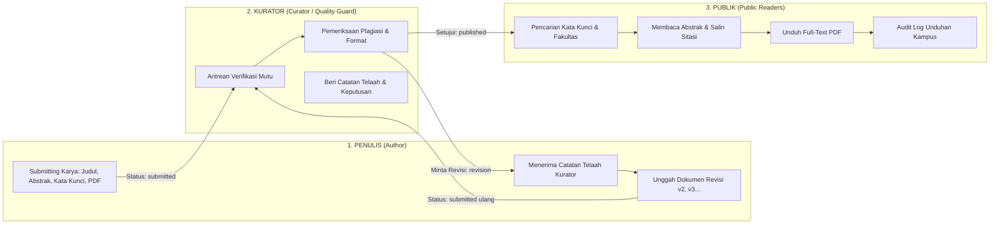

# PRODUCT REQUIREMENT DOCUMENT (PRD)
## LENTERA — Laman Etalase Karya Tulis Ilmiah Terpadu Akademik
### Universitas Madura (UNIRA)

---

## 1. Studi Kasus & Latar Belakang Asli

> *"Setiap tahun sebuah kampus menghasilkan ratusan karya: skripsi, tesis, jurnal, laporan penelitian, laporan kerja praktik. Karya-karya itu adalah memori intelektual kampus. Namun kenyataannya, karya menumpuk di rak pembimbing, tersimpan di flashdisk mahasiswa yang sudah lulus, atau tercecer di drive pribadi dosen. Ketika adik tingkat ingin mencari referensi tentang topik tertentu, mereka tidak tahu harus bertanya ke siapa. Ketika akreditasi tiba, program studi kelimpungan mengumpulkan bukti karya dalam waktu seminggu. Pengetahuan yang seharusnya mengalir justru mengendap.*
> 
> *Bayangkan sebuah etalase digital milik kampus sendiri. Mahasiswa mengunggah karyanya lengkap dengan judul, abstrak, kata kunci, dan file full-text. Karya itu tidak langsung tampil ke publik — ia antre untuk diperiksa kurator. Kurator membaca, memberi catatan, meminta revisi bila perlu, dan hanya karya yang layak yang diterbitkan. Setelah terbit, siapa pun bisa mencarinya lewat kata kunci, membacanya, dan mengunduhnya. Setiap unduhan tercatat, sehingga kampus tahu karya apa yang paling banyak dibaca. Skripsi yang dulu hanya dibaca penguji kini bisa menginspirasi ratusan mahasiswa berikutnya.*
> 
> **Penghuninya ada tiga: penulis yang submitting dan merevisi karyanya, kurator yang menjaga mutu etalase, serta publik yang datang untuk mencari dan membaca.**"

---

## 2. Prinsip Inti: Tiga Penghuni Repositori (The Triad Actors)

Sistem LENTERA berfokus total pada sinergi tiga aktor utama ini:

---

## 3. Matriks Hak Akses & Kewenangan (Role-Based Access Control)

| Fitur / Halaman | Publik (Guest) | Penulis (Author) | Kurator (Curator) | Super Admin (IT Ops) |
| :--- | :---: | :---: | :---: | :---: |
| **Pencarian Karya (Kata Kunci / Judul / Penulis)** | ✅ Ya (Penuh) | ✅ Ya | ✅ Ya | ✅ Ya |
| **Melihat Detail Naskah & Generator Sitasi** | ✅ Ya | ✅ Ya | ✅ Ya | ✅ Ya |
| **Unduh Berkas Full-Text PDF Terbit** | ✅ Ya (Tercatat Log) | ✅ Ya (Tercatat Log) | ✅ Ya | ✅ Ya |
| **Registrasi Akun Peneliti / Mahasiswa** | ✅ Ya | ❌ (Sudah login) | ❌ (Sudah login) | ❌ |
| **Unggah Naskah Baru (Submitting)** | ❌ Ditolak | ✅ Ya (`creates.php`) | ❌ Dibatasi ke Penulis | ❌ Dibatasi |
| **Dashboard Pemantauan Karya Pribadi** | ❌ Ditolak | ✅ Ya (`workss/indexs.php`) | ❌ Ditolak | ❌ Ditolak |
| **Melihat Catatan Kurator & Mengunggah Revisi** | ❌ Ditolak | ✅ Ya (`revises.php`) | ❌ Ditolak | ❌ Ditolak |
| **Antrean Kurasi Naskah Masuk (Editorial Queue)** | ❌ Ditolak | ❌ Ditolak (403) | ✅ Ya (`reviews/indexs.php`) | ✅ Ya (Supervisi) |
| **Workspace Kurasi & Form Keputusan Editorial** | ❌ Ditolak | ❌ Ditolak (403) | ✅ Ya | ✅ Ya |
| **Panel Master Data Fakultas, Prodi & Akun** | ❌ Ditolak | ❌ Ditolak (403) | ❌ Ditolak (403) | ✅ Ya (`admins/indexs.php`) |

---

## 4. Audit Komparasi: Memastikan Sistem Tidak Melenceng dari Studi Kasus

Berikut perbandingan mendalam antara kebutuhan studi kasus asli klien dengan implementasi kode aplikasi saat ini:

### A. Kebutuhan 1: Penulis yang "Submitting dan Merevisi Karyanya"
- **Bunyi Studi Kasus**: *"Mahasiswa mengunggah karyanya lengkap dengan judul, abstrak, kata kunci, dan file full-text. Karya itu tidak langsung tampil ke publik — ia antre untuk diperiksa kurator... merevisi karyanya bila perlu."*
- **Kondisi Implementasi Aplikasi**:
  1. **Submitting Lengkap**: Formulir `creates.php` mewajibkan: Judul naskah (min. 10 karakter), Abstrak lengkap (min. 30 karakter), Kata Kunci (dipisahkan koma), Tipe Karya (Skripsi/Tesis/Jurnal/Laporan), Program Studi, Tahun, Dosen Pembimbing, dan Berkas Dokumen Full-Text PDF (maks. 20MB, validasi MIME).
  2. **Tidak Langsung Tampil ke Publik**: Status awal naskah saat disimpan adalah `'submitted'`. Controller `work_controllers::stores` menyimpan status ini ke tabel `works`. Query pencarian publik (`search_public_works`) memiliki klausa mutlak `WHERE w.status = 'published'`, sehingga naskah yang baru diunggah **mustahil muncul atau terbaca oleh publik sebelum disetujui kurator**.
  3. **Revisi Bersiklus (Versioned Revisions)**: Jika kurator menetapkan keputusan `revision`, tombol *"Unggah Revisi"* aktif di dashboard penulis (`workss/indexs.php`). Penulis mengunggah file baru di `revises.php`. Sistem menonaktifkan versi lama (`is_current = 0`), menaikkan nomor versi (`v2`, `v3`...), dan mengembalikan status ke `'submitted'` untuk penelaahan kurator kembali.
- **Kesimpulan Audit**: **100% SESUAI & PRESISI.**

---

### B. Kebutuhan 2: Kurator yang "Menjaga Mutu Etalase"
- **Bunyi Studi Kasus**: *"Kurator membaca, memberi catatan, meminta revisi bila perlu, dan hanya karya yang layak yang diterbitkan... kurator yang menjaga mutu etalase."*
- **Kondisi Implementasi Aplikasi**:
  1. **Antrean Kurasi Khusus**: Halaman `reviews/indexs.php` hanya dapat diakses oleh akun ber-role `curator` atau `admin`. Role `author` atau publik yang mencoba mengakses langsung diblokir dan dialihkan ke login.
  2. **Pemeriksaan Lengkap (Workspace Kurasi)**: Kurator dapat membaca naskah PDF asli (`Galley PDF`), memeriksa teks abstrak, kata kunci, serta memastikan tingkat kemiripan (anti-plagiasi maks. 25%).
  3. **Keputusan Editorial 4 Tahap**:
     - `approve`: Setujui & Terbitkan (otomatis mengubah status karya menjadi `published`, mengaktifkan timestamp `published_at`, dan langsung tampil di etalase publik).
     - `in_review`: Menandai bahwa naskah sedang aktif dipelajari oleh tim mitra bestari.
     - `revision`: Minta Penulis Merevisi (wajib mengisi Catatan Telaah Kurator; naskah berpindah status menjadi `revision` dan catatan kurator otomatis muncul di akun penulis terkait).
     - `reject`: Menolak naskah yang tidak memenuhi etika ilmiah/plagiasi berat.
- **Kesimpulan Audit**: **100% SESUAI & PRESISI.**

---

### C. Kebutuhan 3: Publik yang "Mencari, Membaca, dan Mengunduh (Tercatat)"
- **Bunyi Studi Kasus**: *"Setelah terbit, siapa pun bisa mencarinya lewat kata kunci, membacanya, dan mengunduhnya. Setiap unduhan tercatat, sehingga kampus tahu karya apa yang paling banyak dibaca. Skripsi yang dulu hanya dibaca penguji kini bisa menginspirasi ratusan mahasiswa berikutnya."*
- **Kondisi Implementasi Aplikasi**:
  1. **Akses Publik Bebas Hambatan**: Publik (mahasiswa adik tingkat, dosen, tamu luar) tidak diwajibkan mendaftar/login untuk mencari karya, membaca abstrak, dan menyalin sitasi akademik.
  2. **Pencarian Berbasis Kata Kunci Pintar**: Portal pencarian (`searchs/indexs.php`) mencocokkan kata kunci ke tabel relasi `work_keywords`, judul naskah, nama penulis, dan teks abstrak, dilengkapi filter fakultas & prodi.
  3. **Pencatatan Audit Unduhan Realtime**: Saat berkas diunduh melalui `downloads.php`, sistem secara otomatis mengeksekusi:
     - `UPDATE works SET download_count = download_count + 1 WHERE id = :work_ids`
     - `INSERT INTO download_logs (work_id, user_id, ip_address, user_agent, downloaded_at) VALUES (...)`
  4. **Etalase Statistik Akreditasi**: Halaman `statisticss/indexs.php` menyajikan peringkat karya paling banyak dibaca dan diunduh, serta grafik koleksi per fakultas, menjawab tuntas kebutuhan pelaporan akreditasi kampus.
- **Kesimpulan Audit**: **100% SESUAI & PRESISI.**

---

### D. Mengenai Keberadaan "Super Admin": Mengapa Ada dan Di Mana Posisinya?
- **Potensi Kekeliruan Pemahaman**: Jika Super Admin dianggap sebagai aktor konten harian repositori, itu keliru.
- **Kedudukan yang Benar Sesuai Arsitektur Perangkat Lunak**:
  - Tiga penghuni repositori adalah **Penulis, Kurator, dan Publik**. Merekalah yang menggerakkan pertukaran ilmu pengetahuan.
  - Super Admin **bukan penghuni konten**, melainkan **operator infrastruktur sistem** (Technical Operator) yang bertugas:
    - Menyiapkan daftar fakultas & prodi UNIRA agar dapat dipilih penulis saat mendaftar.
    - Mengangkat dosen/peneliti menjadi Kurator.
    - Menjaga keaktifan server dan mengaudit log sistem.
  - Dengan demikian, Super Admin tidak menggantikan atau merusak peran dari ketiga penghuni utama tersebut.

---

## 5. Rangkuman Kredensial Pengujian untuk 3 Penghuni Utama

| Aktor | Akun Pengujian | Sandi | Halaman Utama |
| :--- | :--- | :--- | :--- |
| **1. Penulis (Author)** | `bangmam456@gmail.com` atau `ImamHambali_001` | `Imam Hambali 001` | `http://localhost/lentera/frontends/webs/viewss/workss/indexs.php` |
| **2. Kurator (Curator)** | `imamdhespachito001@gmail.com` atau `imam_hambali_001` | `Imam Hambali 001` | `http://localhost/lentera/frontends/webs/viewss/reviews/indexs.php` |
| **3. Publik (Guest)** | *(Tanpa Akun)* | *(Tanpa Sandi)* | `http://localhost/lentera/frontends/webs/indexs.php` |
| *(Opsional) IT Admin* | `admin@lentera.unira.ac.id` atau `admin_lentera` | `Imam Hambali 001` | `http://localhost/lentera/frontends/webs/viewss/admins/indexs.php` |
