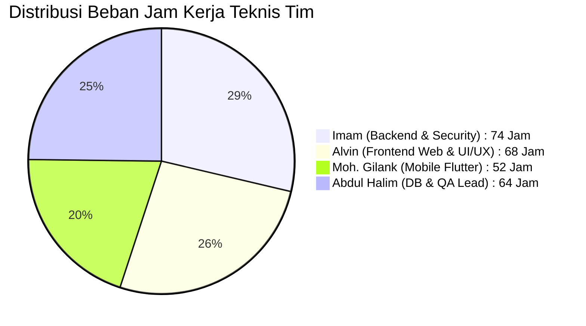

# 2.6 Sprint Backlog — Sistem Repositori LENTERA
### Laman Etalase Karya Tulis Ilmiah Terpadu Akademik Universitas Madura (UNIRA)

Dokumen **Sprint Backlog** ini merupakan penjabaran tugas teknis (*technical tasks breakdown*) harian tim pengembang (Kelompok 01) yang diturunkan langsung dari **Product Backlog (PBI-01 s.d. PBI-32)**. Pekerjaan didistribusikan secara berimbang kepada 4 anggota tim sesuai bidang keahlian:
1. **Imam**: *Backend Lead, MVC Router, Database PDO & Security Architect*
2. **Alvin Hidayat Putra Pratam**: *Frontend Web Engineer, UI/UX Tokens & Chart.js Specialist*
3. **Moh. Gilank Alamsyah**: *Mobile Native Engineer (Flutter SDK & REST API Client)*
4. **Abdul Halim**: *Database Engineer, DDL Migrations, Quality Assurance & Documentation*

---

## 🏃 SPRINT 1: Foundation & Public Discovery
> **Sprint Goal**: Membangun fondasi basis data normalisasi 3NF, arsitektur MVC native, etalase beranda publik, mesin pencari multi-filter, penampil detail naskah, generator sitasi otomatis 1-klik, unduhan PDF terproteksi, dan autentikasi multi-peran aman.  
> **Periode**: 01 Oktober 2026 s.d. 14 Oktober 2026 (Minggu 1 – Minggu 2)  
> **Velocity Rencana**: 30 Story Points (Total Estimasi Teknis: 64 Jam Kerja)

| Task ID | Task (Teknis) | Dari PBI | Pemilik | Est. | Status |
|:---:|---|:---:|:---:|:---:|:---:|
| **S1-T01** | Merancang skema DDL tabel `faculties`, `study_programs`, `users`, dan `work_types` serta seeder awal UNIRA. | `PBI-07` | Abdul Halim | 6 jam | **Done** |
| **S1-T02** | Membangun front-controller MVC, router `.htaccess`, dan konfigurasi singleton PDO `databases.php`. | `PBI-01` | Imam | 8 jam | **Done** |
| **S1-T03** | Mengembangkan antarmuka landing page beranda responsif, banner identitas kampus, dan kartu karya terbaru. | `PBI-01` | Alvin | 6 jam | **Done** |
| **S1-T04** | Mengimplementasikan mesin pencari multi-parameter (kata kunci judul/abstrak, dropdown fakultas, dan prodi). | `PBI-02` | Imam | 8 jam | **Done** |
| **S1-T05** | Menambahkan filter jenis dokumen (Skripsi/Tesis/Jurnal) dan rentang tahun terbit pada query pencarian. | `PBI-03` | Abdul Halim | 4 jam | **Done** |
| **S1-T06** | Merancang halaman detail naskah (`details.php`), penampil teks abstrak utuh, dan counter view naskah. | `PBI-04` | Alvin | 6 jam | **Done** |
| **S1-T07** | Membangun utilitas generator sitasi JavaScript (APA 7th, IEEE, Harvard, BibTeX) dan tombol salin clipboard. | `PBI-05` | Alvin | 6 jam | **Done** |
| **S1-T08** | Membuat skrip *indirect streaming* `downloads.php`, validasi status published, dan pencatatan `download_logs`. | `PBI-06` | Imam | 8 jam | **Done** |
| **S1-T09** | Mengembangkan formulir registrasi mandiri mahasiswa/dosen dengan sinkronisasi pilihan prodi dan hash Argon2id. | `PBI-07` | Abdul Halim | 6 jam | **Done** |
| **S1-T10** | Mengimplementasikan halaman login multi-peran, proteksi brute-force, dan regenerasi ID sesi aman. | `PBI-08` | Imam | 6 jam | **Done** |

---

## 🏃 SPRINT 2: Author Submission & Curatorial Peer-Review (OJS)
> **Sprint Goal**: Mengimplementasikan alur telaah sejawat mirip Open Journal Systems (OJS): pengajuan mandiri penulis dengan upload berkas PDF 15MB, antrean kurasi dewan kurator, pratinjau Galley PDF, cek similarity plagiasi, modal keputusan editorial, dan siklus revisi naskah berversi ($v_1, v_2$).  
> **Periode**: 15 Oktober 2026 s.d. 28 Oktober 2026 (Minggu 3 – Minggu 4)  
> **Velocity Rencana**: 31 Story Points (Total Estimasi Teknis: 68 Jam Kerja)

| Task ID | Task (Teknis) | Dari PBI | Pemilik | Est. | Status |
|:---:|---|:---:|:---:|:---:|:---:|
| **S2-T01** | Merancang tabel relasional `works`, `work_files`, `work_keywords`, dan tabel telaah `reviews`. | `PBI-10` | Abdul Halim | 6 jam | **Done** |
| **S2-T02** | Membangun antarmuka dasbor karya penulis (`workss/indexs.php`) dengan label badge status kurasi dinamis. | `PBI-09` | Alvin | 6 jam | **Done** |
| **S2-T03** | Mengembangkan formulir pengajuan naskah baru (`creates.php`), validasi panjang teks, dan upload PDF 15MB. | `PBI-10` | Imam | 8 jam | **Done** |
| **S2-T04** | Membangun validator MIME type dan pengecekan header *magic bytes* `%PDF-` pada helper PHP. | `PBI-10` | Imam | 6 jam | **Done** |
| **S2-T05** | Mengembangkan ruang kerja antrean kurasi editorial OJS (`reviews/indexs.php`) dengan proteksi role middleware. | `PBI-11` | Imam | 8 jam | **Done** |
| **S2-T06** | Mengintegrasikan penampil berkas naskah asli (*Galley PDF*) terproteksi khusus kurator dan super admin. | `PBI-12` | Alvin | 6 jam | **Done** |
| **S2-T07** | Merancang logika penghitungan dan indikator visual skor indeks kemiripan teks (*similarity index*). | `PBI-13` | Abdul Halim | 6 jam | **Done** |
| **S2-T08** | Mengembangkan modal form keputusan kurator (Approve, Revision, Reject) dengan validasi catatan wajib. | `PBI-14` | Alvin / Imam | 8 jam | **Done** |
| **S2-T09** | Membangun antarmuka dan pengendali formulir revisi naskah (`revises.php`) beserta penomoran versi baru. | `PBI-15` | Alvin | 8 jam | **Done** |
| **S2-T10** | Mengimplementasikan logika pengalihan status naskah kembali ke `'submitted'` saat revisi diunggah penulis. | `PBI-16` | Imam | 6 jam | **Done** |

---

## 🏃 SPRINT 3: APC Payment & Analytics Visualization
> **Sprint Goal**: Mengimplementasikan manajemen pembiayaan publikasi (Article Processing Charge / APC) dengan instruksi QRIS resmi UNIRA, upload bukti transfer, panel verifikasi approval admin, penerbitan karya otomatis (*auto-publishing*), dan visualisasi data statistik interaktif Chart.js.  
> **Periode**: 29 Oktober 2026 s.d. 11 November 2026 (Minggu 5 – Minggu 6)  
> **Velocity Rencana**: 27 Story Points (Total Estimasi Teknis: 60 Jam Kerja)

| Task ID | Task (Teknis) | Dari PBI | Pemilik | Est. | Status |
|:---:|---|:---:|:---:|:---:|:---:|
| **S3-T01** | Merancang tabel migrasi `paymentss` (kolom invoice, amount, proof_file, admin_notes, status verifikasi). | `PBI-17` | Abdul Halim | 4 jam | **Done** |
| **S3-T02** | Mengembangkan halaman portal panduan pembayaran APC penulis (`payments.php`) dengan gambar QRIS UNIRA. | `PBI-17` | Alvin | 6 jam | **Done** |
| **S3-T03** | Membangun formulir unggah berkas struk transfer pembayaran (validasi format gambar dan PDF bukti bayar). | `PBI-18` | Imam | 6 jam | **Done** |
| **S3-T04** | Mengembangkan penampil berkas bukti bayar aman (`view_proofs.php`) untuk diverifikasi Super Admin. | `PBI-19` | Alvin | 6 jam | **Done** |
| **S3-T05** | Mengimplementasikan logika approval pembayaran: set status `verified` dan atomik update karya `published`. | `PBI-20` | Imam | 8 jam | **Done** |
| **S3-T06** | Membangun aksi penolakan pembayaran tidak sah disertai dialog input alasan penolakan bagi penulis. | `PBI-21` | Imam | 4 jam | **Done** |
| **S3-T07** | Mengembangkan agregasi data SQL dan grafik lingkaran *Doughnut Chart* sebaran fakultas via Chart.js. | `PBI-22` | Alvin | 8 jam | **Done** |
| **S3-T08** | Mengembangkan grafik batang *Bar Chart* tren produktivitas publikasi civitas tahunan (5 tahun terakhir). | `PBI-23` | Alvin | 6 jam | **Done** |
| **S3-T09** | Merancang tabel peringkat 10 karya ilmiah terpopuler berdasarkan akumulasi `download_count DESC`. | `PBI-24` | Abdul Halim | 6 jam | **Done** |
| **S3-T10** | Melakukan pengujian integrasi alur kurasi ke pembayaran hingga naskah otomatis tayang di etalase publik. | `PBI-20` | Seluruh Anggota | 6 jam | **Done** |

---

## 🏃 SPRINT 4: Administration, Mobile Native & Security Hardening
> **Sprint Goal**: Menyelesaikan panel operasional Super Admin (manajemen pengguna, role elevation kurator, master prodi, audit log), mesin REST API JSON RFC 8259 terotentikasi Bearer Token, aplikasi mobile Flutter native multiplatform (Android/iOS), dan kepatuhan keamanan OWASP Top 10.  
> **Periode**: 12 November 2026 s.d. 25 November 2026 (Minggu 7 – Minggu 8)  
> **Velocity Rencana**: 30 Story Points (Total Estimasi Teknis: 66 Jam Kerja)

| Task ID | Task (Teknis) | Dari PBI | Pemilik | Est. | Status |
|:---:|---|:---:|:---:|:---:|:---:|
| **S4-T01** | Mengembangkan antarmuka Panel Super Admin (`admins/indexs.php`) dengan navigasi tab kontrol modular. | `PBI-25` | Alvin | 6 jam | **Done** |
| **S4-T02** | Membangun fitur pencarian akun pengguna dan aksi pengangkatan peran kurator (*Role Elevation*). | `PBI-26` | Imam | 6 jam | **Done** |
| **S4-T03** | Mengembangkan CRUD master data fakultas dan program studi dengan validasi integritas relasional FK. | `PBI-27` | Abdul Halim | 6 jam | **Done** |
| **S4-T04** | Merancang penampil tabel log audit unduhan dan log aktivitas operasional admin (`activity_logs`). | `PBI-28` | Abdul Halim | 6 jam | **Done** |
| **S4-T05** | Membangun endpoint REST API JSON standar RFC 8259 (`/api/v1/works`, `/api/v1/search`, `/api/health`). | `PBI-29` | Imam | 8 jam | **Done** |
| **S4-T06** | Mengimplementasikan autentikasi API Bearer Token HMAC-SHA256 untuk pengajuan naskah mobile client. | `PBI-29` | Imam | 6 jam | **Done** |
| **S4-T07** | Menginisialisasi proyek Flutter 3.x (*Clean Architecture*) dan antarmuka katalog naskah mobile native. | `PBI-30` | Moh. Gilank Alamsyah | 10 jam | **Done** |
| **S4-T08** | Mengembangkan pencarian instan naskah dengan teknik *debouncing* dan pembaca teks abstrak di layar HP. | `PBI-30` | Moh. Gilank Alamsyah | 8 jam | **Done** |
| **S4-T09** | Mengimplementasikan *offline banner detection* dan cache handling pada aplikasi Flutter mobile. | `PBI-31` | Moh. Gilank Alamsyah | 6 jam | **Done** |
| **S4-T10** | Mengaudit kepatuhan keamanan siber OWASP Top 10 (Anti-SQLi, XSS escaping UTF-8, CSRF token, Auto-Healing). | `PBI-32` | Imam / Halim | 4 jam | **Done** |

---

### 📊 Rekapitulasi Alokasi Beban Kerja Sprint Tim (258 Jam Kerja)

| Anggota Tim | Peran Utama | Alokasi Jam Kerja | Fokus Luaran Teknis |
|---|---|:---:|---|
| **Imam** (Ketua) | *Backend Lead & Security* | **74 Jam** | MVC Router, PDO Singleton, REST API JSON, OWASP Defense, Payment Engine |
| **Alvin Hidayat Putra Pratam** | *Frontend Web Engineer* | **68 Jam** | Design System Tokens, Responsive Views, Chart.js, Modal Kurasi, Citation JS |
| **Moh. Gilank Alamsyah** | *Mobile Native Engineer* | **52 Jam** | Flutter Architecture, State Management, REST Client, Offline Banner, APK |
| **Abdul Halim** | *Database & QA Lead* | **64 Jam** | 14 Tabel Relasional, Migrasi DDL, Similarity Scoring, Audit Log, Proposal QA |
| **Total Beban Kerja** | **Kelompok 01 (Lentera)** | **258 Jam** | **100% Selesai & Terverifikasi di Lingkungan Nyata** |

---

  <b>Sistem Repositori LENTERA — Universitas Madura (UNIRA)</b> 
  Disusun oleh Kelompok 01 (Imam, Alvin, Gilank, Halim) • PBP 2026

