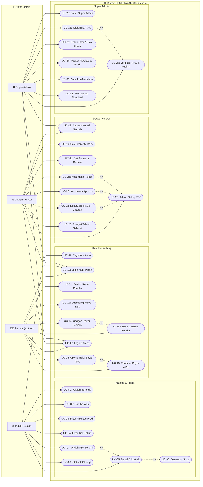
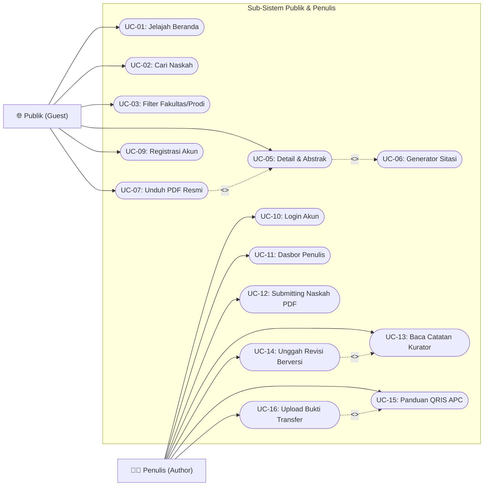
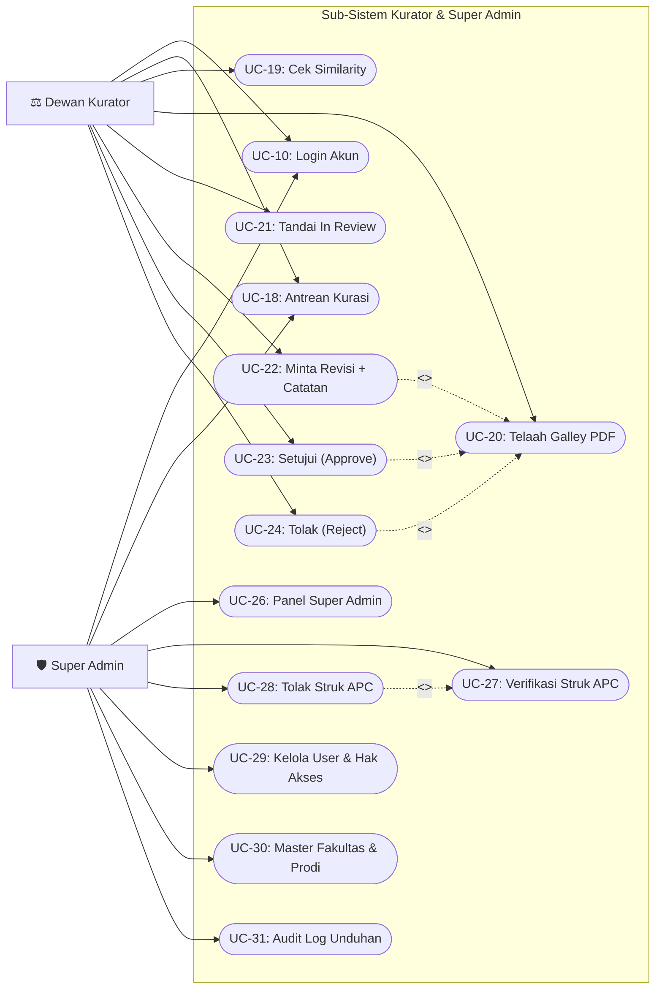

# 2.2 Use Case — Sistem Repositori LENTERA
### Laman Etalase Karya Tulis Ilmiah Terpadu Akademik Universitas Madura (UNIRA)

Dokumen ini memetakan rancangan fungsionalitas sistem LENTERA menggunakan pemodelan **Use Case Diagram** berstandar StarUML dan PlantUML. Seluruh use case merepresentasikan secara presisi kebutuhan yang tertuang dalam **52 User Story (`US-01` s.d. `US-52`)**.

---

### A. Inventaris & Pemetaan 32 Use Case terhadap User Story

Daftar use case dikelompokkan ke dalam 4 peran pengguna (*Publik*, *Penulis*, *Kurator*, dan *Super Admin*), menghasilkan **32 Use Case (UC-01 s.d. UC-32)** yang mencakup seluruh alur sistem:

| Kelompok Peran | ID Use Case | Nama Use Case | Pemetaan User Story (US) |
|---|:---:|---|---|
| **1. Publik (Guest)** | **UC-01** | Menjelajah Beranda & Katalog Karya Terbit Terbaru | `US-11`, `US-13` |
| | **UC-02** | Mencari Naskah Ilmiah via Kata Kunci (Judul/Abstrak) | `US-01` |
| | **UC-03** | Menyaring Naskah Berdasarkan Fakultas & Program Studi | `US-02`, `US-10` |
| | **UC-04** | Menyaring Naskah Berdasarkan Tipe Dokumen & Tahun | `US-03`, `US-04` |
| | **UC-05** | Melihat Detail Naskah & Membaca Teks Abstrak Lengkap | `US-05` |
| | **UC-06** | Menggunakan Generator Sitasi Otomatis (APA/IEEE/Harvard/BibTeX) | `US-06`, `US-07`, `US-08` |
| | **UC-07** | Mengunduh Berkas Naskah PDF Resmi (Tercatat Log) | `US-09` |
| | **UC-08** | Melihat Visualisasi Statistik Sebaran & Tren (Chart.js) | `US-12` |
| **2. Penulis (Author)** | **UC-09** | Mendaftar Akun Penulis Baru (Registrasi Mahasiswa/Dosen) | `US-14` |
| | **UC-10** | Masuk ke Akun (Login Berbasis Peran) | `US-15` |
| | **UC-11** | Mengakses Dasbor Karya Penulis (Monitoring Status Naskah) | `US-19`, `US-27` |
| | **UC-12** | Mengunggah Naskah Ilmiah Baru (Submitting Judul & PDF) | `US-16`, `US-17`, `US-18` |
| | **UC-13** | Membaca Catatan Evaluasi & Masukan Perbaikan Kurator | `US-20` |
| | **UC-14** | Mengunggah Dokumen Naskah Revisi Berversi (v2, v3...) | `US-21`, `US-22` |
| | **UC-15** | Mengakses Portal & Panduan Pembayaran APC (QRIS & VA) | `US-23`, `US-24` |
| | **UC-16** | Mengunggah Bukti Struk Transfer Pembayaran APC | `US-25`, `US-26` |
| | **UC-17** | Keluar Sesi Akun (Logout Aman) | Seluruh Peran Terotentikasi |
| **3. Dewan Kurator** | **UC-18** | Mengakses Ruang Kerja Antrean Kurasi (Editorial Queue) | `US-28`, `US-36`, `US-39` |
| | **UC-19** | Memeriksa Skor Indeks Kemiripan Teks (Similarity Check) | `US-29` |
| | **UC-20** | Membuka & Menelaah Naskah Galley PDF Terproteksi | `US-30`, `US-38` |
| | **UC-21** | Menandai Status Naskah 'In Review' | `US-31` |
| | **UC-22** | Memberikan Keputusan 'Revision' Beserta Catatan Perbaikan | `US-33`, `US-35` |
| | **UC-23** | Memberikan Keputusan 'Approve' (Setujui Mutu Naskah) | `US-32` |
| | **UC-24** | Memberikan Keputusan 'Reject' (Tolak Naskah Ilmiah) | `US-34` |
| | **UC-25** | Melihat Riwayat Rekam Jejak Keputusan Kurasi Pribadi | `US-37` |
| **4. Super Admin** | **UC-26** | Mengakses Panel Kontrol Super Admin | `US-40` |
| | **UC-27** | Memverifikasi Struk APC & Menerbitkan Naskah ke Publik | `US-41`, `US-42`, `US-43` |
| | **UC-28** | Menolak Bukti Pembayaran APC Tidak Valid | `US-44` |
| | **UC-29** | Mengelola Data Pengguna & Hak Akses (Role Elevation Kurator) | `US-45`, `US-46` |
| | **UC-30** | Mengelola Master Data Fakultas & Program Studi UNIRA | `US-47` |
| | **UC-31** | Memantau Audit Log Unduhan Naskah & Log Aktivitas Sistem | `US-48`, `US-50` |
| | **UC-32** | Mengakses Rekapitulasi Borang Akreditasi & Konfigurasi Tarif | `US-49`, `US-51`, `US-52` |

---

### B. Diagram Use Case (3 Visual Diagram)

#### 1. Gambar 3.1 — Diagram Use Case Keseluruhan Sistem LENTERA
Diagram global yang menghubungkan 4 aktor peran terhadap 32 fungsi utama sistem:

> **Tools:** StarUML v5.x / PlantUML | **File sumber:** `docs/diagram/usecase.puml`

 

---

#### 2. Gambar 3.2 — Diagram Use Case Sub-Sistem Publik & Penulis
Fokus pada alur pencarian, pembacaan naskah, pengajuan karya mandiri, revisi berkas, hingga pembayaran APC:

> **Tools:** StarUML v5.x / PlantUML | **File sumber:** `docs/diagram/usecase_publik_penulis.puml`

 

---

#### 3. Gambar 3.3 — Diagram Use Case Sub-Sistem Kurator & Super Admin
Fokus pada alur penelaahan mutu OJS, evaluasi plagiasi, verifikasi pembayaran APC, dan manajemen data:

> **Tools:** StarUML v5.x / PlantUML | **File sumber:** `docs/diagram/usecase_kurator_admin.puml`

 

---

### C. Tabel 3.1 — Skenario Detail Use Case

Berikut adalah penjabaran skenario detail untuk use case representatif dari masing-masing peran pengguna:

---

#### 1. Skenario Detail: UC-02 (Pencarian Naskah Ilmiah via Kata Kunci)
| Field | Isi |
|---|---|
| **ID + Nama** | **UC-02: Mencari Naskah Ilmiah via Kata Kunci (Judul/Abstrak)** |
| **Aktor primer & tujuan** | **Publik (Guest / Mahasiswa)**: Menemukan naskah karya ilmiah yang relevan dengan topik risetnya secara cepat tanpa login. |
| **Precondition** | Sistem web Lentera aktif dan basis data `works` memiliki koleksi naskah berstatus `published`. |
| **Postcondition** | Sistem menyajikan daftar naskah yang cocok beserta cuplikan judul, nama penulis, prodi, dan tahun terbit. |
| **Main flow (numbered)** | 1. Pengguna membuka halaman muka repositori atau halaman pencarian (`/search`). 2. Pengguna mengetikkan kata kunci pada kolom pencarian (misal: "Kriptografi", "Machine Learning"). 3. Pengguna menekan tombol "Cari Naskah" atau menekan tombol Enter. 4. Sistem memproses permintaan melalui parameterized query pada kolom judul, abstrak, dan relasi kata kunci. 5. Sistem merender daftar naskah yang cocok dengan pagination terstruktur. |
| **Alternate flow** | **4a. Jika kata kunci tidak ditemukan pada basis data:** &nbsp;&nbsp;&nbsp;&nbsp;1. Sistem menampilkan komponen *empty state* informatif: "Tidak ada karya ilmiah yang cocok dengan kata kunci tersebut". &nbsp;&nbsp;&nbsp;&nbsp;2. Sistem memberikan saran kata kunci populer atau opsi mereset filter. |
| **Aturan bisnis** | • Hanya naskah berstatus `'published'` yang boleh ditampilkan ke publik. • Input pencarian wajib disanitasi dari karakter injeksi SQL melalui PDO prepared statements. |

---

#### 2. Skenario Detail: UC-06 (Generator Sitasi Otomatis)
| Field | Isi |
|---|---|
| **ID + Nama** | **UC-06: Menggunakan Generator Sitasi Otomatis (APA/IEEE/Harvard/BibTeX)** |
| **Aktor primer & tujuan** | **Publik / Peneliti**: Menyalin sitasi resmi naskah ilmiah ke clipboard dalam format akademik standar dalam 1 sentuhan. |
| **Precondition** | Pengguna sedang berada pada halaman detail naskah (`details.php?id={work_id}`). |
| **Postcondition** | Teks sitasi dengan format yang dipilih berhasil tersalin ke clipboard sistem pengguna. |
| **Main flow (numbered)** | 1. Pengguna melihat kotak "Generator Sitasi Ilmiah" pada halaman detail naskah. 2. Pengguna memilih format gaya sitasi yang diinginkan (default: APA 7th Edition). 3. Sistem menggenerasi teks sitasi secara otomatis berdasarkan metadata penulis, tahun, dan judul naskah. 4. Pengguna mengklik tombol "Salin Sitasi". 5. Sistem menyalin string sitasi ke *clipboard* peramban dan memunculkan animasi umpan balik centang hijau ("Tersalin!"). |
| **Alternate flow** | **4a. Jika fitur clipboard peramban diblokir oleh perizinan sistem:** &nbsp;&nbsp;&nbsp;&nbsp;1. Sistem memblok teks sitasi secara otomatis (`execCommand('select')`) agar pengguna dapat menekan Ctrl+C secara manual. |
| **Aturan bisnis** | • Format APA wajib mengikuti pola: `Penulis, (Tahun). Judul naskah. Universitas Madura.` • Format IEEE wajib menggunakan tanda kurung siku penomoran: `[1] Penulis, "Judul," UNIRA, Tahun.` |

---

#### 3. Skenario Detail: UC-07 (Mengunduh Berkas Naskah PDF Resmi)
| Field | Isi |
|---|---|
| **ID + Nama** | **UC-07: Mengunduh Berkas Naskah PDF Resmi (Tercatat Log)** |
| **Aktor primer & tujuan** | **Publik / Peneliti**: Mengunduh berkas lengkap (*full-text PDF*) untuk dipelajari secara offline. |
| **Precondition** | Naskah yang dipilih berstatus `published` dan memiliki berkas fisik di direktori terlindungi. |
| **Postcondition** | Berkas PDF terunduh ke perangkat pengguna, nilai counter unduhan bertambah +1, dan entri tercatat di `download_logs`. |
| **Main flow (numbered)** | 1. Pengguna mengklik tombol "Unduh Naskah PDF" pada halaman detail naskah. 2. Permintaan diteruskan ke skrip streaming aman `downloads.php?id={work_id}`. 3. Sistem memverifikasi bahwa status naskah adalah `published`. 4. Sistem mencatat alamat IP pengunjung, User-Agent, dan timestamp ke tabel `download_logs`. 5. Sistem mengupdate counter `download_count = download_count + 1` pada tabel `works`. 6. Sistem mengalirkan biner PDF melalui HTTP header `Content-Type: application/pdf` dan browser memulai proses unduh. |
| **Alternate flow** | **3a. Jika naskah berstatus draft/submitted dan pengunduh bukan pemilik sah/kurator:** &nbsp;&nbsp;&nbsp;&nbsp;1. Sistem menolak permintaan dengan kode HTTP 403 Forbidden dan pesan "Dokumen belum dipublikasikan". **6a. Jika berkas fisik PDF tidak ditemukan pada media penyimpanan server:** &nbsp;&nbsp;&nbsp;&nbsp;1. Sistem mencatat log internal dan menampilkan halaman galat 404 informatif tanpa membocorkan path direktori server. |
| **Aturan bisnis** | • Berkas PDF tidak boleh memiliki URL langsung statis (wajib melewati *indirect protected stream*). |

---

#### 4. Skenario Detail: UC-12 (Mengunggah Naskah Ilmiah Baru)
| Field | Isi |
|---|---|
| **ID + Nama** | **UC-12: Mengunggah Naskah Ilmiah Baru (Submitting Judul & PDF)** |
| **Aktor primer & tujuan** | **Penulis (Author)**: Mendaftarkan naskah skripsi/jurnal baru ke repositori agar dapat ditelaah oleh dewan kurator. |
| **Precondition** | Penulis telah terotentikasi dan login dengan peran `author`. |
| **Postcondition** | Naskah baru tersimpan dengan status `'submitted'` dan masuk ke dalam antrean kurasi OJS. |
| **Main flow (numbered)** | 1. Penulis mengakses menu "Unggah Naskah" (`creates.php`). 2. Penulis menginput Judul Naskah (min. 10 karakter), Abstrak (min. 30 karakter), Kata Kunci, Tipe Karya, Tahun, dan Dosen Pembimbing. 3. Penulis memilih berkas naskah format PDF dari komputernya. 4. Penulis menekan tombol "Ajukan Naskah ke Kurator". 5. Sistem memvalidasi token CSRF, validitas input teks, ukuran file ($\le 15\text{MB}$), dan MIME type `%PDF-`. 6. Sistem mengunggah file dengan nama acak unik di `uploads/works/` dan mencatat data ke tabel `works` serta `work_files`. 7. Sistem mengarahkan penulis kembali ke dasbor dengan notifikasi sukses "Naskah berhasil diajukan dan sedang antre ditelaah". |
| **Alternate flow** | **5a. Jika format berkas bukan PDF atau melebihi 15 MB:** &nbsp;&nbsp;&nbsp;&nbsp;1. Sistem membatalkan proses upload dan mempertahankan isian formulir. &nbsp;&nbsp;&nbsp;&nbsp;2. Sistem menampilkan pesan galat: "Berkas wajib berformat PDF asli dengan ukuran maksimal 15 MB". **5b. Jika judul naskah kurang dari 10 karakter:** &nbsp;&nbsp;&nbsp;&nbsp;1. Sistem menampilkan peringatan validasi pada kolom judul. |
| **Aturan bisnis** | • Status awal naskah mutlak `'submitted'`. • Naskah yang baru diajukan dilarang keras tampil di pencarian publik sebelum ada keputusan kurator. |

---

#### 5. Skenario Detail: UC-14 (Mengunggah Dokumen Naskah Revisi Berversi)
| Field | Isi |
|---|---|
| **ID + Nama** | **UC-14: Mengunggah Dokumen Naskah Revisi Berversi (v2, v3...)** |
| **Aktor primer & tujuan** | **Penulis (Author)**: Mengunggah berkas naskah yang telah diperbaiki sesuai arahan kurator agar dapat ditelaah kembali. |
| **Precondition** | Naskah milik penulis berstatus `revision` dan kurator telah memberikan catatan evaluasi. |
| **Postcondition** | Berkas revisi tersimpan dengan nomor versi baru (`v2`, `v3`...), dan status naskah kembali menjadi `'submitted'`. |
| **Main flow (numbered)** | 1. Penulis membuka halaman Dasbor Karya Saya dan melihat naskah berstatus oranye "Perlu Revisi". 2. Penulis membaca catatan telaah dari kurator lalu mengklik tombol "Unggah Revisi" (`revises.php`). 3. Penulis mengunggah file PDF naskah revisi baru dan menuliskan tanggapan perbaikan. 4. Penulis mengklik tombol "Kirim Dokumen Revisi". 5. Sistem memvalidasi berkas PDF, menonaktifkan versi sebelumnya (`is_current = 0`), dan menyimpan versi baru (`version = 2`, `is_current = 1`). 6. Sistem memperbarui status naskah kembali menjadi `'submitted'`. 7. Sistem menampilkan pesan sukses dan naskah kembali masuk ke antrean kurator. |
| **Alternate flow** | **5a. Jika berkas revisi yang diunggah tidak valid:** &nbsp;&nbsp;&nbsp;&nbsp;1. Sistem menolak berkas dan versi naskah lama tetap aktif. &nbsp;&nbsp;&nbsp;&nbsp;2. Sistem meminta penulis memilih kembali berkas PDF yang benar. |
| **Aturan bisnis** | • Naskah hanya dapat direvisi jika statusnya sedang berada pada state `revision`. • Riwayat berkas versi terdahulu tetap dipertahankan dalam basis data untuk keperluan audit komparasi kurator. |

---

#### 6. Skenario Detail: UC-16 (Mengunggah Bukti Struk Bayar APC)
| Field | Isi |
|---|---|
| **ID + Nama** | **UC-16: Mengunggah Bukti Struk Bayar APC** |
| **Aktor primer & tujuan** | **Penulis (Author)**: Mengirimkan konfirmasi pelunasan biaya publikasi APC agar karya dapat diverifikasi admin dan diterbitkan. |
| **Precondition** | Naskah telah lolos kurasi dan berstatus `waiting_payment`. |
| **Postcondition** | Berkas bukti transfer tersimpan di `uploads/payment/` dan status pembayaran menjadi `pending_verification`. |
| **Main flow (numbered)** | 1. Penulis mengklik tombol "Bayar Biaya Publikasi APC" pada kartu naskah di dasbornya. 2. Sistem menampilkan portal pembayaran dengan rincian invoice, nominal tagihan, dan QRIS resmi UNIRA. 3. Penulis melakukan pembayaran dan mengunggah gambar/foto struk bukti transfer. 4. Penulis menekan tombol "Kirim Konfirmasi Pembayaran". 5. Sistem memvalidasi ekstensi gambar (`.jpg`, `.jpeg`, `.png`, `.pdf`) dan mencatatnya ke tabel `payments`. 6. Status pembayaran diperbarui menjadi `pending_verification` dan menunggu persetujuan Super Admin. |
| **Alternate flow** | **5a. Jika berkas bukti bukan format gambar atau PDF:** &nbsp;&nbsp;&nbsp;&nbsp;1. Sistem menolak unggahan dan menampilkan pesan peringatan format file tidak valid. |
| **Aturan bisnis** | • Hanya naskah yang telah disetujui kurator (`waiting_payment`) yang dapat memproses transaksi APC. |

---

#### 7. Skenario Detail: UC-20 (Membuka & Menelaah Galley PDF)
| Field | Isi |
|---|---|
| **ID + Nama** | **UC-20: Membuka & Menelaah Naskah Galley PDF Terproteksi** |
| **Aktor primer & tujuan** | **Dewan Kurator**: Memeriksa kelayakan konten, metode, dan kepatuhan format naskah akademik sebelum mengambil keputusan telaah. |
| **Precondition** | Kurator telah login dan membuka halaman antrean naskah masuk (`/reviews/indexs.php`). |
| **Postcondition** | Dokumen Galley PDF naskah terbuka pada tab peramban baru untuk dipelajari kurator. |
| **Main flow (numbered)** | 1. Kurator melihat daftar naskah berstatus `submitted` atau `in_review` pada tabel kurasi. 2. Kurator mengklik tombol "Buka Naskah Galley PDF". 3. Sistem memeriksa sesi dan wewenang kurator di middleware. 4. Sistem mengalirkan dokumen PDF asli dari media penyimpanan aman ke viewer peramban. 5. Kurator menelaah kelayakan struktur penulisan, orisinalitas ide, dan kesesuaian abstrak. |
| **Alternate flow** | **3a. Jika sesi login kurator telah habis (expired):** &nbsp;&nbsp;&nbsp;&nbsp;1. Sistem memblokir akses ke berkas dan mengarahkan pengguna ke halaman login dengan peringatan sesi berakhir. |
| **Aturan bisnis** | • File galley naskah yang belum terbit hanya boleh dibuka oleh pemilik naskah, dewan kurator, dan super admin. |

---

#### 8. Skenario Detail: UC-22 (Keputusan Revision Beserta Catatan)
| Field | Isi |
|---|---|
| **ID + Nama** | **UC-22: Memberikan Catatan & Minta Revisi (Decision: Revision)** |
| **Aktor primer & tujuan** | **Dewan Kurator**: Menginstruksikan perbaikan naskah kepada penulis dengan poin-poin catatan telaah yang jelas. |
| **Precondition** | Kurator sedang membuka modal telaah naskah yang berstatus `submitted` atau `in_review`. |
| **Postcondition** | Status naskah berubah menjadi `revision`, catatan tersimpan di tabel `reviews`, dan pesan peringatan muncul di akun penulis. |
| **Main flow (numbered)** | 1. Kurator memilih opsi keputusan radio button: "Minta Revisi (Revision)". 2. Sistem mengaktifkan kolom textarea "Catatan Evaluasi / Masukan Perbaikan Kurator" sebagai kolom wajib diisi (*mandatory*). 3. Kurator mengetikkan poin-poin kekurangan naskah (misal: "Abstrak belum memuat metodologi kuantitatif, perbaiki daftar pustaka"). 4. Kurator menekan tombol "Simpan Keputusan Kurator". 5. Sistem memvalidasi token CSRF dan memastikan kolom catatan tidak kosong. 6. Sistem mengupdate status naskah di tabel `works` menjadi `'revision'` dan mencatat keputusan di tabel `reviews`. 7. Sistem menutup modal dan memperbarui tabel antrean kurasi. |
| **Alternate flow** | **5a. Jika kurator memilih opsi revisi namun mengosongkan kolom catatan telaah:** &nbsp;&nbsp;&nbsp;&nbsp;1. Sistem membatalkan penyimpanan dan menandai kolom dengan batas merah: "Catatan telaah wajib diisi saat meminta revisi". |
| **Aturan bisnis** | • Keputusan revisi wajib menyertakan instruksi tertulis yang jelas bagi penulis. |

---

#### 9. Skenario Detail: UC-23 (Menyetujui Mutu Naskah / Approve)
| Field | Isi |
|---|---|
| **ID + Nama** | **UC-23: Menyetujui Mutu Naskah (Decision: Approve)** |
| **Aktor primer & tujuan** | **Dewan Kurator**: Menyatakan naskah memenuhi integritas dan kualitas akademik untuk melanjutkan ke penerbitan. |
| **Precondition** | Kurator telah memeriksa Galley PDF dan skor kesamaan naskah berada di bawah ambang batas toleransi ($\le 25\%$). |
| **Postcondition** | Status naskah beralih menjadi `waiting_payment` (atau `published` bila bebas APC), siap dipublikasikan. |
| **Main flow (numbered)** | 1. Kurator memilih opsi keputusan: "Setujui / Terima (Approve)". 2. Kurator dapat menambahkan catatan apresiasi atau catatan pengesahan pada kolom komentar. 3. Kurator menekan tombol "Simpan Keputusan Kurator". 4. Sistem memverifikasi token CSRF dan otorisasi kurator. 5. Sistem memperbarui status naskah menjadi `'waiting_payment'` dan mencatat ID kurator penilai ke tabel `reviews`. 6. Sistem menampilkan pesan sukses dan naskah berpindah ke daftar naskah yang selesai dikurasi. |
| **Alternate flow** | **1a. Jika skor kesamaan naskah $> 25\%$:** &nbsp;&nbsp;&nbsp;&nbsp;1. Sistem memunculkan dialog konfirmasi penegasan peringatan plagiasi sebelum kurator dapat melanjutkan persetujuan. |
| **Aturan bisnis** | • Keputusan approve mengunci naskah dari perubahan mandiri oleh penulis tanpa persetujuan kurator. |

---

#### 10. Skenario Detail: UC-27 (Verifikasi Struk APC & Terbitkan Karya)
| Field | Isi |
|---|---|
| **ID + Nama** | **UC-27: Verifikasi Struk APC & Terbitkan Karya ke Publik** |
| **Aktor primer & tujuan** | **Super Admin**: Memvalidasi bukti mutasi pelunasan biaya APC dan menerbitkan naskah ilmiah ke etalase publik secara resmi. |
| **Precondition** | Penulis telah mengunggah bukti bayar dan naskah berstatus `waiting_payment`. |
| **Postcondition** | Status pembayaran menjadi `verified`, status karya menjadi `published`, timestamp `published_at = NOW()`, dan naskah langsung tayang di katalog pencarian publik. |
| **Main flow (numbered)** | 1. Super Admin membuka Panel Admin (`/admins/indexs.php`) pada tab "Verifikasi Pembayaran APC". 2. Admin mengklik tombol "Lihat Struk" untuk memeriksa keabsahan bukti transfer di penampil aman `view_proofs.php`. 3. Setelah mencocokkan mutasi, Admin menekan tombol hijau "Verifikasi & Terbitkan". 4. Sistem mengonfirmasi aksi melalui dialog pop-up konfirmasi. 5. Sistem secara atomik memperbarui status pembayaran menjadi `'verified'` dan status karya menjadi `'published'`. 6. Sistem mengisi kolom `published_at` dengan waktu saat ini. 7. Sistem mencatat kejadian ini pada `activity_logs` dan menampilkan notifikasi sukses. Naskah langsung muncul di beranda dan pencarian publik. |
| **Alternate flow** | **3a. Jika bukti bayar buram atau dana belum masuk rekening kampus:** &nbsp;&nbsp;&nbsp;&nbsp;1. Admin beralih ke alur UC-28 (Menolak Bukti Bayar) disertai alasan penolakan. |
| **Aturan bisnis** | • Naskah hanya berstatus publik (`published`) setelah melalui dua gerbang validasi: persetujuan mutu oleh Kurator dan verifikasi administrasi oleh Super Admin. |

---

#### 11. Skenario Detail: UC-29 (Mengelola Pengguna & Hak Akses)
| Field | Isi |
|---|---|
| **ID + Nama** | **UC-29: Mengelola Data Pengguna & Hak Akses (Role Elevation Kurator)** |
| **Aktor primer & tujuan** | **Super Admin**: Mengatur hak akses civitas akademika, termasuk mengangkat dosen menjadi Dewan Kurator. |
| **Precondition** | Super Admin telah login dan berada pada menu "Manajemen Pengguna". |
| **Postcondition** | Hak akses akun pengguna diperbarui dan berlaku seketika pada login berikutnya. |
| **Main flow (numbered)** | 1. Admin mencari nama atau email dosen pada tabel pengguna. 2. Admin mengklik tombol aksi "Ubah Peran (Role)". 3. Admin memilih peran baru: "Kurator (Curator)". 4. Admin menekan tombol simpan perubahan. 5. Sistem memperbarui kolom `role = 'curator'` pada tabel `users`. 6. Sistem mencatat perubahan wewenang ke `activity_logs` dan menampilkan pesan sukses. |
| **Alternate flow** | **1a. Jika akun pengguna tidak ditemukan:** &nbsp;&nbsp;&nbsp;&nbsp;1. Sistem menampilkan pesan akun tidak ditemukan dan menyarankan pencarian berdasarkan NIM/NIDN. |
| **Aturan bisnis** | • Pengangkatan kurator hanya dapat dilakukan oleh akun berstatus `admin`. |

---

#### 12. Skenario Detail: UC-31 (Audit Log Unduhan & Aktivitas Sistem)
| Field | Isi |
|---|---|
| **ID + Nama** | **UC-31: Memantau Audit Log Unduhan Naskah & Log Aktivitas Sistem** |
| **Aktor primer & tujuan** | **Super Admin**: Memantau statistik trafik pembacaan naskah dan mengawasi integritas keamanan sistem dari aktivitas mencurigakan. |
| **Precondition** | Super Admin telah login dan membuka tab "Log Audit Sistem". |
| **Postcondition** | Admin melihat tabel rekam jejak unduhan dan aktivitas operasional secara komprehensif. |
| **Main flow (numbered)** | 1. Admin membuka menu audit log. 2. Sistem menyajikan tabel rekam jejak dari tabel `download_logs` dan `activity_logs`. 3. Admin dapat memfilter log berdasarkan rentang tanggal, judul naskah, atau alamat IP. 4. Sistem menampilkan rincian alamat IP, User-Agent peramban, waktu kejadian, dan naskah terkait. |
| **Alternate flow** | **3a. Jika filter tidak menghasilkan data:** &nbsp;&nbsp;&nbsp;&nbsp;1. Sistem menampilkan pesan tidak ada catatan log pada rentang waktu yang dipilih. |
| **Aturan bisnis** | • Data audit log bersifat *append-only* (tidak dapat diubah atau diedit) guna menjamin keabsahan bukti audit akreditasi kampus. |

---

  <b>Sistem Repositori LENTERA — Universitas Madura (UNIRA)</b> 
  Disusun oleh Kelompok 01 (Imam, Alvin, Gilank, Halim) • PBP 2026

