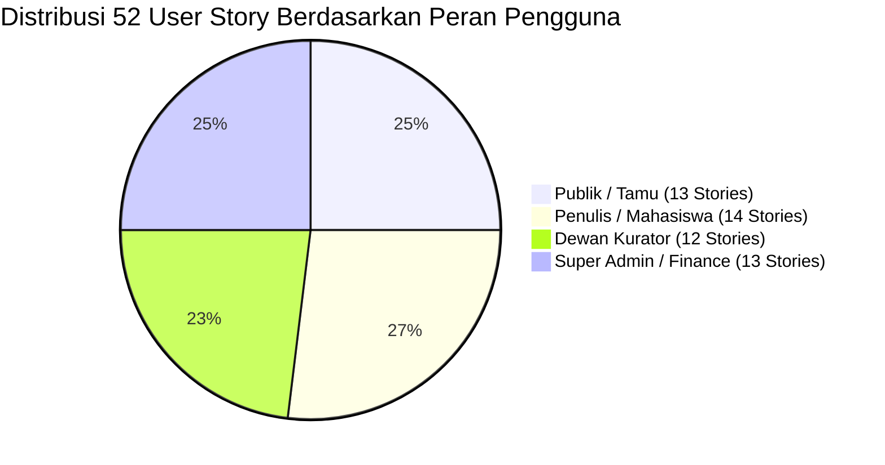

# 2.1 User Story — Sistem Repositori LENTERA
### Laman Etalase Karya Tulis Ilmiah Terpadu Akademik Universitas Madura (UNIRA)

Dokumen ini memetakan kebutuhan fungsional sistem repositori Lentera dari sudut pandang pengguna (*user-centric requirements*). Seluruh user story diangkat dari permasalahan riil tata kelola karya ilmiah kampus dan dipetakan secara presisi terhadap solusi digital (fitur web, mobile, dan keamanan) yang telah dibangun.

---

### A. Panduan Standar Penulisan & Metrik

1. **Format Baku Pernyataan**:  
   `Sebagai [peran], saya ingin [kebutuhan] sehingga [manfaat]`
2. **Peran Pengguna (The Triad Actors + Infrastructure Admin)**:
   - **Publik / Tamu**: Mahasiswa adik tingkat, dosen pembaca, periset luar kampus.
   - **Penulis (Author)**: Mahasiswa tingkat akhir dan dosen peneliti yang mengajukan naskah.
   - **Dewan Kurator (Curator)**: Mitra bestari/editor yang menjaga standar mutu ilmiah naskah.
   - **Super Admin (IT Ops & Finance)**: Pengelola sistem, verifikator biaya APC, dan master data kampus.
3. **Prioritas (MoSCoW Framework)**:
   - **Must**: Fitur vital yang wajib ada untuk MVP dan kelayakan fungsional sistem.
   - **Should**: Fitur krusial dengan nilai tambah tinggi bagi pengalaman pengguna.
   - **Could**: Fitur pelengkap yang dapat diimplementasikan bila sumber daya memungkinkan.
4. **Estimasi Beban Kerja (Story Points Fibonacci)**:
   - `1`: Sangat mudah / perubahan mikro visual atau konfigurasi statis.
   - `2`: Mudah / logika sederhana atau formulir standar.
   - `3`: Sedang / integrasi query relasional, validasi server-side, atau interaksi DOM.
   - `5`: Kompleks / alur logika bertingkat, upload berkas terenkripsi, atau visualisasi analitik.
   - `8`: Sangat kompleks / arsitektur multi-tier, REST API terotentikasi, atau transaksi lintas peran.
5. **Kriteria Keberterimaan (Acceptance Criteria)**:
   - Terdiri dari 1–2 kriteria teruji (testable verification points).

---

### B. Tabel Lengkap 52 User Story (US-01 s.d. US-52)

| ID | Sebagai … saya ingin … sehingga … | Prioritas | Estimasi | Acceptance Criteria |
|:---:|---|:---:|:---:|---|
| **US-01** | **Sebagai Publik**, saya ingin mencari karya ilmiah berdasarkan kata kunci judul atau abstrak tanpa harus mendaftar/login, sehingga saya dapat menemukan referensi skripsi yang relevan secara cepat. | **Must** | 3 | 1. Pengunjung dapat mengetikkan kata kunci pada kotak pencarian di beranda dan menekan tombol cari tanpa login. 2. Sistem menampilkan daftar naskah berstatus `published` yang judul, abstrak, atau kata kuncinya cocok. |
| **US-02** | **Sebagai Publik**, saya ingin menyaring hasil pencarian naskah berdasarkan Fakultas dan Program Studi, sehingga referensi yang tampil sesuai dengan bidang keilmuan saya di UNIRA. | **Must** | 3 | 1. Dropdown pilihan fakultas dan program studi tersedia pada halaman pencarian. 2. Daftar naskah yang muncul terfilter secara akurat sesuai prodi yang dipilih. |
| **US-03** | **Sebagai Publik**, saya ingin menyaring naskah berdasarkan jenis dokumen (Skripsi, Tesis, Jurnal, Kerja Praktik), sehingga saya dapat membedakan antara laporan tugas akhir dan artikel ilmiah. | **Should** | 2 | 1. Pengguna dapat memilih filter tipe karya pada form pencarian. 2. Sistem hanya menampilkan naskah dengan `work_type_id` yang sesuai. |
| **US-04** | **Sebagai Publik**, saya ingin memfilter karya ilmiah berdasarkan tahun publikasi, sehingga saya bisa membatasi pencarian pada literatur terbitan 5 tahun terakhir. | **Should** | 2 | 1. Input filter rentang tahun berfungsi membatasi query pencarian. 2. Hasil pencarian hanya memuat naskah dengan kolom `year` yang berada pada rentang tersebut. |
| **US-05** | **Sebagai Publik**, saya ingin membaca teks abstrak lengkap dan melihat metadata pembimbing pada halaman detail karya, sehingga saya memahami substansi penelitian sebelum mengunduh berkas utuh. | **Must** | 2 | 1. Halaman detail menyajikan judul, penulis, pembimbing I & II, prodi, tahun, dan abstrak utuh. 2. Halaman memuat indikator jumlah pembaca (*view count*) yang bertambah secara dinamis. |
| **US-06** | **Sebagai Publik**, saya ingin menyalin format sitasi standar APA 7th Edition dengan 1 klik, sehingga saya tidak perlu mengetikkan data sitasi karya secara manual saat menulis daftar pustaka. | **Must** | 2 | 1. Tersedia tombol "Salin Sitasi (APA)" pada kotak generator sitasi. 2. Teks sitasi berformat baku langsung tersalin ke clipboard sistem disertai pesan tooltip sukses. |
| **US-07** | **Sebagai Publik**, saya ingin memilih alternatif format sitasi IEEE dan Harvard, sehingga saya dapat menyesuaikan sitasi dengan gaya selingkung publikasi jurnal target saya. | **Should** | 2 | 1. Tersedia tab/opsi pemilihan gaya sitasi IEEE dan Harvard. 2. Susunan penulisan sitasi berubah secara instan mengikuti kaidah resmi masing-masing format. |
| **US-08** | **Sebagai Publik**, saya ingin menyalin format sitasi BibTeX, sehingga saya dapat langsung mengimpor metadata naskah ke aplikasi manajemen referensi seperti Mendeley, Zotero, atau Overleaf. | **Could** | 1 | 1. Format sintaks `@article` / `@thesis` BibTeX tersedia di penampil sitasi. 2. Teks BibTeX valid dan dapat disalin tanpa karakter rusak. |
| **US-09** | **Sebagai Publik**, saya ingin mengunduh berkas naskah PDF resmi yang telah diterbitkan, sehingga saya dapat mempelajari metodologi penelitian naskah secara lengkap secara offline. | **Must** | 3 | 1. Tombol "Unduh Naskah PDF" aktif untuk semua karya yang berstatus `published`. 2. Berkas PDF dialirkan secara aman melalui skrip unduhan dan counter unduhan naskah bertambah +1. |
| **US-10** | **Sebagai Publik**, saya ingin mengakses halaman etalase arsip khusus per fakultas, sehingga saya dapat melihat seluruh portofolio karya ilmiah yang dihasilkan oleh fakultas tertentu di UNIRA. | **Should** | 3 | 1. Tersedia menu navigasi fakultas yang mengarahkan ke halaman detail fakultas. 2. Halaman menampilkan daftar prodi di bawah fakultas tersebut beserta etalase naskah terbitnya. |
| **US-11** | **Sebagai Publik**, saya ingin melihat daftar naskah ilmiah yang baru saja terbit di halaman beranda, sehingga saya selalu mengetahui tren penelitian teranyar di kampus. | **Must** | 2 | 1. Halaman beranda memuat section "Karya Ilmiah Terbaru" yang diurutkan dari `published_at DESC`. 2. Judul naskah pada section tersebut dapat diklik menuju halaman detail naskah. |
| **US-12** | **Sebagai Publik**, saya ingin melihat visualisasi grafik sebaran karya dan tren publikasi tahunan berbasis Chart.js, sehingga saya mendapatkan gambaran statistik produktivitas ilmiah UNIRA. | **Should** | 5 | 1. Halaman statistik merender grafik lingkaran (proporsi fakultas) dan grafik batang (tren tahun). 2. Data grafik diambil secara dinamis dari database dan responsif di layar ponsel. |
| **US-13** | **Sebagai Publik**, saya ingin membuka repositori di smartphone tanpa kendala tata letak, sehingga saya nyaman mencari naskah ilmiah kapan pun melalui perangkat mobile. | **Must** | 3 | 1. Seluruh antarmuka web lolos uji tampilan mobile tanpa adanya horizontal scrolling. 2. Menu navigasi mobile drawer membuka dan menutup mulus dengan ukuran target sentuh $\ge 44\text{px}$. |
| **US-14** | **Sebagai Penulis**, saya ingin mendaftarkan akun mandiri dengan mencantumkan nama, NIM/NIDN, fakultas, dan program studi, sehingga saya memiliki identitas resmi untuk mengunggah karya. | **Must** | 3 | 1. Formulir registrasi memvalidasi format email, keunikan username, serta sinkronisasi prodi. 2. Akun baru tersimpan dengan sandi ter-hash Argon2id/Bcrypt dan role otomatis bernilai `author`. |
| **US-15** | **Sebagai Penulis**, saya ingin masuk (*login*) ke portal Lentera dengan kredensial saya, sehingga saya dapat mengakses ruang kerja pribadi penulis (*Author Workspace*). | **Must** | 2 | 1. Sistem mengotentikasi username/email dan sandi melalui verifikasi hash aman. 2. Setelah login berhasil, pengguna dengan peran `author` langsung diarahkan ke dasbor karya pribadinya. |
| **US-16** | **Sebagai Penulis**, saya ingin mengisi formulir pengajuan naskah baru lengkap dengan metadata judul, abstrak, dan kata kunci, sehingga karya saya terdaftar secara rapi ke repositori kampus. | **Must** | 5 | 1. Formulir menolak input jika panjang judul $<10$ karakter atau abstrak $<30$ karakter. 2. Data naskah tersimpan ke database dengan status awal mutlak `'submitted'`. |
| **US-17** | **Sebagai Penulis**, saya ingin mengunggah berkas naskah format PDF dengan batasan ukuran hingga 15–20 MB, sehingga seluruh naskah lengkap saya tersimpan tanpa terpotong. | **Must** | 5 | 1. Sistem menolak berkas non-PDF (validasi MIME dan header magic byte `%PDF-`). 2. File PDF yang lolos validasi tersimpan di folder terisolasi dengan nama acak unik dan tercatat di `work_files`. |
| **US-18** | **Sebagai Penulis**, saya ingin memasukkan nama Dosen Pembimbing I dan II pada formulir pengajuan, sehingga dewan kurator mengetahui siapa dosen yang membimbing karya tersebut. | **Must** | 2 | 1. Input teks nama pembimbing tersedia dan tersimpan pada kolom `supervisor`. 2. Nama pembimbing tampil dengan benar pada halaman pratinjau dan detail naskah. |
| **US-19** | **Sebagai Penulis**, saya ingin memantau status naskah saya (*Submitted*, *In Review*, *Revision*, *Waiting Payment*, *Published*, *Rejected*) dari dasbor pribadi, sehingga saya mengetahui progres telaah karya saya. | **Must** | 3 | 1. Dasbor penulis menampilkan tabel seluruh naskah miliknya lengkap dengan badge status warna. 2. Status naskah diperbarui secara *real-time* sesuai keputusan kurator atau verifikasi admin. |
| **US-20** | **Sebagai Penulis**, saya ingin membaca catatan telaah kualitatif dari kurator ketika naskah saya berstatus 'Revision', sehingga saya paham bagian mana yang harus diperbaiki. | **Must** | 3 | 1. Ketika status naskah adalah `revision`, tampil kotak peringatan berwarna oranye di dasbor penulis. 2. Kotak tersebut memuat teks catatan evaluasi (*review notes*) yang ditulis oleh kurator penelaah. |
| **US-21** | **Sebagai Penulis**, saya ingin mengunggah berkas PDF revisi (versi 2, 3, dst.) melalui formulir revisi naskah, sehingga dewan kurator dapat meninjau naskah saya yang telah diperbaiki. | **Must** | 5 | 1. Tombol "Unggah Revisi" aktif pada naskah yang berstatus `revision`. 2. Unggahan baru otomatis menaikkan nomor versi di `work_files` dan mengembalikan status ke `'submitted'`. |
| **US-22** | **Sebagai Penulis**, saya ingin memperbarui judul atau teks abstrak pada formulir revisi, sehingga metadata naskah saya ikut terkoreksi sesuai masukan kurator. | **Should** | 3 | 1. Formulir revisi menyediakan input untuk menyesuaikan teks judul dan abstrak yang diperbaiki. 2. Perubahan teks metadata tersimpan ke record `works` saat pengajuan revisi dikirimkan. |
| **US-23** | **Sebagai Penulis**, saya ingin melihat rincian biaya publikasi APC (*Article Processing Charge*) setelah karya disetujui kurator, sehingga saya mengetahui nominal yang harus saya bayarkan. | **Must** | 3 | 1. Naskah berstatus `waiting_payment` menampilkan tombol "Bayar Biaya Publikasi APC". 2. Halaman pembayaran menyajikan nomor invoice, judul karya, dan nominal tagihan resmi. |
| **US-24** | **Sebagai Penulis**, saya ingin melihat gambar QRIS resmi dan rekening Virtual Account kampus UNIRA, sehingga saya dapat melakukan pembayaran secara nontunai dengan mudah. | **Should** | 2 | 1. Gambar barcode QRIS dinamis/statis tampil dengan jelas pada portal pembayaran. 2. Nomor rekening tujuan transfer dan panduan transfer tertera lengkap. |
| **US-25** | **Sebagai Penulis**, saya ingin mengunggah bukti struk atau screenshot transfer pembayaran APC, sehingga administrator kampus dapat memverifikasi transaksi saya. | **Must** | 3 | 1. Form unggah bukti bayar menerima format gambar (`.jpg`, `.jpeg`, `.png`) atau `.pdf`. 2. Setelah diunggah, status pembayaran beralih menjadi `pending_verification`. |
| **US-26** | **Sebagai Penulis**, saya ingin melihat status konfirmasi pembayaran saya, sehingga saya mengetahui apakah naskah saya sudah siap diterbitkan atau bukti bayar ditolak. | **Should** | 2 | 1. Halaman pembayaran menampilkan status verifikasi bukti bayar (`pending`, `verified`, `rejected`). 2. Jika ditolak, sistem menampilkan catatan alasan penolakan dari admin. |
| **US-27** | **Sebagai Penulis**, saya ingin melihat grafik hitung pembaca (*view counter*) dan unduhan (*download counter*) pada karya terbit saya, sehingga saya tahu seberapa besar dampak karya saya bagi civitas akademika. | **Could** | 2 | 1. Dasbor penulis menampilkan angka total views dan total downloads di setiap kartu naskah terbit. 2. Nilai metrik konsisten dengan angka yang tercatat pada tabel `works` dan `download_logs`. |
| **US-28** | **Sebagai Dewan Kurator**, saya ingin mengakses ruang kerja antrean kurasi (*Curator Editorial Queue*) khusus peran saya, sehingga saya dapat melihat naskah-naskah civitas yang menunggu ditelaah. | **Must** | 3 | 1. Halaman antrean kurasi terproteksi middleware peran, menolak akses publik dan role author (403). 2. Tabel kurasi menyajikan seluruh naskah yang berstatus `submitted` dan `in_review`. |
| **US-29** | **Sebagai Dewan Kurator**, saya ingin melihat skor indeks kemiripan (*similarity score*) naskah, sehingga saya dapat mendeteksi indikasi plagiasi akademik sebelum menelaah isi naskah. | **Must** | 3 | 1. Nilai persentase kesamaan teks tampil pada baris antrean naskah. 2. Sistem memberi penanda visual jika angka kemiripan melebihi batas toleransi kampus (>25%). |
| **US-30** | **Sebagai Dewan Kurator**, saya ingin membuka dan menelaah naskah lengkap format PDF (*Galley PDF*) secara langsung, sehingga saya dapat memeriksa metodologi dan struktur penulisan naskah. | **Must** | 5 | 1. Tombol pratinjau naskah membuka dokumen PDF secara aman pada tab peramban baru. 2. Berkas PDF dapat dibaca tanpa membocorkan tautan path fisik penyimpanan server. |
| **US-31** | **Sebagai Dewan Kurator**, saya ingin mengubah status naskah menjadi 'In Review', sehingga anggota kurator lain mengetahui bahwa naskah tersebut sedang aktif saya pelajari. | **Should** | 2 | 1. Kurator dapat mengklik opsi telaah untuk menandai naskah sebagai `in_review`. 2. Perubahan status terbarui di database dan tercatat di dashboard pemantauan penulis. |
| **US-32** | **Sebagai Dewan Kurator**, saya ingin memberikan keputusan 'Approve' (Setujui) untuk naskah yang memenuhi standar ilmiah, sehingga karya dapat melanjutkan ke tahap penerbitan. | **Must** | 3 | 1. Modal keputusan kurator menyediakan opsi "Setujui / Approve". 2. Eksekusi approve mengubah status naskah menjadi `waiting_payment` (atau `published`) dan mencatat ID kurator. |
| **US-33** | **Sebagai Dewan Kurator**, saya ingin memberikan keputusan 'Revision' (Minta Revisi) disertai catatan perbaikan yang wajib diisi, sehingga penulis mengetahui perbaikan yang harus dilakukan. | **Must** | 3 | 1. Form keputusan mewajibkan pengisian catatan telaah jika kurator memilih opsi "Revisi". 2. Sistem menolak pengiriman jika catatan kosong dan status naskah berubah menjadi `revision`. |
| **US-34** | **Sebagai Dewan Kurator**, saya ingin memberikan keputusan 'Reject' (Tolak) dengan alasan ilmiah yang jelas, sehingga naskah yang melanggar etika akademik tidak masuk etalase kampus. | **Must** | 3 | 1. Opsi "Tolak / Reject" tersedia pada modal keputusan editorial. 2. Status naskah berubah menjadi `rejected` dan riwayat penolakan tersimpan di tabel `reviews`. |
| **US-35** | **Sebagai Dewan Kurator**, saya ingin melihat perbandingan versi naskah awal dan naskah revisi, sehingga saya dapat memastikan seluruh poin perbaikan telah dipenuhi oleh penulis. | **Should** | 5 | 1. Ruang kerja telaah menampilkan nomor versi naskah yang sedang aktif diperiksa (`v1`, `v2`...). 2. Kurator dapat mengunduh berkas versi terdahulu untuk melakukan telaah komparasi. |
| **US-36** | **Sebagai Dewan Kurator**, saya ingin memfilter antrean naskah berdasarkan program studi, sehingga saya dapat memprioritaskan pemeriksaan naskah yang sesuai dengan kompetensi keilmuan saya. | **Should** | 3 | 1. Tersedia dropdown filter prodi pada halaman antrean kurasi. 2. Antrean naskah yang ditampilkan menyusut secara akurat sesuai prodi yang dipilih kurator. |
| **US-37** | **Sebagai Dewan Kurator**, saya ingin melihat riwayat seluruh keputusan telaah yang pernah saya berikan, sehingga saya memiliki arsip rekam jejak penilaian sejawat (*peer-review archive*). | **Should** | 3 | 1. Tersedia tab "Riwayat Telaah Selesai" pada panel kurator. 2. Tabel memuat daftar naskah yang telah diputuskan beserta tanggal keputusan dan status akhirnya. |
| **US-38** | **Sebagai Dewan Kurator**, saya ingin mengunduh berkas naskah untuk ditelaah secara offline, sehingga saya tetap dapat memeriksa karya saat berada di luar koneksi internet kampus. | **Could** | 2 | 1. Kurator yang terotentikasi dapat mengunduh berkas PDF naskah langsung dari antrean kurasi. 2. Pengunduhan oleh kurator terotorisasi tanpa mengubah status publikasi naskah. |
| **US-39** | **Sebagai Dewan Kurator**, saya ingin melihat metrik ringkas jumlah naskah yang berhasil saya proses, sehingga saya dapat melaporkan kinerja kurasi semesteran kepada pimpinan jurusan. | **Could** | 2 | 1. Dasbor kurator menampilkan kartu ringkasan: Total Antrean, Naskah Disetujui, dan Naskah Direvisi. 2. Angka ringkasan dihitung otomatis dari tabel `reviews` berdasarkan `curator_id`. |
| **US-40** | **Sebagai Super Admin**, saya ingin masuk ke antarmuka kontrol Super Admin dengan proteksi sesi ketat, sehingga keamanan konfigurasi sistem repositori UNIRA tetap terjamin. | **Must** | 3 | 1. Halaman `/admins/indexs.php` memverifikasi peran pengguna berstatus mutlak `admin`. 2. Pengguna selain admin yang mencoba mengakses diarahkan ke halaman login dengan kode HTTP 403. |
| **US-41** | **Sebagai Super Admin**, saya ingin melihat daftar antrean bukti pembayaran APC dari para penulis, sehingga bagian keuangan kampus dapat memvalidasi dana publikasi yang masuk. | **Must** | 3 | 1. Panel admin menyajikan tabel verifikasi pembayaran berstatus `pending_verification`. 2. Tabel memuat nama penulis, judul karya, nominal pembayaran, tanggal transfer, dan tombol aksi. |
| **US-42** | **Sebagai Super Admin**, saya ingin membuka penampil berkas struk bukti transfer secara aman, sehingga saya dapat mencocokkan mutasi rekening sebelum menyetujui publikasi karya. | **Must** | 3 | 1. Mengklik tombol "Lihat Bukti" membuka gambar struk transfer melalui modal/tab aman `view_proofs.php`. 2. Berkas bukti tidak dapat diakses tanpa sesi admin yang valid. |
| **US-43** | **Sebagai Super Admin**, saya ingin menyetujui (*Approve/Verify*) bukti pembayaran APC yang valid, sehingga sistem otomatis menerbitkan naskah tersebut ke etalase publik. | **Must** | 5 | 1. Tombol "Verifikasi & Terbitkan" mengubah status pembayaran menjadi `verified`. 2. Secara atomik, sistem memperbarui status karya menjadi `published` dan mengisi `published_at = NOW()`. |
| **US-44** | **Sebagai Super Admin**, saya ingin menolak bukti bayar yang tidak valid atau buram disertai catatan alasan, sehingga penulis dapat mengunggah ulang bukti transfer yang benar. | **Must** | 3 | 1. Tombol "Tolak Pembayaran" membuka input konfirmasi catatan penolakan admin. 2. Status pembayaran berubah menjadi `rejected` dan catatan tampil di dasbor penulis yang bersangkutan. |
| **US-45** | **Sebagai Super Admin**, saya ingin mencari dan mengelola data akun pengguna repositori berdasarkan NIM, nama, atau email, sehingga saya dapat membantu pengguna yang mengalami kendala akun. | **Must** | 3 | 1. Panel manajemen pengguna menyediakan fitur pencarian akun real-time. 2. Admin dapat melihat status akun, role saat ini, serta tanggal pembuatan akun. |
| **US-46** | **Sebagai Super Admin**, saya ingin menaikkan peran (*Role Elevation*) seorang dosen dari 'Author' menjadi 'Curator', sehingga dosen tersebut dapat ikut menelaah karya mahasiswa. | **Must** | 3 | 1. Tersedia tombol aksi ganti peran menjadi kurator pada baris data pengguna. 2. Perubahan role langsung tersimpan di tabel `users` dan hak akses baru berlaku pada login berikutnya. |
| **US-47** | **Sebagai Super Admin**, saya ingin menambah atau mengedit data master Fakultas dan Program Studi, sehingga pilihan prodi pada sistem selalu sesuai dengan struktur organisasi UNIRA. | **Must** | 5 | 1. Admin dapat membuat entitas fakultas baru dan program studi baru melalui formulir master data. 2. Data prodi baru langsung muncul pada dropdown registrasi dan filter pencarian naskah. |
| **US-48** | **Sebagai Super Admin**, saya ingin melihat catatan audit log pengunduhan PDF (*Download Logs*), sehingga kampus mengetahui alamat IP, waktu unduh, dan judul naskah yang diakses pengunjung. | **Must** | 3 | 1. Panel admin menampilkan tabel audit unduhan yang bersumber dari tabel `download_logs`. 2. Data log mencakup timestamp, nama naskah, alamat IP, dan informasi browser *User-Agent*. |
| **US-49** | **Sebagai Super Admin**, saya ingin mengekspor rekapitulasi data karya ilmiah terbit per program studi, sehingga staf prodi dapat langsung menggunakannya untuk borang akreditasi BAN-PT. | **Should** | 5 | 1. Tersedia fitur filter rekapitulasi karya terbit berdasarkan rentang tanggal dan prodi. 2. Data rekapitulasi menyajikan total judul, penulis, pembimbing, dan tautan arsip secara rapi. |
| **US-50** | **Sebagai Super Admin**, saya ingin memantau log aktivitas operasional (*Activity Logs*), sehingga tim IT dapat mengidentifikasi setiap perubahan status naskah atau login yang mencurigakan. | **Should** | 3 | 1. Halaman activity logs mencatat kejadian penting (login, verifikasi kurator, approval admin). 2. Setiap rekaman log menyertakan identitas pengguna pelaku aksi dan waktu eksekusi kejadian. |
| **US-51** | **Sebagai Super Admin**, saya ingin mengubah parameter tarif standar biaya publikasi APC sistem, sehingga nominal tagihan naskah dapat disesuaikan dengan kebijakan rektorat terbaru. | **Could** | 2 | 1. Halaman pengaturan menyediakan input konfigurasi nominal biaya publikasi APC. 2. Tarif yang disimpan otomatis menjadi nilai default pada tagihan naskah baru berikutnya. |
| **US-52** | **Sebagai Super Admin**, saya ingin memastikan basis data memiliki sistem auto-healing migrasi, sehingga jika ada pembaruan skema tabel di server, struktur database dapat pulih secara otomatis. | **Should** | 5 | 1. Konfigurasi `databases.php` mengecek ketersediaan tabel utama dan menjalankan DDL otomatis. 2. Sistem tidak mengalami kegagalan fatal saat pertama kali dijalankan di lingkungan baru. |

---

### C. Ringkasan Distribusi & Pemenuhan Standar

| Kategori Analisis | Rincian Distribusi | Persentase |
|---|---|:---:|
| **Distribusi Peran** | • Publik (US-01 s.d. US-13): 13 Stories • Penulis (US-14 s.d. US-27): 14 Stories • Kurator (US-28 s.d. US-39): 12 Stories • Super Admin (US-40 s.d. US-52): 13 Stories | **100% (52 Stories)** |
| **Distribusi MoSCoW** | • **Must** (Vital MVP): 33 Stories (63.5%) • **Should** (Nilai Tambah Tinggi): 14 Stories (26.9%) • **Could** (Pelengkap): 5 Stories (9.6%) | **100%** |
| **Distribusi Story Points** | • Poin 1 (Mikro): 1 Story • Poin 2 (Mudah): 14 Stories • Poin 3 (Sedang): 24 Stories • Poin 5 (Kompleks): 13 Stories | **Total: 161 Story Points** |

---

  <b>Sistem Repositori LENTERA — Universitas Madura (UNIRA)</b> 
  Disusun oleh Kelompok 01 (Imam, Alvin, Gilank, Halim) • PBP 2026

